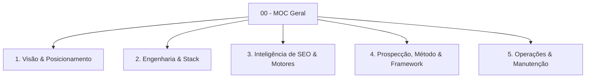

# 🗺️ MOC — Base de Conhecimento: Leonardo Brasil

> [!abstract] Visão do Ecossistema
> Este cofre reúne todo o conhecimento estratégico, técnico, mercadológico e operacional do ecossistema **[leonardobrasil.com.br](https://leonardobrasil.com.br)** — especializado em **Google Meu Negócio**, **SEO Local**, **Prospecção Ativa Cirúrgica** e **Conversão Orgânica** para negócios locais no Brasil.

---

## 🧭 Mapa de Navegação do Cofre

### 1. [[Posicionamento e Tese da Marca|1. Visão e Posicionamento]]
Fundamentos de posicionamento do especialista independente, contratos de marca e proposição de valor.
* [[Posicionamento e Tese da Marca]] — A tese de dominância do Top 3 no Google Maps sem dependência de anúncios pagos.
* [[Os 6 Pilares da Otimização no Google Maps]] — A metodologia técnica de auditoria e rankeamento local.
* [[Proposta de Valor e Oferta Comercial]] — Escopo da consultoria, precificação em investimento único e entregáveis.
* [[Perfil Profissional Leonardo Brasil]] — Bio executiva, autoridade técnica e canais de contato.
* [[Brandbook e Diretrizes Visuais]] — Identidade visual *dark mode*, paleta de cores (Ink, Gold, Blue) e tipografia.

### 2. [[Arquitetura do Sistema e Stack Técnica|2. Engenharia e Arquitetura]]
A infraestrutura fullstack, pré-renderização estática (SSG/SSR) e compatibilidade com buscadores.
* [[Arquitetura do Sistema e Stack Técnica]] — Vite 8, React 18, Tailwind CSS, Express 5 e TypeScript.
* [[SSR e Pré-Renderização Estática]] — Como 82 páginas HTML reais são geradas para robôs e rastreadores de IA.
* [[Infraestrutura e Deploy na Hostinger]] — Configuração do runtime Node.js, scripts de ciclo de vida e `.env`.
* [[Supabase Auth e Banco de Dados]] — Autenticação do CRM, sessões locais seguras e persistência PostgreSQL.
* [[Rotas e Componentes Principais]] — Mapeamento do roteamento cliente/servidor (`local-router.tsx`).

### 3. [[Máquina de SEO Local - Visão Geral|3. Inteligência de SEO e Motores]]
A estratégia determinística de captura de leads orgânicos em escala industrial.
* [[Máquina de SEO Local - Visão Geral]] — A arquitetura dos 3 Motores de multiplicação orgânica.
* [[Motor 1 - Raio-X e Auditoria Interativa]] — Ferramenta de diagnóstico em `/auditoria-perfil-google` com score 0–100.
* [[Motor 2 - Malha Programática 3.0 (312k URLs)]] — 4 verticais × 14 nichos × 5.571 municípios brasileiros.
* [[Motor 3 - Hubs Éticos (CFM, OAB, CFO)]] — Captação de alta intenção com conformidade regulatória para Médicos, Advogados e Dentistas.
* [[Recuperação de Perfis Suspensos no Google]] — Hub `/recuperar-perfil-suspenso-google` para captação de clientes em crise aguda.
* [[Sitemaps XML e Particionamento GSC]] — 8 sitemaps particionados respeitando o limite de 50.000 URLs do Google.
* [[Blog e Estratégia de Topic Clusters]] — Artigos aprofundados em Markdown com SEO on-page estruturado.

### 4. [[Método de Prospecção Ativa Local|4. Prospecção, Método e Framework]]
A metodologia comercial cirúrgica de prospecção, qualificação, abordagem no WhatsApp e o sistema CRM em `/crm`.
* [[Método de Prospecção Ativa Local]] — A metodologia anti-spam baseada em evidência factual real e não-acusação.
* [[O Framework dos 3 Pilares da Oferta]] — A transição da falha simples para a venda de alto valor (R$ 650 / R$ 380/mês).
* [[Fluxo Modular de Abordagem WhatsApp (4 Blocos)]] — A cadência conversacional em 4 blocos sem textão invasivo.
* [[Roteiros e Scripts Cirúrgicos por Nicho]] — Casos reais auditados na Zona Sul de Porto Alegre (Veterinária, Oficinas, Odonto, Restaurantes).
* [[Gestão de Objeções e Scripts de Contorno]] — Contorno para *"vou arrumar sozinho"*, *"já tenho agência"*, *"Google é de graça"* e *"tá caro"*.
* [[Sistema CRM Local e Manual Operacional]] — O Kanban de 5 colunas, rotina diária de vendas e modo contingência.
* [[Base de 40 Leads Auditados de Porto Alegre]] — Tabela consolidada da Rodada 01 (Tristeza, Ipanema, Vila Assunção, Cristal).
* [[Branding, Perfil Comercial e Presença Digital]] — Retrato executivo com terno azul, capa de WhatsApp Business 16:9, bio e `@leonardobrasil`.

### 5. [[Checklist de Verificação e Testes|5. Operações e Manutenção]]
Protocolos de qualidade, testes automatizados e gestão contínua.
* [[Checklist de Verificação e Testes]] — Testes de regressão (18/18 testes) e typechecking com `tsc`.
* [[Gestão de Segurança e Dependências Node.js]] — Resolução de vulnerabilidades Hostinger e conformidade com `npm audit`.
* [[Comandos e Rotinas de Deploy]] — Scripts NPM para desenvolvimento, compilação, testes e publicação.

---

> [!tip] Dica de Navegação no Obsidian
> Use o atalho `Ctrl + O` (ou `Cmd + O`) para buscar qualquer nota pelo título, ou abra a visualização gráfica (`Ctrl + G`) para enxergar as conexões bidirecionais entre a arquitetura técnica, os motores de SEO e a máquina de vendas ativa.
