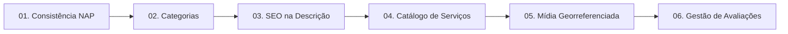

# 🏛️ Os 6 Pilares da Otimização no Google Maps

A metodologia aplicada em [leonardobrasil.com.br](https://leonardobrasil.com.br) apoia-se em 6 eixos determinísticos que orientam o algoritmo de classificação local do Google (Local Pack e Google Maps).

---

## Detalhamento dos Pilares

### Pilar 01: Auditoria & Consistência NAP
* **O que é:** Alinhamento milimétrico de **Nome (Name)**, **Endereço (Address)** e **Telefone (Phone)**.
* **O Impacto:** O algoritmo do Google cruza os dados do perfil com registros na Receita Federal, diretórios locais, redes sociais e site oficial. Qualquer divergência (ex: número antigo no Maps e novo no site) gera perda drástica de confiança e queda no ranking.
* **A Solução:** Padronização completa do NAP em todas as instâncias digitais.

### Pilar 02: Categorias Estratégicas (Primária e Secundárias)
* **O que é:** A categoria primária é o fator individual mais pesado de SEO Local. 
* **O Impacto:** Negócios que selecionam categorias genéricas (ex: "Empresa" em vez de "Clínica Odontológica" ou "Advogado Trabalhista") desaparecem das pesquisas qualificadas.
* **A Solução:** Seleção da categoria primária com maior densidade de busca somada a até 9 categorias secundárias correlatas para cobrir sinônimos e serviços específicos.

### Pilar 03: SEO Local na Descrição (750 Caracteres)
* **O que é:** O Google disponibiliza 750 caracteres para descrever o perfil da empresa.
* **O Impacto:** O texto é analisado não apenas pelo algoritmo tradicional, mas também pelos modelos de IA generativa (Google AI Overviews / Gemini).
* **A Solução:** Redação técnica e persuasiva que embute naturalmente a localização geográfica (cidade, bairros de atuação), diferenciais, especialidades e chamadas para ação.

### Pilar 04: Catálogo de Produtos & Serviços com Links
* **O que é:** Preenchimento exaustivo das seções de "Produtos" e "Serviços" do Perfil da Empresa.
* **O Impacto:** Quando um usuário busca um tratamento ou serviço específico (ex: "implante dentário", "divórcio consensual", "revisão de suspensão"), o perfil com o item cadastrado recebe destaque preferencial.
* **A Solução:** Cadastro estruturado de cada serviço com nome, faixa de valor ou "a consultar", descrição do escopo e link direto de agendamento para o WhatsApp.

### Pilar 05: Fotos e Mídias Georreferenciadas
* **O que é:** Alimentação periódica do perfil com imagens de alta resolução do ambiente interno, fachada, equipe e equipamentos.
* **O Impacto:** Perfis com atualização constante de fotos geram até 42% mais solicitações de rotas no Google Maps e sinalizam atividade frequente aos robôs de busca.
* **A Solução:** Curadoria visual profissional, upload regular e inclusão de dados de contexto real sem uso de bancos de imagem genéricos e artificiais.

### Pilar 06: Kit de Avaliações 5 Estrelas & Respostas com Palavras-Chave
* **O que é:** Gestão da reputação e volume de depoimentos reais de clientes atendidos.
* **O Impacto:** O texto das avaliações dos clientes e as respostas do proprietário são indexados pelo Google como termos de busca.
* **A Solução:** Criação de link curto direto para avaliação (`g.page/r/.../review`) e treinamento/orientação para o proprietário responder a cada avaliação inserindo naturalmente termos geográficos e serviços prestados.

---

## Aplicação no Diagnóstico Interativo
Estes 6 pilares são a base do cálculo do **Score de Visibilidade (0 a 100)** na ferramenta:
👉 [[Motor 1 - Raio-X e Auditoria Interativa]]

---

## Conexões Relacionadas
* [[Posicionamento e Tese da Marca]]
* [[Proposta de Valor e Oferta Comercial]]
* [[00 - MOC - Índice Geral|Voltar ao MOC]]
