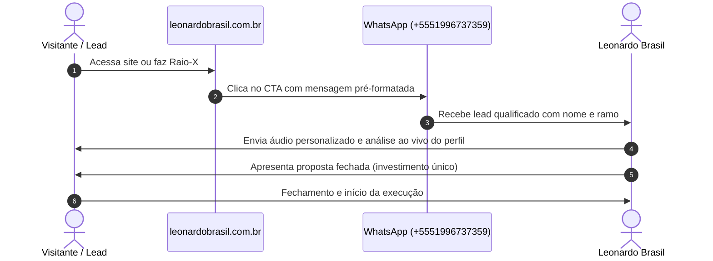

# 💼 Proposta de Valor e Oferta Comercial

A estrutura de serviços oferecida por **Leonardo Brasil** foca em soluções definitivas, com escopo fechado e sem modelo de retenção mensal obrigatória.

---

## 1. O Modelo de Contratação: Investimento Único

Diferente de agências tradicionais que cobram mensalidades (fee mensal) para fazer pequenas postagens cosméticas, a consultoria de Leonardo opera sob a ótica de **Estruturação de Ativo**:

> [!tip] Raciocínio Econômico
> *"Otimizar o perfil da empresa no Google é como construir uma fachada premium no ponto comercial mais nobre da cidade: você estrutura com excelência, instala as fundações sólidas e passa a colher o fluxo de clientes orgânicos diariamente sem ter que pagar aluguel ao Google por clique."*

---

## 2. Esteira de Serviços Oferecida

### Serviço A: Consultoria & Otimização Completa de Perfil
* **Público:** Empresas com loja física, consultórios, escritórios ou prestadores de serviços com perfil criado, mas sem visibilidade relevante.
* **Entregáveis:**
  1. Auditoria completa de consistência de dados (NAP).
  2. Ajuste de categoria primária e inclusão de até 9 categorias secundárias.
  3. Redação persuasiva da descrição do perfil (750 caracteres com SEO Local).
  4. Organização do catálogo de serviços e produtos com links diretos para WhatsApp.
  5. Curadoria e upload de imagens e vídeos reais.
  6. Envio do **Kit Prático de Avaliações 5 Estrelas** (roteiro + link direto).
* **Prazo Médio de Execução:** 3 a 5 dias úteis.

### Serviço B: Recuperação de Perfil Suspenso ou Desativado
* **Público:** Negócios que tiveram o perfil bloqueado repentinamente pelo Google ("Suspensão por Violação de Diretrizes" ou "Atividade Suspeita").
* **Entregáveis:**
  1. Análise técnica da causa raiz do bloqueio (inconsistência cadastral, mudança brusca de nome, categoria inadequada ou denúncia de concorrente).
  2. Adequação documental completa (Comprovante de CNPJ, Contrato Social, conta de consumo com endereço físico e fotos da fachada).
  3. Abertura do processo formal de contestação perante o time de engenharia de suporte do Google Business Profile.
  4. Acompanhamento até o restabelecimento do perfil com preservação das avaliações históricas.
* **Página Dedicada:** [[Recuperação de Perfis Suspensos no Google|/recuperar-perfil-suspenso-google]]

### Serviço C: Adequação Ética e Normativa de Profissões Regulamentadas
* **Público:** Médicos (CFM), Advogados (OAB) e Cirurgiões-Dentistas (CFO).
* **Entregáveis:**
  * Otimização cirúrgica garantindo 100% de sobriedade e conformidade com os conselhos federais, evitando processos ético-disciplinares e multas.
* **Hubs Dedicados:** [[Motor 3 - Hubs Éticos (CFM, OAB, CFO)]]

---

## 3. Fluxo de Atendimento ao Lead (Conversão)

---

## Conexões Relacionadas
* [[Posicionamento e Tese da Marca]]
* [[Os 6 Pilares da Otimização no Google Maps]]
* [[Motor 1 - Raio-X e Auditoria Interativa]]
* [[00 - MOC - Índice Geral|Voltar ao MOC]]
