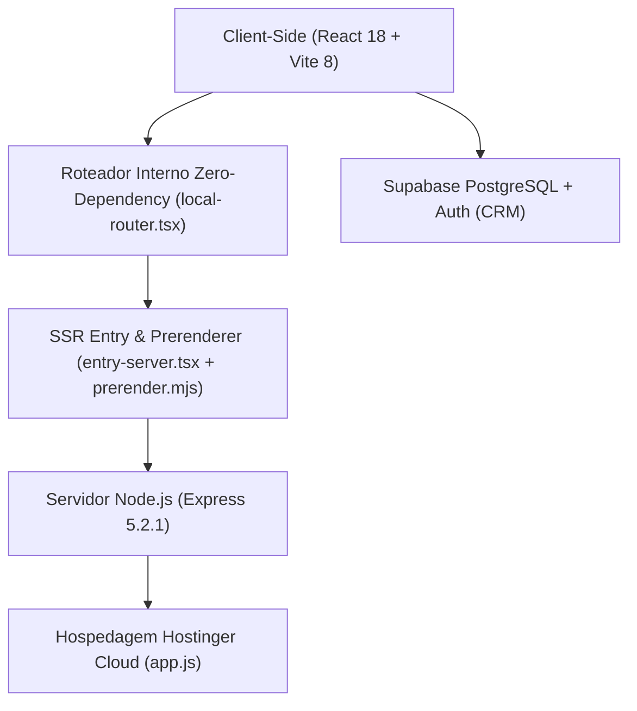

# ⚡ Arquitetura do Sistema e Stack Técnica

A stack tecnológica de [leonardobrasil.com.br](https://leonardobrasil.com.br) foi concebida para aliar velocidade extrema de carregamento (Performance 100 no Google PageSpeed), indexabilidade perfeita por motores de busca e segurança estrita de runtime.

---

## 1. Visão Geral da Stack



### Componentes Principais:
* **Frontend Framework:** `React 18.3.1` + `TypeScript 5.6.3`.
* **Bundler & Build Tool:** `Vite 8.3.6` (suporte a ESM nativo e rolldown backend rápido).
* **Estilização:** `Tailwind CSS 3.4.19` com plugins `@tailwindcss/typography`.
* **Servidor HTTP:** `Express 5.2.1` servindo assets estáticos pré-renderizados e SSR sob demanda.
* **Backend como Serviço:** `@supabase/supabase-js 2.119.0` para autenticação segura e persistência de dados do CRM.
* **Gerenciamento de Metatags:** `react-helmet-async 3.0.0` para injeção dinâmica de Open Graph, Canonical e JSON-LD.
* **Ícones:** `lucide-react 1.70.0` + SVGs inline otimizados.

---

## 2. Inovação: O Roteador Interno (`src/lib/local-router.tsx`)

Em vez de bibliotecas pesadas e suscetíveis a quebras como `react-router-dom` v6/v7, o projeto utiliza um **micro-roteador próprio baseado na API nativa History do browser** (`window.history.pushState` e evento `popstate`), com apenas ~80 linhas de código.

### Vantagens Estratégicas:
1. **Zero Sobrecarga de Bundle:** Redução imediata de ~45 kB no pacote inicial do cliente.
2. **Compatibilidade SSR Total:** Na renderização em servidor (`entry-server.tsx`), o roteador recebe o `url` da requisição e renderiza instantaneamente o componente correto sem necessidade de provedores complexos de memória.
3. **Imunidade a Vulnerabilidades:** Eliminação de CVEs recorrentes de pacotes externos de roteamento.

---

## 3. Scripts NPM Nucleares (`package.json`)

```json
{
  "scripts": {
    "dev": "vite",
    "build": "vite build && vite build --ssr src/entry-server.tsx --outDir dist/server && node scripts/prerender.mjs && node scripts/generate-sitemap.mjs && node scripts/sync-brasa-subdomain.mjs",
    "start": "node app.js",
    "test": "node --test server/*.test.mjs",
    "verify": "npm run typecheck && npm run build && npm test",
    "typecheck": "tsc --noEmit"
  }
}
```

---

## Conexões Relacionadas
* [[SSR e Pré-Renderização Estática]]
* [[Infraestrutura e Deploy na Hostinger]]
* [[Supabase Auth e Banco de Dados]]
* [[00 - MOC - Índice Geral|Voltar ao MOC]]
