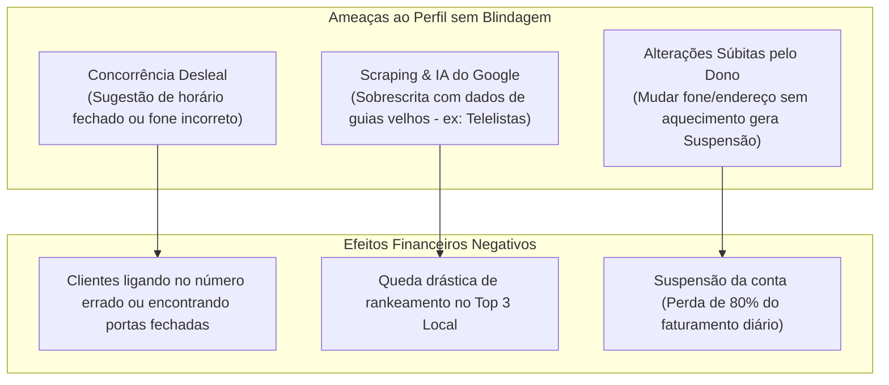

> [[Início|Painel]] › [[Mapa de SEO e Aquisição|SEO e Aquisição]]

# 🛡️ Blindagem Cadastral e Proteção contra Suspensões no Google

> [!abstract] O Conceito Estratégico de Blindagem
> A **Blindagem Cadastral** é o conjunto de protocolos avançados de governança, verificação e amarração técnica de dados que torna a ficha do **Google Meu Negócio / Perfil da Empresa no Google** imune a edições indevidas de terceiros, concorrência desleal, alterações automáticas desastrosas por inteligência artificial do Google e suspensões cadastrais arbitrárias.

---

## 1. Por que uma Ficha Sem Blindagem é Altamente Vulnerável?

O Google Maps opera sob uma lógica colaborativa aberta. Por padrão, qualquer usuário comum ou concorrente com uma conta Gmail pode tocar no botão público **"Sugerir uma alteração"** (*Suggest an edit*) e propor:
* Mudança do número de telefone (redirecionando chamadas para outro número ou linha inativa);
* Alteração de horários comerciais (marcando uma clínica ou oficina como "Fechada aos sábados");
* Modificação do endereço físico ou deslocamento do alfinete no mapa (*pinjacking*);
* Marcação do estabelecimento como *"Fechado permanentemente"* ou *"Não existe neste local"*.

Quando o perfil não possui **Blindagem Cadastral Ativa**, o algoritmo do Google muitas vezes aceita essas sugestões externas automaticamente sem pedir autorização prévia ao proprietário, gerando prejuízos imediatos.

---

## 2. Os 4 Pilares da Blindagem Cadastral Técnica

Para proteger a empresa de forma definitiva, o especialista Leonardo Brasil aplica os **4 Pilares da Blindagem**:

### Pilar I: Verificação Primária e Posse Corporativa
* **E-mail Corporativo Proprietário:** O Perfil é vinculado como proprietário primário a uma conta corporativa de alta reputação (ex: no domínio oficial da empresa ou sob custódia técnica homologada `@leonardobrasil.com.br`), nunca em um e-mail temporário de ex-funcionário ou agência amadora;
* **Autenticação em Duas Etapas (2FA) Obrigatória:** Evita invasão e sequestro de ficha (*profile hijacking*).

### Pilar II: Amarração de Consistência NAP (Name, Address, Phone)
O algoritmo do Google rastreia a web comparando os dados do Google Maps com outras fontes públicas. A blindagem garante que os três elementos fundamentais estejam **100% idênticos em toda a pegada digital**:
1. **Nome Oficial:** Sem palavras-chave abusivas (*keyword stuffing*) que acionem o filtro de spam do Google;
2. **Endereço Completo:** Padronizado com CEP, bairro oficial de Porto Alegre e coordenadas geográficas (Latitude e Longitude) milimetricamente fixadas;
3. **Telefone Oficial:** Prioritariamente o número de atendimento primário com rastreamento e WhatsApp integrado.

### Pilar III: Vinculação de Autoridade via Google Search Console & Schema.org
* **Conexão Direta com o Domínio:** Vinculação da ficha do Maps à propriedade oficial no **Google Search Console**;
* **Marcação de Dados Estruturados (`LocalBusiness` Schema):** Inserção de código JSON-LD na página inicial do site da empresa espelhando exatamente os mesmos atributos cadastrados no Maps. Isso cria um "elo de confiança algorítmico" que impede o Google de acatar sugestões de terceiros.

### Pilar IV: Protocolo de Travamento e Monitoramento Ativo
* **Rejeição Automática de Sugestões de Terceiros:** Monitoramento semanal das notificações da API do Google My Business para rejeitar qualquer sugestão de alteração indesejada antes de entrar em vigor;
* **Cópia de Segurança Probatória (Dossiê de Conformidade):** Manutenção de uma pasta com CNPJ atualizado, Alvará de Funcionamento, Conta de Energia/Água em nome da empresa e fotos da fachada com letreiro legível. Caso o algoritmo do Google tente uma suspensão automática, a reativação é executada em menos de 24 horas.

---

## 3. O Valor da Blindagem no Processo de Venda (R$ 650)

> [!tip] Como Argumentar a Blindagem Cadastral no WhatsApp
> *"Não adianta apenas colocar o WhatsApp no seu perfil ou mudar o horário. Se a ficha não tiver blindagem cadastral e amarração técnica de autoridade, qualquer concorrente ou o próprio robô do Google pode alterar seus dados na semana que vem e você nem fica sabendo.*  
> *A blindagem garante que sua ficha é sua, ninguém altera e você nunca acorda com o perfil suspenso do nada."*

Essa fundamentação transforma uma alteração que parecia "básica" em uma contratação de **segurança patrimonial indispensável** para clínicas, oficinas, restaurantes e consultórios.

---

## Conexões Relacionadas
* [[O Framework dos 3 Pilares da Oferta]]
* [[Recuperação de Perfis Suspensos no Google]]
* [[Fluxo Modular de Abordagem WhatsApp (4 Blocos)]]
* [[Os 6 Pilares da Otimização no Google Maps]]
* [[Sistema CRM Local e Manual Operacional]]
* [[Início|Voltar ao MOC]]
