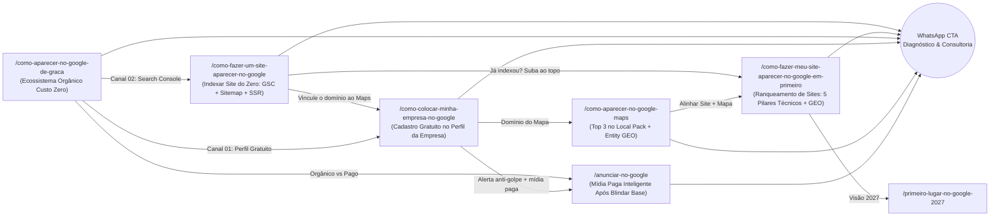

> [[Início|Painel]] › [[Mapa de SEO e Aquisição|SEO e Aquisição]]

# Cluster de Aquisição Orgânica - Site, Ads e Gratuito

> [!abstract] Decisão de Diretoria de SEO (Zero Canibalização)
> Ao mapear as 6 buscas de alta intenção de aquisição local em **2026-11-10**, aplicou-se a regra de **1 Intenção Única = 1 URL Canônica**. Duas buscas sobrepunham URLs já posicionadas no site e receberam **reforço BLUF/GEO nas páginas canônicas** para concentrar autoridade em vez de dividir PageRank. As outras 4 intenções receberam páginas estratégicas inéditas conectadas em Topic Cluster.

---

## 1. Matriz Anti-Canibalização das 6 Palavras-Chave

| Termo-Alvo | Ação Estratégica | URL Canônica | Componente React |
| :--- | :--- | :--- | :--- |
| `Como aparecer no google de graça` | **Nova Página** | `/como-aparecer-no-google-de-graca` | `ComoAparecerNoGoogleDeGraca.tsx` |
| `Como colocar minha empresa no google gratuitamente` | **Reforço Canônico (Zero Duplicação)** | `/como-colocar-minha-empresa-no-google` | `ComoColocarEmpresaNoGoogle.tsx` |
| `Anunciar no google` | **Nova Página (Ângulo Híbrido)** | `/anunciar-no-google` | `AnunciarNoGoogle.tsx` |
| `Como aparecer no google maps` | **Reforço Canônico (GEO + Entity)** | `/como-aparecer-no-google-maps` | `ComoAparecerNoGoogleMaps.tsx` |
| `Como fazer meu site aparecer no google em primeiro` | **Nova Página (SEO de Sites & GEO)** | `/como-fazer-meu-site-aparecer-no-google-em-primeiro` | `ComoFazerSiteAparecerEmPrimeiro.tsx` |
| `Como fazer um site aparecer no google` | **Nova Página (Indexação Zero)** | `/como-fazer-um-site-aparecer-no-google` | `ComoFazerSiteAparecerNoGoogle.tsx` |

> [!warning] Por que não criar URL separada para "gratuitamente"?
> Criar `/como-colocar-minha-empresa-no-google-gratuitamente` ao lado de `/como-colocar-minha-empresa-no-google` faria o Google alternar e diluir os sinais entre duas páginas praticamente idênticas (**canibalização de palavras-chave**). Em vez disso, a canônica existente recebeu resposta BLUF explícita, meta tags atualizadas e alerta anti-golpe contra boletos falsos.

---

## 2. Arquitetura de Interlinking do Cluster (Jornada do Cliente)

---

## 3. Diretrizes Técnicas e de GEO Implementadas

1. **BLUF Boxes (Bottom Line Up Front):** Cada página traz, logo abaixo do `H1`, um resumo direto de 40–65 palavras formatado para extração direta por Google AI Overviews, Gemini e buscadores generativos.
2. **Copywriting Anti-Falsa Promessa:** Mantida a política de não prometer "1º lugar garantido e fixo", explicando a personalização geográfica em tempo real e focando no domínio consistente do Top 3 e da 1ª página.
3. **Tabelas Semânticas Comparativas:**
   - Orgânico Gratuito vs. Google Ads (`/como-aparecer-no-google-de-graca`)
   - Só Google Ads vs. Funil Híbrido Maps + Ads (`/anunciar-no-google`)
   - Site na 3ª Página vs. Site Estruturado para o Topo (`/como-fazer-meu-site-aparecer-no-google-em-primeiro`)
4. **Rich Snippets JSON-LD (`Schema.org`):** Todas as páginas combinam `Article` + `HowTo` + `FAQPage` (e `Service` em `/anunciar-no-google`), além do `BrandGraph` automático via `SeoHead.tsx`.
5. **Malha Total de Build & Sitemaps:** Sincronizadas em `src/main.tsx`, `src/entry-server.tsx`, `scripts/prerender.mjs`, `scripts/generate-sitemap.mjs` e `src/components/Footer.tsx`.

---

*Conexões:*
- [[Mapa de SEO e Aquisição]]
- [[Taxonomia dos 6 Pilares de Negócios Locais e Diretrizes GEO]]
- [[Pesquisa de Palavras-Chave - A Mente do Dono de Negócio Local]]
- [[Rotas e Componentes Principais]]
- [[Sitemaps XML e Particionamento GSC]]
