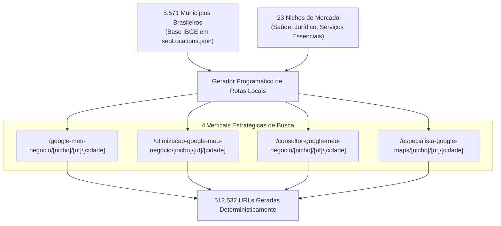

> [[Início|Painel]] › [[Mapa de SEO e Aquisição|SEO e Aquisição]]

# 🌐 Motor 2 — Malha Programática 3.0 (512k URLs)

> [!abstract] A Escala Industrial de Busca Orgânica Local
> O **Motor 2** é o coração da dominância orgânica nacional de [leonardobrasil.com.br](https://leonardobrasil.com.br). Mapeia **todos os 5.571 municípios brasileiros** cruzados com **23 nichos de mercado** em 4 verticais de intenção de busca, totalizando **512.532 rotas locais mapeadas deterministicamente**.

---

## 1. A Estrutura da URL e Conteúdo Hiper-Local

Cada página gerada não é um template vazio, mas um documento estruturado com:
* **H1 Geolocalizado:** *"Google Meu Negócio para [Nicho Formatado] em [Nome da Cidade] - [UF]"*;
* **Copywriting Especializado:** Dores agudas de captação e benefícios comerciais mapeados por nicho em `src/data/seoNicheData.ts`;
* **Dados Estruturados JSON-LD:** `Service`, `LocalBusiness`, `ProfessionalService` e tipagens específicas (`Electrician`, `AutoRepair`, `VeterinaryCare`, etc.);
* **Chamada para Ação no WhatsApp:** Mensagem pré-formatada contextualizando o nicho, cidade, estado e verticais de contratação, com captura de UTMs e GCLID via `src/lib/analytics.ts`.

---

## 2. Os 23 Nichos Ativos na Malha

1. Dentistas
2. Advogados
3. Psicólogas
4. Nutricionistas
5. Arquitetos
6. Contadores
7. Médicos
8. Clínicas de Estética
9. Corretores de Imóveis
10. Fisioterapeutas
11. Engenheiros
12. Personal Trainers
13. Energia Solar
14. Oficinas Mecânicas & Auto Centers
15. Eletricistas & Instalações
16. Pedreiros & Empreiteiras
17. Guinchos & Auto Socorro 24h
18. Assistência Técnica de Celulares
19. Manutenção de Computadores & Notebooks
20. Clínicas Veterinárias & Hospitais Pet
21. Pet Shops & Estética Animal
22. Casas Agropecuárias & Rurais
23. Restaurantes & Gastronomia Local

> Para a documentação detalhada dos 10 clusters essenciais e estratégias para inteligências artificiais, consulte [[Clusterização Semântica e GEO para Nichos Essenciais]].

---

## 3. Resolução do Limite de Sitemaps do Google

O Google Search Console impõe um limite rígido de **50.000 URLs por arquivo de sitemap**. Para indexar a malha de mais de meio milhão de páginas sem falhas:
* O sistema compila **13 a 14 Sitemaps XML particionados** (`sitemap-local-1.xml` a `sitemap-local-13.xml` com chunk de 40.000 URLs);
* O arquivo `sitemap-core.xml` reúne rotas estáticas, blog e os 23 hubs mestres;
* Um arquivo mestre `sitemap.xml` (Sitemap Index) gerencia os índices secundários e informa aos robôs do Google a árvore completa de navegação.

---

## Conexões Relacionadas
* [[Máquina de SEO Local - Visão Geral]]
* [[Clusterização Semântica e GEO para Nichos Essenciais]]
* [[Sitemaps XML e Particionamento GSC]]
* [[SSR e Pré-Renderização Estática]]
* [[Início|Voltar ao MOC]]
