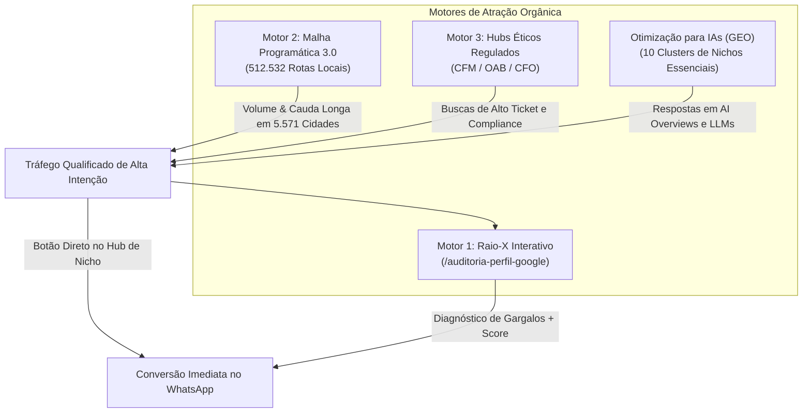

> [[Início|Painel]] › [[Mapa de SEO e Aquisição|SEO e Aquisição]]

# 🚀 Máquina de SEO Local — Visão Geral

A estratégia de atração orgânica de [leonardobrasil.com.br](https://leonardobrasil.com.br) replica a arquitetura bem-sucedida de [funilcomercial.com](https://funilcomercial.com), gerando leads contínuos e gratuitos vindos das pesquisas do Google Maps e buscas com IA (GEO).

---

## 1. Os 3 Motores Estratégicos + Camada GEO

1. **[[Motor 1 - Raio-X e Auditoria Interativa|Motor 1 — Raio-X Interativo]]:** Uma ferramenta prática no próprio site que calcula a pontuação do perfil (0 a 100) e entrega um diagnóstico instantâneo, convertendo o visitante em lead com alta urgência.
2. **[[Motor 2 - Malha Programática 3.0 (512k URLs)|Motor 2 — Malha Programática 3.0]]:** Expansão do indexador local para **4 verticais** de busca em todos os 5.571 municípios do país cruzados com **23 nichos**, cobrindo pesquisas exatas do tipo *"especialista em google meu negocio em [cidade]"*.
3. **[[Motor 3 - Hubs Éticos (CFM, OAB, CFO)|Motor 3 — Hubs Éticos de Alta Intenção]]:** Páginas dedicadas a categorias profissionais regulamentadas que sofrem com restrições éticas de publicidade e exigem autoridade especializada.
4. **[[Clusterização Semântica e GEO para Nichos Essenciais|Camada GEO & Clusters de Serviços Essenciais]]:** Otimização voltada para mecanismos de IA (Perplexity, SearchGPT, Gemini e AI Overviews) cobrindo serviços imediatos do dia a dia (eletricistas, guinchos, mecânicas, petshops, etc.).

---

## 2. A Filosofia: Conversão Baseada em Gargalos

Diferente de formulários de contato tradicionais que exigem preenchimento de campos longos e têm baixa conversão, a máquina de Leonardo Brasil entrega valor técnico primeiro (auditoria, diagnóstico de conformidade ou dor aguda do setor) para conduzir o lead diretamente a uma conversa no WhatsApp com uma mensagem pré-formatada parametrizada.

---

## Conexões Relacionadas
* [[Motor 1 - Raio-X e Auditoria Interativa]]
* [[Motor 2 - Malha Programática 3.0 (512k URLs)]]
* [[Motor 3 - Hubs Éticos (CFM, OAB, CFO)]]
* [[Clusterização Semântica e GEO para Nichos Essenciais]]
* [[Sitemaps XML e Particionamento GSC]]
* [[Início|Voltar ao MOC]]
