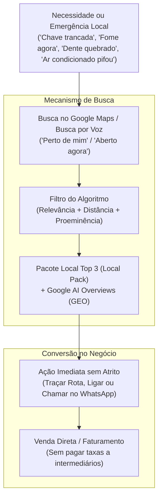

# Taxonomia dos 6 Pilares de Negócios Locais e Diretrizes GEO

> [!abstract] Visão Estratégica da Diretoria de SEO
> Em 2026, a busca local atingiu um ponto de inflexão impulsionado por dois motores convergentes: o **Pacote Local (3-Pack)** do Google Maps (que captura mais de 75% dos cliques de compra no smartphone) e os **Motores de Resposta Generativa (GEO - Generative Engine Optimization)** como Google AI Overviews, SearchGPT, Perplexity e Gemini. Esta nota documenta a taxonomia dos **6 Grandes Segmentos Locais Mais Lucrativos** e estabelece as regras de estruturação técnica para alimentar robôs e IAs.

---

## 1. O Momento Zero da Verdade (ZMOT) no Google Maps

O consumidor local não pesquisa por curiosidade acadêmica. Ele opera no **ZMOT (Zero Moment of Truth)**: já possui a dor latente, a intenção de compra imediata e o orçamento disponível, utilizando o Google Maps exclusivamente para decidir **quem** vai atendê-lo.

---

## 2. A Matriz dos 6 Pilares Setoriais

| Pilar Setorial | Segmentos Abrangidos | Psicologia de Busca | Impacto em IAs (GEO) | Canal Primário de Fechamento |
| :--- | :--- | :--- | :--- | :--- |
| **1. Alta Urgência & 24h** | Chaveiros, encanadores, desentupidoras, oficinas, guinchos, veterinárias 24h | Decisão em < 10 min. Busca termos 'aberto agora' e 'perto de mim'. Não lê sites institucionais. | As IAs recomendam quem tem horário 24h confirmado e SLA de resposta rápido. | Ligação direta ou WhatsApp de emergência |
| **2. Alimentação & Lazer** | Restaurantes, pizzarias, bares, hamburguerias, cafeterias, docerias | Decisão em 15-45 min. Guiada por fotos atraentes de pratos, cardápio, nota média e ambiente. | Gemini e AI Overviews extraem pratos específicos e avaliações sensoriais. | Traçar rota no Maps ou delivery próprio no WhatsApp |
| **3. Saúde & Estética** | Dentistas, médicos, clínicas de estética, psicólogos, fisioterapia, pilates | Decisão em 1-7 dias. Exige alta prova social, fotos do espaço físico e compliance ético. | Modelos LLM priorizam entidades médicas em conformidade (CFM, CFO, OAB). | Agendamento online e triagem da recepção |
| **4. Serviços Domiciliares** | Instalação de ar-condicionado, dedetizadoras, pedreiros, reformas, marcenarias | Decisão em 2-24h. Buscas por bairro e zonas geográficas atendidas (SAB). | O Google valida as 'Áreas de Atendimento' cadastradas contra termos de bairros. | Visita técnica e orçamento formal |
| **5. Varejo de Nicho** | Pet shops, agropecuárias, farmácias, autopeças, materiais de construção | Decisão imediata a 4h. Intenção 'onde comprar X hoje'. Evita espera de frete online. | As IAs consultam a aba de Produtos do Google Perfil para atestar estoque local. | Balcão da loja física e televendas WhatsApp |
| **6. B2B & Liberais** | Advogados, contadores, arquitetos, imobiliárias, corretores de seguros | Decisão em 3-30 dias. Ciclo consultivo de alto ticket. Exige prova social em profundidade. | As IAs medem autoridade de marca via citações externas e histórico do CNPJ. | Reunião estratégica e contrato recorrente |

---

## 3. Diretrizes de GEO (Generative Engine Optimization)

Para que modelos de linguagem citem as páginas do ecossistema `leonardo-brasil` como autoridade de referência, os seguintes padrões foram implementados:

1. **Parágrafos BLUF (Bottom Line Up Front):** As primeiras 40 palavras de cada página de nicho sintetizam a resposta exata da intenção de busca, facilitando a extração por sintetizadores de IA.
2. **Entidades Schema.org Especializadas:** Emprego de tipos granulares como `EmergencyService`, `Plumber`, `Locksmith`, `HVACBusiness`, `MedicalBusiness`, `LegalService` e `FoodEstablishment`.
3. **Entity Anchoring Local:** Vinculação explícita de bairros, avenidas principais, códigos postais e marcos geográficos para fortalecer a autoridade contextual do Local Pack.
4. **Perguntas e Respostas Objetivas (FAQPage):** Respostas curtas, iniciando com respostas diretas (*"Sim. Para aparecer no Google Maps..."*), formatadas para respostas de voz e snippets de IA.

---

## 4. Estrutura de Código e Rotas Ativas

1. **Pillar Page Setorial Master:**
   - Rota: [`/segmentos-locais-google-maps`](file:///d:/LEONARDO/Drive/Projetos/leonardo-brasil/src/pages/SegmentosLocaisGoogleMaps.tsx)
   - Componente: `SegmentosLocaisGoogleMaps.tsx`
2. **Novos Nichos Prioritários no Sistema Programático:**
   - `chaveiros`: [`/google-meu-negocio/chaveiros`](file:///d:/LEONARDO/Drive/Projetos/leonardo-brasil/src/data/niches.ts)
   - `encanadores`: [`/google-meu-negocio/encanadores`](file:///d:/LEONARDO/Drive/Projetos/leonardo-brasil/src/data/niches.ts)
   - `desentupidoras`: [`/google-meu-negocio/desentupidoras`](file:///d:/LEONARDO/Drive/Projetos/leonardo-brasil/src/data/niches.ts)
   - `instalacao-ar-condicionado`: [`/google-meu-negocio/instalacao-ar-condicionado`](file:///d:/LEONARDO/Drive/Projetos/leonardo-brasil/src/data/niches.ts)
3. **Escala da Malha Programática:**
   - Total de nichos no sistema: **27 nichos**.
   - Total de rotas locais particionadas: **601.668 URLs**.
   - Total de rotas estáticas pré-renderizadas no build: **144 URLs**.

---
*Conexões:*
- [[Segmentos Locais Google Maps - Visão Geral]]
- [[Clusterização Semântica e GEO para Nichos Essenciais]]
- [[Motor 2 - Malha Programática 3.0 (512k URLs)]]
- [[Mapa de SEO e Aquisição]]
- [[Rotas e Componentes Principais]]
