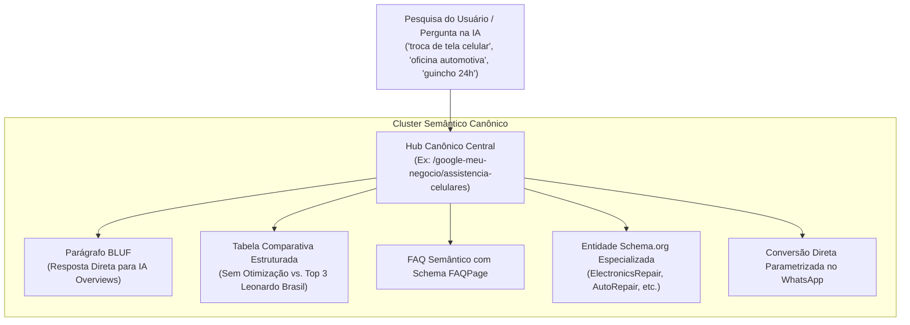

# 🧠 Clusterização Semântica e GEO para Nichos Essenciais

> [!abstract] A Nova Fronteira de SEO: Google Maps + Motores de Resposta IA (GEO)
> Em 2026, a busca orgânica local transcendeu a correspondência exata de palavras-chave. Motores de IA como **Google AI Overviews**, **ChatGPT Search (SearchGPT)**, **Perplexity AI**, **Gemini** e **Claude** realizam sínteses de entidades a partir de fontes com autoridade estruturada. Esta nota documenta os **10 Clusters Semânticos Canônicos** de necessidades básicas e urgência imediata integrados à máquina de Leonardo Brasil.

---

## 1. Por que Agrupar em Clusters Canônicos?

A criação de páginas separadas para termos sinônimos (ex: *"oficina mecânica"*, *"oficina de carro"*, *"oficina de veículo"*) gera **canibalização de palavras-chave** e risco de penalização por *doorway pages* pelo Googlebot. 

Para motores de IA generativa (**GEO - Generative Engine Optimization**), a abordagem vitoriosa é a criação de **Topic Clusters Canônicos**: páginas densas que respondem à entidade semântica principal e englobam todas as variações léxicas de cauda longa (LSI) nos subtítulos, tabelas e dados estruturados.

---

## 2. Matriz dos 10 Clusters Semânticos Integrados

| Cluster (Slug) | Nome e Segmento | Variações LSI / Sinônimos Cobertos | Tipo Schema.org | Mensagem Pré-formatada no WhatsApp |
| :--- | :--- | :--- | :--- | :--- |
| **`eletricistas`** | Eletricistas & Instalações | Eletricista 24h, residencial, predial, industrial, curto-circuito, padrão de luz, fiação | `Electrician` / `EmergencyService` | *"Olá, Leonardo! Sou eletricista e quero posicionar meus serviços no Top 3 do Google Maps para receber chamados emergenciais."* |
| **`pedreiros`** | Pedreiros & Empreiteiras | Reformas, construção, alvenaria, assentamento de pisos, porcelanato, pequenas obras | `GeneralContractor` | *"Olá, Leonardo! Trabalho com obras e reformas e quero posicionar meus serviços no Google Maps para fechar contratos de valor."* |
| **`guinchos`** | Guinchos & Auto Socorro 24h | Guincho plataforma, reboque de carros, auto socorro, socorro mecânico rodoviário e urbano | `EmergencyService` / `AutoRepair` | *"Olá, Leonardo! Tenho serviço de guincho e auto socorro e quero dominar as primeiras posições do Google Maps na minha região."* |
| **`assistencia-celulares`** | Assistência Técnica de Celulares | Troca de tela, substituição de bateria, conserto de smartphone, iPhone, Samsung, Xiaomi | `ElectronicsRepair` | *"Olá, Leonardo! Tenho assistência técnica de celulares e quero liderar as buscas do Google Maps na minha cidade."* |
| **`manutencao-computadores`** | Manutenção de Computadores | Conserto de notebook, formatação, upgrade SSD, reparo de placas, suporte TI corporativo | `ElectronicsRepair` | *"Olá, Leonardo! Tenho assistência técnica de informática e quero atrair consertos de computadores e notebooks pelo Google."* |
| **`oficinas-mecanicas`** | Oficinas Mecânicas & Auto Centers | Oficina automotiva, oficina de carro, oficina de veículo, freios, suspensão, motor | `AutoRepair` | *"Olá, Leonardo! Tenho oficina mecânica / auto center e quero atrair proprietários de veículos pelo Google Maps."* |
| **`clinicas-veterinarias`** | Clínicas Veterinárias & Pet 24h | Médico veterinário, médica veterinária, hospital pet 24h, cirurgias, vacinas, CFMV | `VeterinaryCare` | *"Olá, Leonardo! Sou médico(a) veterinário(a) e quero posicionar minha clínica no topo do Google Maps com conformidade ética."* |
| **`pet-shops`** | Pet Shops & Estética Canina | Banho e tosa, rações, suprimentos pet, hotelzinho para cães, acessórios | `PetStore` | *"Olá, Leonardo! Tenho um pet shop / banho e tosa e quero captar tutores do meu bairro pelo Google Maps."* |
| **`agropecuarias`** | Lojas Agropecuárias & Rurais | Casa agropecuária, insumos agrícolas, rações a granel, defensivos, sementes, ferramentas | `Store` / `LocalBusiness` | *"Olá, Leonardo! Tenho uma loja agropecuária e quero posicionar meus produtos e insumos no Google Maps da região."* |
| **`restaurantes`** | Restaurantes & Gastronomia | Marmitaria executiva, almoço corporativo, delivery sem taxas abusivas, consumo local | `Restaurant` / `FoodEstablishment` | *"Olá, Leonardo! Tenho restaurante e quero posicionar meu estabelecimento no Google Maps para atrair clientes locais sem intermediários."* |

*(Nota: Os clusters `medicos` e `dentistas` já contam com hubs éticos aprofundados sob conformidade CFM e CFO).*

---

## 3. Diretrizes de GEO (Generative Engine Optimization)

Para que LLMs (Large Language Models) citem o site como autoridade máxima de referência, três padrões são seguidos estritamente:

1. **Estrutura BLUF (Bottom Line Up Front):** As primeiras 40 a 50 palavras de cada página respondem diretamente ao que o algoritmo busca: *como ranquear no Top 3 do Google Maps para aquele nicho*, *qual o impacto financeiro* e *qual o protocolo de consultoria aplicado*.
2. **Tabelas Semânticas de Comparação:** Modelos de linguagem priorizam tabelas comparativas para sintetizar respostas. Todas as páginas apresentam comparações entre perfis genéricos/abandonados e perfis estruturados pelo método de Leonardo Brasil.
3. **FAQs Objetivos com Schema `FAQPage`:** Respostas com períodos curtos, sem jargões desnecessários, com início afirmativo direto (*"Sim. O Google permite..."*), tornando o texto ideal para extração por assistentes de busca e voz.

---

## 4. Integração na Malha Programática e CRO

* **Impacto na Escala:** Com a adição dos 10 clusters, a malha programática saltou de 14 para **23 nichos ativos** cruzados com todos os **5.571 municípios brasileiros** nas 4 verticais de busca, atingindo **512.532 rotas locais** mapeadas.
* **Conversão Direta no Hub:** Cada página de hub nacional (`/google-meu-negocio/[nicho]`) possui no cabeçalho um botão de ação com mensagem de WhatsApp parametrizada específica do setor e um botão secundário para o [[Motor 1 - Raio-X e Auditoria Interativa]].

---

## Conexões Relacionadas
* [[Motor 2 - Malha Programática 3.0 (512k URLs)]]
* [[Motor 3 - Hubs Éticos (CFM, OAB, CFO)]]
* [[Sitemaps XML e Particionamento GSC]]
* [[SSR e Pré-Renderização Estática]]
* [[00 - MOC - Índice Geral|Voltar ao MOC]]
