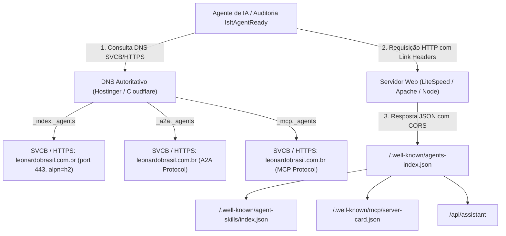

# 🤖 DNS for AI Discovery (DNS-AID) & Agent Readiness

> [!abstract] Padrão IETF & Linux Foundation para IA Autônoma
> O **DNS-AID** (`draft-mozleywilliams-dnsop-dnsaid`) e o **RFC 9460** (SVCB/HTTPS Resource Records) definem a camada descentralizada onde robôs e agentes de IA autônomos (como Claude, Perplexity, ChatGPT e scanners como `isitagentready.com`) descobrem os serviços, APIs, servidores MCP e endpoints de um domínio diretamente via DNS e `.well-known`.

---

## 1. Arquitetura Implementada em `leonardobrasil.com.br`



---

## 2. Endpoints `.well-known` Publicados

* **`/.well-known/agents-index.json`**: Catálogo central de agentes com descrição de capacidades de SEO Local, protocolo A2A e servidor MCP.
* **`/.well-known/agent-skills/index.json`**: Skills e rotas de inteligência artificial.
* **`/.well-known/mcp/server-card.json`**: Configuração de transporte SSE e capabilities do Model Context Protocol.
* **RFC 8288 Discovery Headers**: Cabeçalho HTTP `Link` injetado na raiz apontando para o catálogo.

---

## 3. Entradas DNS Zona Autoritativa (RFC 9460)

```dns
;; ServiceMode HTTPS Records (Recomendado)
_index._agents.leonardobrasil.com.br. 3600 IN HTTPS 1 leonardobrasil.com.br. alpn="h2,http/1.1" port=443
_a2a._agents.leonardobrasil.com.br.   3600 IN HTTPS 1 leonardobrasil.com.br. alpn="h2,http/1.1" port=443
_mcp._agents.leonardobrasil.com.br.   3600 IN HTTPS 1 leonardobrasil.com.br. alpn="h2,http/1.1" port=443

;; Fallback TXT (Compatibilidade Universal)
_index._agents.leonardobrasil.com.br. 3600 IN TXT "v=AID1; endpoint=https://leonardobrasil.com.br/.well-known/agents-index.json; alpn=h2,http/1.1"
_a2a._agents.leonardobrasil.com.br.   3600 IN TXT "v=AID1; endpoint=https://leonardobrasil.com.br/api/assistant; alpn=h2,http/1.1"
```

---

## Conexões Relacionadas
* [[Máquina de SEO Local - Visão Geral]]
* [[Sitemaps XML e Particionamento GSC]]
* [[00 - MOC - Índice Geral|Voltar ao MOC]]
