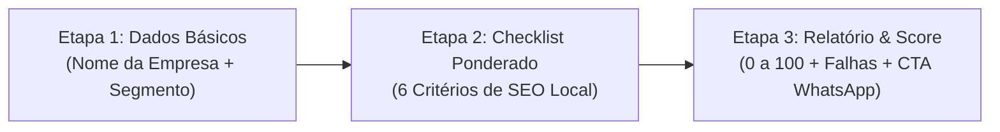

# 🔍 Motor 1 — Raio-X e Auditoria Interativa

* **Rota Pública:** [`/auditoria-perfil-google`](https://leonardobrasil.com.br/auditoria-perfil-google)
* **Arquivo do Componente:** [`src/pages/AuditoriaPerfilGoogle.tsx`](file:///d:/LEONARDO/Drive/Projetos/leonardo-brasil/src/pages/AuditoriaPerfilGoogle.tsx)
* **Objetivo de Negócio:** Capturar visitantes já existentes e transformá-los em conversas ativas no WhatsApp através de um diagnóstico técnico imediato.

---

## 1. Como a Ferramenta Funciona (3 Etapas)



### Etapa 1: Identificação
O usuário informa o **Nome da Empresa** e seleciona seu **Segmento de Atuação** (Clínica/Saúde, Advocacia, Varejo, Serviços Locais, Outros).

### Etapa 2: Checklist Ponderado de SEO Local
O usuário responde a 6 perguntas determinísticas que medem a integridade do seu perfil:
1. **Consistência de Dados (NAP) (Peso: 20 pts):** O nome, endereço e telefone no Google coincidem exatamente com o site e redes sociais?
2. **Categorias Secundárias (Peso: 15 pts):** O perfil possui categorias secundárias configuradas além da primária?
3. **Taxa de Resposta a Avaliações (Peso: 20 pts):** Todas as avaliações de clientes recebem resposta personalizada com termos do negócio?
4. **Atualização Recente de Fotos (Peso: 15 pts):** Foram publicadas fotos reais da fachada, ambiente ou equipe nos últimos 30 dias?
5. **Postagens Semanais no Perfil (Peso: 15 pts):** A empresa utiliza a ferramenta de "Novidades / Postagens" do Google?
6. **Catálogo de Serviços Preenchido (Peso: 15 pts):** Todos os serviços oferecidos estão detalhados com descrição e link direto?

### Etapa 3: Diagnóstico Visual e CTA
O sistema calcula o Score (0 a 100):
* **0 a 49 (Crítico - Vermelho):** O perfil está invisível para pesquisas estratégicas e entregando clientes para concorrentes.
* **50 a 79 (Alerta - Amarelo):** O perfil tem presença, mas perde posições cruciais no Top 3 por falhas básicas.
* **80 a 100 (Otimizado - Verde):** O perfil possui boa estrutura, necessitando de manutenções de proeminência e volume.

A ferramenta exibe **Cards com as Falhas Encontradas** e gera um botão de ação com redirecionamento para o WhatsApp com mensagem contextualizada:

> *"Olá, Leonardo! Fiz o Raio-X do perfil da minha empresa [Nome] no seu site. Minha pontuação foi [Score]/100 e foram apontadas as seguintes falhas: [Lista]. Gostaria de saber como você pode otimizar meu perfil no Google Maps."*

---

## 2. Marcação Schema.org para o Googlebot

A página injeta via `SeoHead` o schema `WebApplication`:
```json
{
  "@context": "https://schema.org",
  "@type": "WebApplication",
  "name": "Raio-X de Perfil do Google Maps — Auditoria Gratuita",
  "url": "https://leonardobrasil.com.br/auditoria-perfil-google",
  "applicationCategory": "BusinessApplication",
  "operatingSystem": "All",
  "offers": {
    "@type": "Offer",
    "price": "0",
    "priceCurrency": "BRL"
  }
}
```

---

## Conexões Relacionadas
* [[Os 6 Pilares da Otimização no Google Maps]]
* [[Máquina de SEO Local - Visão Geral]]
* [[00 - MOC - Índice Geral|Voltar ao MOC]]
