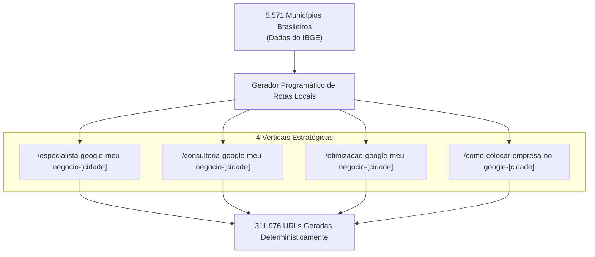

# 🌐 Motor 2 — Malha Programática 3.0 (312k URLs)

> [!abstract] A Escala Industrial de Busca Orgânica
> O **Motor 2** é o coração da dominância orgânica nacional de [leonardobrasil.com.br](https://leonardobrasil.com.br). Utilizando a infraestrutura programática testada em *funilcomercial.com*, a plataforma mapeia **todos os 5.571 municípios brasileiros** em múltiplas verticais e nichos de mercado.

---

## 1. A Estrutura da URL e Conteúdo Hiper-Local

Cada página gerada não é um template vazio, mas um documento estruturado com:
* **H1 Geolocalizado:** *"Especialista em Google Meu Negócio em [Nome da Cidade] - [UF]"*;
* **Metadados de Bairro e Região:** Inserção dinâmica de dados populacionais, mesorregião e contexto econômico;
* **Dados Estruturados JSON-LD:** `Service`, `LocalBusiness` e `ProfessionalService` com coordenadas geográficas;
* **Chamada para Ação para o WhatsApp:** Link parametrizado com UTM indicando a cidade de origem do lead.

---

## 2. Resolução do Limite de Sitemaps do Google

O Google Search Console impõe um limite rígido de **50.000 URLs por arquivo de sitemap**. Para indexar a malha de mais de 300 mil páginas sem falhas:
* O sistema compila **8 Sitemaps XML particionados** (`sitemap-local-1.xml` a `sitemap-local-8.xml`);
* Um arquivo mestre `sitemap.xml` (Sitemap Index) gerencia os índices secundários e informa aos robôs do Google a árvore completa de navegação.

---

## Conexões Relacionadas
* [[Máquina de SEO Local - Visão Geral]]
* [[Sitemaps XML e Particionamento GSC]]
* [[SSR e Pré-Renderização Estática]]
* [[00 - MOC - Índice Geral|Voltar ao MOC]]
