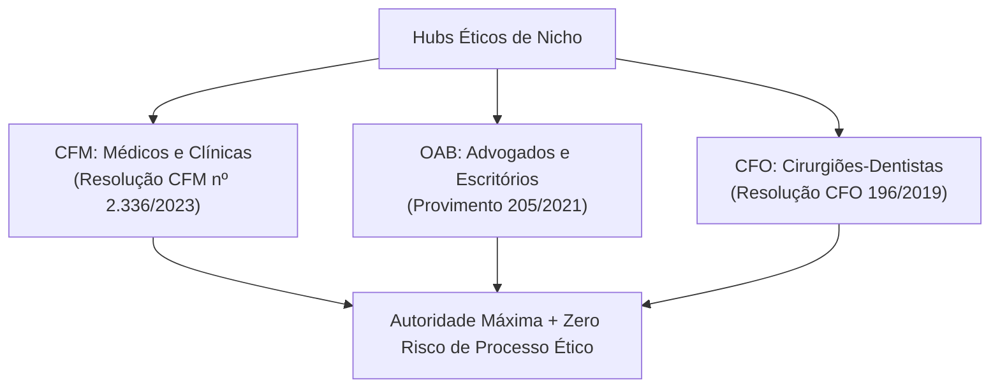

# ⚖️ Motor 3 — Hubs Éticos (CFM, OAB, CFO)

> [!abstract] Mercados Regulados de Alto Ticket
> Profissionais como **Médicos**, **Advogados** e **Dentistas** possuem as maiores restrições de marketing do país e os maiores tickets médios por cliente. O **Motor 3** posiciona Leonardo Brasil como o especialista técnico de referência capaz de otimizar o Google Meu Negócio em rigorosa conformidade com os conselhos de classe.

---

## 1. As 3 Verticais Reguladas

### 🩺 1. Hub Médico (CFM)
* **Regulamentação:** Resolução CFM nº 2.336/2023 sobre publicidade médica.
* **Proibições:** Promessa de resultados, uso sensacionalista de "antes e depois", autopromoção exagerada.
* **Solução Leonardo Brasil:** Otimização informativa de especialidades (RQE), títulos de especialistas e informações de convênios/atendimento de urgência.

### ⚖️ 2. Hub Jurídico (OAB)
* **Regulamentação:** Provimento nº 205/2021 da OAB Nacional.
* **Proibições:** Mercantilização da advocacia, captação indevida de clientela, divulgação de valores de honorários.
* **Solução Leonardo Brasil:** Posicionamento de áreas de atuação (Direito de Família, Trabalhista, Tributário) com foco estritamente institucional e informativo.

### 🦷 3. Hub Odontológico (CFO)
* **Regulamentação:** Resolução CFO-196/2019.
* **Solução Leonardo Brasil:** Estruturação de tratamentos específicos (Implantes, Ortodontia, Harmonização) com registro de responsabilidade técnica (EPAO).

---

## Conexões Relacionadas
* [[Máquina de SEO Local - Visão Geral]]
* [[Posicionamento e Tese da Marca]]
* [[Roteiros e Scripts Cirúrgicos por Nicho]]
* [[00 - MOC - Índice Geral|Voltar ao MOC]]
