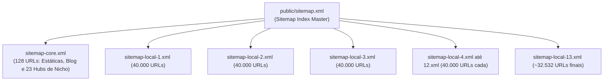

# 🗺️ Sitemaps XML e Particionamento GSC

> [!abstract] Arquitetura de Indexação em Escala
> O ecossistema gera **512.532 URLs programáticas** e necessita de particionamento estrito para total conformidade com o protocolo `sitemaps.org` aceito pelo Google Search Console (limite de 50.000 URLs ou 50MB por arquivo).

---

## 1. Estrutura de Particionamento

* **Script Gerador:** `scripts/generate-sitemap.mjs`
* **Limite por Arquivo:** 40.000 URLs (margem de segurança operacional sobre o teto de 50k);
* **Total de Arquivos:** 14 sitemaps (1 índice master + 1 core + 13 locais);
* **Frequência de Atualização:** Executado automaticamente a cada build de produção (`npm run build`).

---

## 2. Comportamento no Google Search Console

1. **Submissão do Índice Mestre:** Ao submeter `sitemap.xml`, o Google Search Console registra o status *Success*. Inicialmente, o contador de páginas pode marcar 0 porque o índice contém referências `<sitemap>` para os arquivos filhos, que são processados em fila assíncrona.
2. **Submissão Acelerada do Core:** A submissão individual de `sitemap-core.xml` permite que o Googlebot processe e exiba imediatamente as 128 URLs prioritárias dos 23 nichos.
3. **Higienização de URLs Inválidas:** Páginas normais em HTML (como `/consultoria` ou `/cidades`) ou URLs antigas de WordPress (`post-sitemap.xml`, `?feed=sitemap13`) nunca devem ser enviadas no campo de sitemaps do Search Console.

---

## Conexões Relacionadas
* [[Motor 2 - Malha Programática 3.0 (512k URLs)]]
* [[Clusterização Semântica e GEO para Nichos Essenciais]]
* [[SSR e Pré-Renderização Estática]]
* [[00 - MOC - Índice Geral|Voltar ao MOC]]
