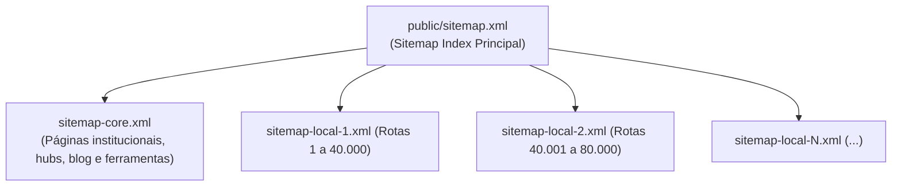

# 🗺️ Sitemaps XML e Particionamento GSC

> [!abstract] Arquitetura de Indexação
> O ecossistema gera centenas de milhares de URLs programáticas e necessita de particionamento estrito para conformidade com o protocolo `sitemaps.org` aceito pelo Google Search Console.

---

## 1. Estrutura de Particionamento

* **Script Gerador:** `scripts/generate-sitemap.mjs`
* **Limite por Arquivo:** 45.000 URLs (margem de segurança sobre o teto de 50k);
* **Frequência de Atualização:** Executado automaticamente a cada build de produção (`npm run build`).

---

## Conexões Relacionadas
* [[Motor 2 - Malha Programática 3.0 (312k URLs)]]
* [[SSR e Pré-Renderização Estática]]
* [[00 - MOC - Índice Geral|Voltar ao MOC]]
