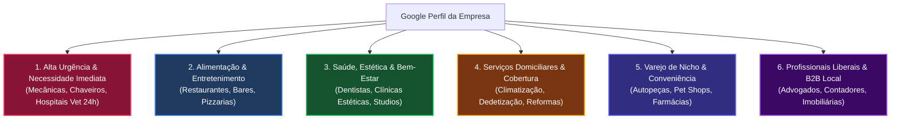

> [[Início|Painel]] › [[Mapa Comercial e CRM|Comercial e CRM]] › [[Método de Prospecção Ativa Local|Método de Prospecção]] › [[Sistema CRM Local e Manual Operacional|CRM Operacional]]

# 🎯 Taxonomia e Matriz de Nichos de Alta Conversão para Prospecção

> [!abstract] Resumo Executivo
> Nem todo negócio local possui a mesma dependência e taxa de conversão no **Google Maps**.  
> Esta matriz classifica o mercado em **6 grandes arquétipos econômicos**, detalhando o comportamento de busca do consumidor, a justificativa de valor para cada segmento e os critérios objetivos a serem aplicados nos próximos levantamentos de prospecção ativa do CRM.

---

## 1. Visão Geral: Mapa dos 6 Arquétipos de Nichos Locais

---

## 2. Detalhamento dos 6 Arquétipos de Mercado

### 1. Negócios de Alta Urgência e Necessidade Imediata

* **Segmentos Típicos:** Oficinas mecânicas, auto socorro / reboque / guincho 24h, chaveiros, desentupidoras, encanadores, clínicas odontológicas de emergência e hospitais veterinários 24h.
* **Comportamento do Consumidor:** O consumidor está no meio de uma crise ou imprevisto (pneu furado, cano estourado, chave trancada no carro, emergência médica do pet). Ele **não navega em sites institucionais nem pesquisa por dias**; ele busca no celular por termos diretos como *"chaveiro aberto agora"* ou *"oficina mecânica perto de mim"* e aciona o **primeiro resultado que tiver telefone e boas avaliações no topo do mapa**.
* **A Justificativa Econômica:** O ranqueamento no **Local 3-Pack** garante uma taxa de conversão quase imediata, superando até mesmo campanhas pagas de Google Ads, pois transmite presença geográfica em tempo real e botão de ligação ou WhatsApp de 1 toque.
* **Gatilho de Venda na Abordagem:** O custo do pátio parado ou da perda de chamados noturnos para os 3 concorrentes do topo.
* **Conexões do Projeto:** [[O-005 - Angelo Car Oficina Mecânica]], [[O-004 - Drive Service - Mecânica e Guincho]], [[V-005 - Vet.Us Centro Clínico Veterinário 24h]].

---

### 2. Alimentação e Entretenimento

* **Segmentos Típicos:** Restaurantes, pizzarias, bares, cafeterias, hamburguerias, bistrôs e docerias.
* **Comportamento do Consumidor:** A decisão de consumo é altamente orientada por **conveniência, cardápio visual e prova social**. O cliente usa o perfil no Maps para:
  1. Verificar horários de funcionamento (especialmente fins de semana e feriados);
  2. Navegar pelo cardápio e conferir faixa de preços;
  3. Ver fotos reais dos pratos e do ambiente físico;
  4. Validar o padrão do local pelas avaliações e comentários recentes antes de traçar a rota ou pedir delivery.
* **A Justificativa Econômica:** Uma ficha sem cardápio, com horários conflitantes ou fotos de baixa qualidade faz o cliente desistir na hora e escolher o concorrente vizinho.
* **Gatilho de Venda na Abordagem:** Redução da perda de mesas nos horários de pico e atração de clientes da região sem depender exclusivamente de taxas de marketplaces como iFood.

---

### 3. Saúde, Estética e Bem-Estar

* **Segmentos Típicos:** Clínicas odontológicas (implantes, alinhadores), dermatologistas, consultórios de estética avançada, barbearias premium, salões de beleza, psicólogos, academias e estúdios de pilates.
* **Comportamento do Consumidor:** São serviços onde o **fator de confiança, higiene e reputação pessoal** são os maiores decisores de compra. Perfis que contêm:
  * Fotos impecáveis do espaço físico e consultórios;
  * Imagens reais de estrutura e ambientação;
  * Integração com botão de WhatsApp e agendamento online;
  * Volume alto e contínuo de avaliações de 5 estrelas;  
  Convertem de **3 a 5 vezes mais** do que anúncios de tráfego frio.
* **A Justificativa Econômica:** O ticket médio desses tratamentos é elevado. Apenas **1 novo paciente** de implante, protocolo estético ou mensalidade de academia já cobre integralmente o investimento único de otimização de R$ 497.
* **Conexões do Projeto:** [[V-001 - Clínica Veterinária Suellen Stefan]], [[V-003 - DogDoc Veterinária e Petshop]].

---

### 4. Prestadores de Serviços Locais e Domiciliares

* **Segmentos Típicos:** Manutenção e instalação de ar-condicionado / climatização, empresas de dedetização, limpeza e higienização de estofados, construtoras de reformas, marceneiros, eletricistas e vidraçarias.
* **Comportamento do Consumidor:** O Google prioriza exibir o "Local Pack" para buscas com clara intenção geográfica local (ex: *"instalação de ar condicionado zona sul"*, *"dedetizadora em porto alegre"*).
* **A Justificativa Econômica:** A parametrização cirúrgica de **Áreas de Cobertura (Service Area Business - SAB)** e o cadastro minucioso do catálogo de serviços garantem que a empresa apareça em bairros estratégicos sem precisar ter uma loja física aberta em cada esquina.
* **Gatilho de Venda na Abordagem:** Eliminação de ligações de bairros fora do raio de atendimento e captura de orçamentos de alto valor na região de atuação.

---

### 5. Varejo Físico de Nicho e Conveniência

* **Segmentos Típicos:** Autopeças, lojas de baterias automotivas, pet shops clínicos, floriculturas, materiais de construção, farmácias de manipulação e lojas de suplementos.
* **Comportamento do Consumidor:** Resolve diretamente pesquisas de oportunidade imediata do tipo **"onde comprar [produto] perto de mim"** (ex: *"onde comprar bateria moura 60ah"*, *"ração renal canina perto de mim"*).
* **A Justificativa Econômica:** Utilizar a função nativa de **Aba de Produtos do Google Perfil da Empresa** exibe o item procurado com foto, descrição e preço, levando o cliente diretamente ao balcão da loja física ou ao WhatsApp para fechar a compra sem passar por intermediários.
* **Gatilho de Venda na Abordagem:** Evitar que o cliente compre em grandes marketplaces ou vá ao concorrente por não saber que a loja da esquina tem o item em estoque.

---

### 6. Profissionais Liberais e Negócios B2B Locais

* **Segmentos Típicos:** Advogados (trabalhistas, previdenciários, cíveis), escritórios de contabilidade, imobiliárias, corretores de seguros e agências de marketing local.
* **Comportamento do Consumidor:** O ciclo de vendas é mais consultivo e de maior ticket. A busca no Google Maps serve como **validação pública definitiva (due diligence)**. O cliente em potencial pesquisa o nome do escritório ou profissional para checar:
  * Avaliações textuais detalhadas que relatem casos resolvidos com sucesso;
  * Credibilidade do endereço físico;
  * Imagem de autoridade e postura profissional.
* **A Justificativa Econômica:** Um perfil com nota baixa ou sem avaliações destrói contratos corporativos antes mesmo da primeira reunião. O perfil otimizado funciona como o "cartão de visitas com chancela de terceiros".
* **Gatilho de Venda na Abordagem:** Blindagem de reputação, autoridade perante clientes corporativos e aceleração do ciclo de fechamento.

---

## 3. Por Que a Otimização Justifica o Investimento nesses Nichos?

> [!important] Os 3 Motores de Justificativa Econômica do Google Maps

### 1. O "Local Pack" Concentra Todo o Tráfego
Em pesquisas locais no smartphone (mais de 80% do volume total), a imensa maioria dos cliques e chamadas vai para o **bloco dos 3 primeiros colocados do mapa**, posicionado imediatamente acima dos resultados orgânicos tradicionais de sites. Ficar em 4º lugar significa disputar apenas as migalhas de quem rola a tela.

### 2. Atuação no "Momento Zero da Verdade" (ZMOT)
O perfil da empresa captura o cliente exatamente no instante em que ele já tomou a decisão de compra:
* Ele já tem o problema concreto (carro quebrado, dente doendo, fome, animal precisando de socorro);
* Ele já tem o orçamento;
* Ele só precisa escolher **quem atender mais rápido e com mais segurança**. Não é topo de funil nem tráfego frio: é conversão de balcão.

### 3. Relevância em IA e Nova Busca do Google (Search Generative Experience / Gemini)
Com os resumos de IA do Google (AI Overviews) e buscas generativas no celular, o algoritmo consome os dados do **Google Perfil da Empresa** (horários em tempo real, categorias nativas, serviços cadastrados e menções nas avaliações) para recomendar negócios diretamente aos usuários:
> *"Qual a melhor oficina mecânica especializada em freios aberta agora na Cavalhada?"*  
> Se o catálogo e os atributos não estiverem cadastrados, a empresa é sumariamente ignorada pela IA.

---

## 4. Diretrizes Operacionais para as Próximas Rodadas de Prospecção no CRM

Para manter a alta taxa de conversão observada nas Rodadas 02 e 03, as futuras varreduras (Rodadas 04 em diante) devem seguir rigorosamente esta escala de prioridade:

| Nível de Prioridade | Arquétipos Contemplados | Justificativa de Foco no CRM |
| :---: | :--- | :--- |
| **Prioridade Máxima (Foco Atual)** | **Arquétipo 1 (Alta Urgência)** + **Arquétipo 3 (Saúde / Veterinária)** | Ciclo de fechamento de 24h a 48h; alta dor de caixa; ROI comprovado em 1 atendimento. |
| **Prioridade Secundária** | **Arquétipo 4 (Serviços Domiciliares)** + **Arquétipo 5 (Varejo de Nicho / Autopeças)** | Excelente abertura para otimização de catálogo de produtos e área de cobertura. |
| **Prioridade Terciária** | **Arquétipo 2 (Gastronomia)** + **Arquétipo 6 (Profissionais Liberais / B2B)** | Foco na reestruturação de cardápio e blindagem de autoridade com link de 5 estrelas. |

---

## Conexões e Documentos Relacionados
* [[Proposta de Valor e Oferta Comercial]]
* [[Método de Prospecção Ativa Local]]
* [[O Framework dos 3 Pilares da Oferta]]
* [[Base de Leads Fora do Top 3 (Rodada 02)]]
* [[Base de Leads Fora do Top 3 (Rodada 03)]]
* [[Sistema CRM Local e Manual Operacional]]
* [[Início|Voltar ao Painel]]
