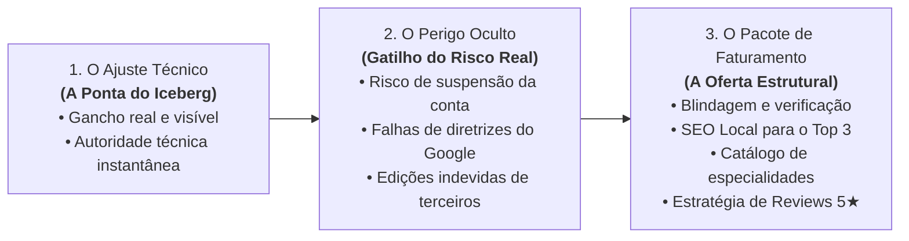
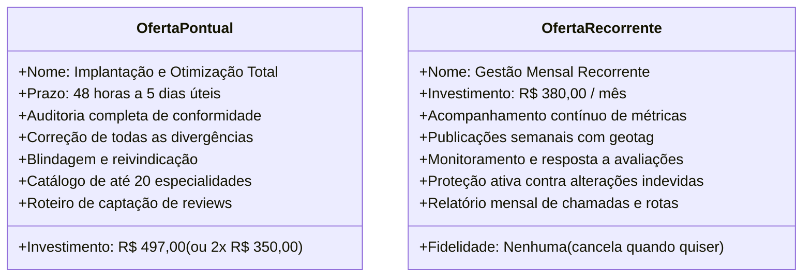

> [[Início|Painel]] › [[Mapa Comercial e CRM|Comercial e CRM]]

# 💎 O Framework dos 3 Pilares da Oferta

> [!question] O Dilema Central da Precificação
> *"Se o gancho inicial for uma falha simples (como alterar um horário de sábado ou cadastrar o WhatsApp no perfil), como cobrar R$ 497,00 pontual ou R$ 380,00/mês sem que o cliente ache caro ou tente fazer sozinho?"*

A resposta reside no **Framework dos 3 Pilares**: o cliente nunca compra a alteração do botão; ele compra a **proteção patrimonial do negócio e a esteira de novos clientes**.

---

## Pilar 1: O Ajuste Técnico (A Ponta do Iceberg)
É o ponto de entrada da conversa. Serve unicamente para **chamar a atenção e provar competência**.

* **Objetivo:** Abrir a conversa no WhatsApp sem soar como telemarketing.
* **Exemplos:**
  * O horário de fechamento do sábado desencontrado entre Maps e site;
  * O telefone cadastrado ser apenas o fixo, enquanto o site destaca WhatsApp;
  * O status constar como *"Aberto 24 horas"*, mas o plantão ser apenas sobreaviso;
  * O perfil exibir o botão público *"Reivindicar esta empresa"*.
* **O Erro Fatal:** Se você parar aqui e disser *"Cobro R$ 497 para arrumar o seu horário"*, a venda está morta. O ajuste técnico é apenas o sintoma de um problema muito mais profundo.

---

## Pilar 2: O Perigo de Mexer Sozinho (Gatilho do Risco Real)
Quando o cliente percebe a falha, o primeiro impulso dele pode ser: *"Vou entrar lá e mudar agora"*. É neste momento que o consultor introduz o **Pilar do Risco Regulatório do Google**:

> [!warning] O Rigor Algorítmico do Google Meu Negócio
> Desde as atualizações recentes de conformidade, alterar dados primários como **Telefone Principal, Nome Comercial, Endereço ou Categoria** é o gatilho nº 1 que faz o Google classificar o perfil como *"Atividade Suspeita"*, resultando em:
> 1. **Suspensão Imediata do Perfil:** O estabelecimento é apagado das buscas do Google Maps da noite para o dia;
> 2. **Exigência de Verificação por Vídeo ao Vivo:** O empresário precisa gravar um vídeo complexo da fachada, maquinário e documentos fiscais;
> 3. **Perda de Histórico de Avaliações:** Semanas de faturamento perdidas durante o processo de contestação.

Quando o empresário entende esse risco, ele percebe que mexer por conta própria é um perigo desnecessário.

---

## Pilar 3: O Pacote de Faturamento (A Oferta Estrutural)
Aqui você apresenta o verdadeiro produto. O escopo abrange a reestruturação comercial completa do perfil:

1. **Blindagem e Reivindicação Oficial:** Vinculação com canais oficiais validados e proteção contra sugestões automáticas de usuários ou concorrentes desleais;
2. **Engenharia de Categorias & SEO Local:** Inclusão de até 10 categorias secundárias de alta intenção e catálogo de serviços com palavras-chave geolocalizadas do bairro;
3. **Conversão de 1 Toque:** Configuração de link direto de WhatsApp com mensagem rastreável (*"Olá, vi sua clínica no Google Maps e gostaria de um agendamento"*);
4. **Estratégia de Reputação Ativa:** Roteiro prático para a recepção obter avaliações 5 estrelas legítimas de clientes satisfeitos no balcão.

---

## Estrutura Comercial e Precificação

### A Ancoragem de Valor Insuperável
* Para uma **Clínica Veterinária:** Uma única internação ou cirurgia de urgência evitada/salva rende de **R$ 1.500 a R$ 5.000**.
* Para uma **Oficina Mecânica:** Um único socorro mecânico ou revisão completa rende de **R$ 800 a R$ 3.000**.
* Para uma **Clínica Odontológica:** Uma única avaliação de implante ou alinhador rende de **R$ 2.000 a R$ 12.000**.

> Quando comparado ao ticket do cliente, o investimento de **R$ 497,00** é infinitamente menor do que o custo de continuar perdendo clientes para o concorrente ao lado no Google Maps.

---

## Conexões Relacionadas
* [[Método de Prospecção Ativa Local]]
* [[Fluxo Modular de Abordagem WhatsApp (4 Blocos)]]
* [[Roteiros e Scripts Cirúrgicos por Nicho]]
* [[Gestão de Objeções e Scripts de Contorno]]
* [[Proposta de Valor e Oferta Comercial]]
* [[Início|Voltar ao MOC]]
