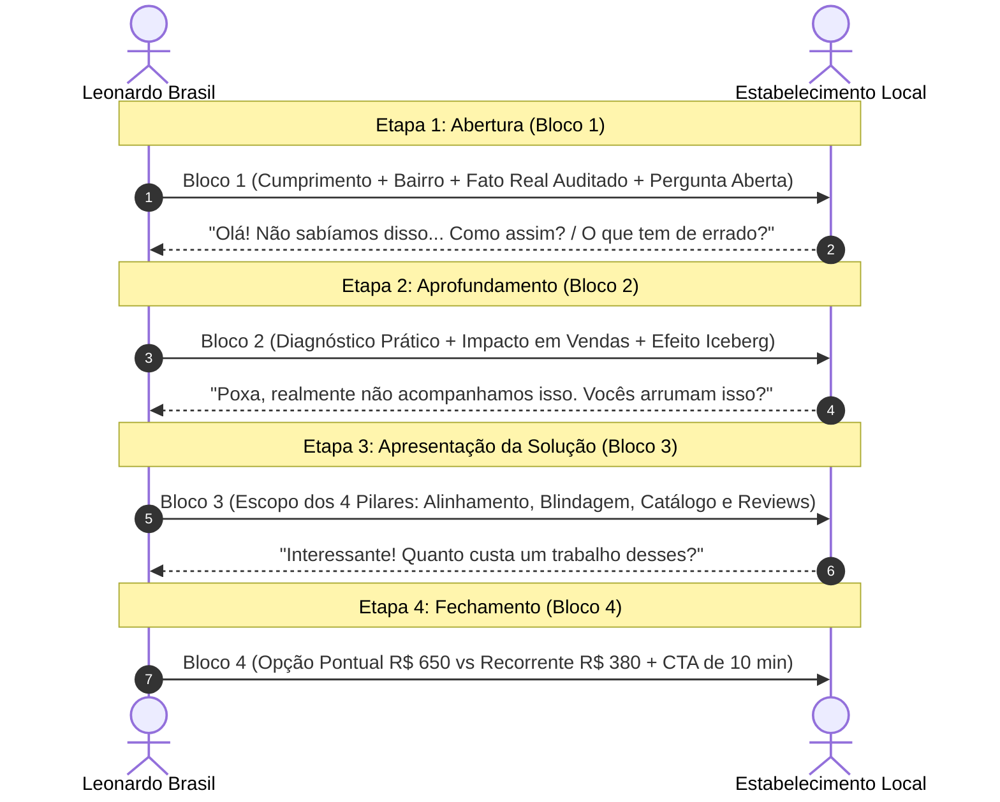

> [[Início|Painel]] › [[Mapa Comercial e CRM|Comercial e CRM]]

# 💬 Fluxo Modular de Abordagem WhatsApp (4 Blocos)

> [!important] Princípio de Ouro do WhatsApp Comercial
> **Nunca envie um "textão" de 40 linhas no primeiro contato.**  
> O WhatsApp é um aplicativo de conversa rápida entre seres humanos. Disparar a proposta comercial inteira na primeira mensagem gera rejeição instantânea e denúncia de spam. O processo de vendas é dividido em **4 blocos conversacionais progressivos**, onde cada bloco só é enviado após a interação do cliente.

---

## Estrutura Detalhada dos 4 Blocos

### 🟢 Bloco 1: O Gancho (Abertura com Permissão de Envio)
* **Objetivo:** Conseguir a primeira resposta com autorização para enviar a análise (taxa de abertura e micro-compromisso).
* **Gatilhos Mentais:** Identificação Pessoal Imediata, Dado Concreto de Mercado (Volume de Buscas), Curiosidade e Chamada Leve sem Venda.

O CRM disponibiliza **dois modelos alternáveis com 1 clique**:

#### 🎯 Modelo A (O Modelo Padrão — Volume de Buscas & Posicionamento):
> *"Olá, tudo bem? Aqui é o Leonardo Brasil, trabalho com posicionamento de empresas no Google.*  
>  
> *Só a palavra \"{{Palavra-Chave do Nicho}}\" tem cerca de {{Volume Estimado}} buscas por mês na cidade e o perfil da *{{Nome da Empresa}}* ainda não aparece entre os primeiros.*  
>  
> *Posso te mandar uma análise rápida e gratuita, mostrando o que dá para melhorar?"*

#### 🔍 Modelo B (Modelo Factual — Falha Cadastral / Desencontro Auditado):
> *"Olá, tudo bem? Aqui é o Leonardo Brasil, trabalho com posicionamento de empresas no Google.*  
>  
> *Estava analisando o perfil da *{{Nome da Empresa}}* em {{Bairro}} pelo Google Maps e notei um detalhe prático: *{{Falha Específica Observada}}*.*  
>  
> *Posso te mandar uma análise rápida e gratuita, mostrando o que dá para melhorar?"*

---

### 🟡 Bloco 2: O Diagnóstico & O Efeito Iceberg
* **Quando enviar:** Imediatamente após a resposta do lead (ex: *"Oi, qual divergência?"* ou *"Não sabíamos, o que houve?"*).
* **Objetivo:** Mostrar autoridade, demonstrar o prejuízo em clientes perdidos e revelar que a falha visível é apenas a ponta do iceberg.
* **Template Mestre:**
> *"Entendi perfeitamente!*  
>  
> *O que acontece na prática: quando um cliente busca por *{{Segmento}} em {{Bairro}}* no smartphone, ele vê informações no perfil do Google que não coincidem com o atendimento real da empresa.*  
>  
> *{{Detalhamento do impacto operacional e financeiro}}*  
>  
> *Isso faz com que pessoas prontas para agendar ou comprar fiquem em dúvida ou acabem clicando no próximo concorrente da lista.*  
>  
> *Além disso, quando fiz a análise, notei outros pontos críticos no perfil, como a falta de blindagem cadastral contra alterações automáticas do Google e a ausência do catálogo de especialidades que faz a empresa aparecer nas buscas orgânicas da região."*

---

### 🔵 Bloco 3: O Escopo do Serviço (A Entrega)
* **Quando enviar:** Quando o lead demonstra interesse em resolver ou pergunta como funciona.
* **Objetivo:** Descrever com clareza cristalina os 4 entregáveis concretos da consultoria.
* **Template Mestre:**
> *"Eu sou especialista em estruturação e gestão estratégica do *Perfil da Empresa no Google* para negócios e clínicas locais.*  
>  
> *O meu trabalho de **Otimização, Implantação e Blindagem** resolve isso de ponta a ponta em 4 pilares:*  
>  
> *1. **Alinhamento Cadastral Total:** Horários corretos, canais oficiais e link de WhatsApp direto de 1 toque com mensagem personalizada de rastreamento;*  
> *2. **Blindagem e Reivindicação:** Proteção contra sugestões automáticas indevidas de usuários e concorrentes, evitando bloqueios ou suspensão de conta;*  
> *3. **Catálogo de Especialidades:** Inclusão dos serviços e procedimentos mais buscados no seu bairro para você dominar as buscas orgânicas no Google Maps;*  
> *4. **Link Oficial de Avaliações:** Ativação do link direto do Google que abre a tela de 5 estrelas em 1 toque no celular do cliente para acelerar avaliações sem burocracia."*

---

### 🟣 Bloco 4: A Proposta Comercial & Fechamento
* **Quando enviar:** Logo após o Bloco 3 ou quando o lead perguntar valores.
* **Objetivo:** Apresentar a ancoragem dupla (Pontual vs. Recorrente) e fechar com uma chamada para ação leve e de baixo atrito.
* **Template Mestre:**
> *"Os benefícios diretos são o fim de clientes perdidos por dados desencontrados e mais mensagens no seu WhatsApp de pessoas da Zona Sul prontas para contratar.*  
>  
> *Eu trabalho com dois formatos práticos:*  
>  
> *📌 **1. Implantação e Otimização Total (Pontual):***  
> *Diagnóstico completo, correção de todas as falhas, reestruturação e blindagem do perfil.*  
> *💰 Investimento único: *R$ 650,00* (ou 2x de R$ 350,00).*  
>  
> *📌 **2. Gestão Mensal Recorrente (Opcional):***  
> *Acompanhamento contínuo, publicação mensal de fotos/atualizações com geotag, monitoramento de avaliações e relatórios mensais.*  
> *💰 Mensalidade: *R$ 380,00/mês* (sem qualquer fidelidade contratual).*  
>  
> *Podemos agendar uma conversa rápida de 10 minutos amanhã às 14h ou 16h para eu mostrar os pontos exatos na tela?"*

---

## 🛠️ Integração com o CRM Próprio (`/crm`)

No painel operacional em `leonardobrasil.com.br/crm`, cada card de prospect possui uma **Gaveta Lateral de Blocos**:
* Botão **"Copiar Bloco N"** que copia o texto com as variáveis já preenchidas e dispara feedback de toast;
* Botão **"Abrir WhatsApp Web"** que abre a conversa direta com o número formatado (`5551...`) e o Bloco 1 já inserido no campo de texto;
* Marcador de status que avança o lead automaticamente de *"1. A Abordar"* para *"2. Contatado"*.

---

## Conexões Relacionadas
* [[Método de Prospecção Ativa Local]]
* [[O Framework dos 3 Pilares da Oferta]]
* [[Roteiros e Scripts Cirúrgicos por Nicho]]
* [[Gestão de Objeções e Scripts de Contorno]]
* [[Sistema CRM Local e Manual Operacional]]
* [[Início|Voltar ao MOC]]
