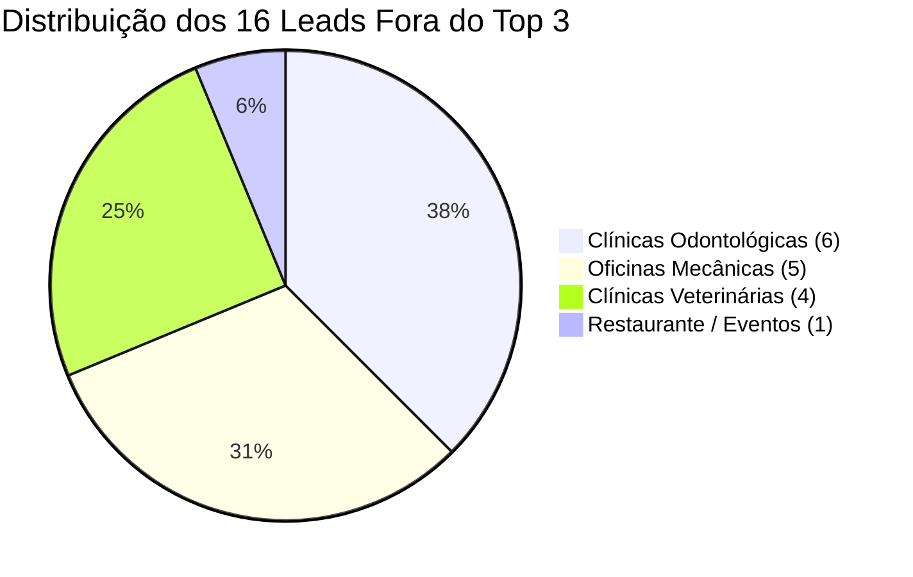

> [[Início|Painel]] › [[Mapa Comercial e CRM|Comercial e CRM]] › [[Sistema CRM Local e Manual Operacional|CRM]]

# 📍 Base de Leads Fora do Top 3 (Rodada 02)

> [!abstract] Resumo da Base Qualificada
> Em conformidade com o **Critério P (Posição Observada $\ge$ 4)**, esta base reúne **16 estabelecimentos reais da Zona Sul de Porto Alegre** (Ipanema, Tristeza, Cristal e Cavalhada) que ocupam da **4ª à 7ª posição** no Google Maps. Todos os perfis possuem **celular móvel e WhatsApp confirmados**, alta demanda mensal de buscas e falhas cadastrais ou de catálogo que impedem sua entrada no cobiçado Local 3-Pack.

---

## 1. Distribuição dos Leads por Nicho e Posição no Maps

---

## 2. Tabela de Leads Qualificados no CRM (`/crm`)

| ID | Nome do Estabelecimento | Bairro | Posição no Maps | Nicho | WhatsApp Verificado | Demanda Mensal | Falha Concreta Auditada |
| :---: | :--- | :--- | :---: | :--- | :---: | :---: | :--- |
| **V-001** | **Clínica Veterinária Suellen Stefan** | Ipanema | **4º lugar** | Veterinária | `(51) 99145-6761` | 2.400/mês | Fora do Local 3-Pack; sem catálogo de especialidades médicas. |
| **V-002** | **Clínica Veterinária Essência Animal** | Ipanema | **5º lugar** | Veterinária | `(51) 99950-5052` | 2.400/mês | Sem botão de WhatsApp no perfil; perde cliques para a Juca Batista. |
| **V-003** | **DogDoc Veterinária e Petshop** | Tristeza | **4º lugar** | Veterinária | `(51) 99978-6295` | 2.200/mês | 4º lugar na Wenceslau Escobar; sem produtos/exames cadastrados. |
| **V-004** | **Cristal Vet** | Cristal | **4º lugar** | Veterinária | `(51) 98446-1000` | 3.100/mês | 4º lugar na Campos Velho; sem postagens recentes nem catálogo. |
| **O-001** | **Hugo Almeida Mecânica Total** | Tristeza | **4º lugar** | Oficina | `(51) 99969-6397` | 1.600/mês | 4º lugar na Dr. Barcelos; sem catálogo de freios/revisão. |
| **O-002** | **Ciro Car Centro Automotivo** | Tristeza | **5º lugar** | Oficina | `(51) 98400-8925` | 1.600/mês | 5º lugar na Otto Niemeyer; perde motoristas para as do topo. |
| **O-003** | **Garagetec Oficina Mecânica** | Cristal | **4º lugar** | Oficina | `(51) 99165-1412` | 1.500/mês | 4º lugar na Campos Velho; faltam especialidades estruturadas. |
| **O-004** | **Drive Service - Mecânica e Guincho** | Cavalhada | **4º lugar** | Oficina | `(51) 98486-3861` | 1.900/mês | Socorro 24h na 4ª posição no Maps; perde chamadas noturnas. |
| **O-005** | **Angelo Car Oficina Mecânica** | Cavalhada | **5º lugar** | Oficina | `(51) 98428-1009` | 1.900/mês | 5º lugar na Vicente Monteggia; perfil sem blindagem cadastral. |
| **D-001** | **Dra. Mariana Canal Odontologia** | Tristeza | **4º lugar** | Odontologia | `(51) 98511-1656` | 2.100/mês | 4º lugar na Mário Totta; sem catálogo de tratamentos estéticos. |
| **D-002** | **OdontoVittá - Clínica Odontológica** | Tristeza | **5º lugar** | Odontologia | `(51) 99958-5908` | 2.100/mês | 5º lugar na Armando Barbedo; sem link rastreado de WhatsApp. |
| **D-003** | **Clínica Odontológica Ortos** | Tristeza | **6º lugar** | Odontologia | `(51) 99918-8205` | 2.100/mês | 6º lugar no Maps; sem catálogo de ortodontia e alinhadores. |
| **D-004** | **Borghetti Ortodontia** | Ipanema | **4º lugar** | Odontologia | `(51) 99123-2426` | 1.800/mês | 4º lugar na Juca Batista; sem procedimentos cadastrados no Maps. |
| **D-005** | **Neville Odontologia / Saúde** | Ipanema | **5º lugar** | Odontologia | `(51) 98528-3512` | 1.800/mês | 5º lugar na Zona Sul; sem categorias secundárias otimizadas. |
| **D-006** | **Sorrire Odontologia** | Tristeza | **7º lugar** | Odontologia | `(51) 99162-1387` | 2.100/mês | 7º lugar na Camaquã; perfil desatualizado e sem avaliações recentes. |
| **R-001** | **Espaço Maestro** | Tristeza | **4º lugar** | Restaurante | `(51) 99253-8722` | 3.800/mês | 4º lugar na Dr. Barcelos; sem cardápio integrado para reservas. |

---

## 3. Calibração do Modelo A de Abordagem

Como todos os 16 leads estão comprovadamente entre o 4º e o 7º lugar, o script do **Modelo A (Volume + Posição Real)** é matematicamente exato e causa impacto psicológico imediato:

> *"Olá, tudo bem? Aqui é o Leonardo Brasil, trabalho com posicionamento de empresas no Google.*  
>  
> *Só a palavra \"{{Palavra-Chave}}\" tem cerca de {{Volume Estimado}} buscas por mês na cidade e o perfil da *{{Nome da Empresa}}* ainda não aparece entre os 3 primeiros no Google Maps (está atualmente em {{Posição Real}}º lugar).*  
>  
> *Posso te mandar uma análise rápida e gratuita, mostrando o que dá para ajustar para colocar vocês no Top 3?"*

---

## Conexões Relacionadas
* [[Método de Prospecção Ativa Local]]
* [[Sistema CRM Local e Manual Operacional]]
* [[Fluxo Modular de Abordagem WhatsApp (4 Blocos)]]
* [[O Framework dos 3 Pilares da Oferta]]
* [[Início|Voltar ao Painel]]
