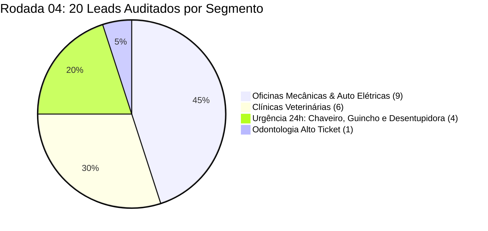

> [[Início|Painel]] › [[Mapa Comercial e CRM|Comercial e CRM]] › [[Base de Leads Fora do Top 3 (Rodada 03)|Rodada 03]] › [[Sistema CRM Local e Manual Operacional|CRM]]

# 🎯 Base de Leads Fora do Top 3 (Rodada 04 — Motor Determinístico 0–100 pts)

> [!important] Diretriz Comercial Sem Subjetividade (Direção Comercial)
> A **Rodada 04** consolida todas as evoluções operacionais e empíricas da prospecção ativa:
> - **Bloqueio Rígido pelo Critério P:** nenhuma empresa em 1º, 2º ou 3º lugar entra na fila;
> - **Foco Empírico + Arquétipo 1:** prioridade máxima em **Oficinas Mecânicas / Auto Elétricas** e **Clínicas Veterinárias** (campeãs de resposta na Rodada 02) somadas aos nichos de **Urgência 24h** (Chaveiro, Guincho, Desentupidora) da [[Taxonomia e Matriz de Nichos de Alta Conversao para Prospeccao]];
> - **Motor Determinístico (0–100 pts):** substituição completa de escolha subjetiva por sinais auditáveis no Google Maps + website oficial (implementado em `deterministicScoring.ts`).

---

## 1. Fórmula do Motor Determinístico (`0 a 100 pts`)

| Critério Binário / Numérico | Regra Exata de Pontuação | Pontos Máximos |
| :--- | :--- | :---: |
| **Critério P (Trava Obrigatória)** | Posição `<= 3º` em qualquer variação pesquisada = **0 pts (Bloqueado)** | `Bloqueio` |
| **1. Posição Fora do Top 3** | `4º–5º lugar` (**+20 pts**) \| `6º–10º lugar` (**+15 pts**) \| `> 10º lugar` (**+10 pts**) | **20 pts** |
| **2. Arquétipo & Tração Empírica** | Nível 1: Mecânica / Vet / Urgência 24h (**+20 pts**) \| Nível 2: Odonto (**+15 pts**) \| Nível 3: Domiciliares (**+10 pts**) | **20 pts** |
| **3. Sinais Técnicos Auditáveis** | `D` Divergência Cadastral (**+15**) + `WA` Falha/Ausência WhatsApp Maps (**+15**) + `U/C` Sem Catálogo/Não Reivindicado (**+10**) + `H/R` Horário Oculto/Reviews s/ Resposta (**+5**) + `L` Site Ausente/Quebrado (**+5**) | **50 pts** |
| **4. Canal WhatsApp + Demanda** | WhatsApp `(51) 9XXXX-XXXX` confirmado + buscas mensais `>= 1.500` (**+10 pts**) ou `< 1.500` (**+5 pts**) | **10 pts** |

* **Classe A (`75 a 100 pts`):** Prioridade Imediata Hoje (7 leads na Rodada 04)
* **Classe B (`60 a 74 pts`):** Alta Qualificação — Segunda Onda Imediata (13 leads na Rodada 04)
* **Classe C (`40 a 59 pts`):** Fila Secundária

---

## 2. Classe A (75–90 pts) — Ataque Imediato Hoje (`10/11/2026`)

| Score | ID | Empresa | Segmento | Bairro | Maps | WhatsApp Verificado | Falha Factual Auditada |
| :---: | :---: | :--- | :--- | :--- | :---: | :---: | :--- |
| **90 pts** | **O-014** | **CAP autocenter** | Oficina Mecânica | Cavalhada | **5º** | `(51) 99909-6573` | Categoria errada (*"Serviços de usinagem automotiva"*) + botão `wa.me` no site **sem o 9º dígito** + sem WA no Maps. |
| **90 pts** | **V-013** | **Almofadinhas Vet Care** | Clínica Veterinária | Menino Deus | **7º** | `(51) 98414-3799` | Categoria exclusiva *"Pet Shop"* + Maps exibe **só fixo** `(51) 3519-7777` apesar do site trazer WA + 96 avs s/ resposta. |
| **85 pts** | **O-015** | **Injecar** | Oficina Mecânica | Nonoai | **4º** | `(51) 98178-6457` | Maps exibe **só fixo** `(51) 3018-1429` vs WA no site; site anuncia *Socorro 24h* vs Maps comercial (269 avs s/ resposta). |
| **85 pts** | **E-001** | **CHAVEIRO ZONA SUL PORTO ALEGRE** | Chaveiro 24h | Aberta dos Morros | **5º** | `(51) 98564-0131` | Botão oficial de "Site" no Maps (`wa.me/message/...`) retorna **Erro HTTP 400**, sem site próprio e 23 avs 5.0 s/ resposta. |
| **85 pts** | **E-003** | **Guinchos zona sul** | Guincho 24h | Cavalhada | **6º** | `(51) 99655-0025` | Categoria errada (*"Empresa de transporte rodoviário"* vs *Serviço de reboque*) + fones divergentes + sem WA no Maps. |
| **80 pts** | **E-002** | **Tele Chaveiro Botafogo** | Chaveiro 24h | Menino Deus | **5º** | `(51) 98452-1404` | Perfil 24h marca **"Sábado Fechado"** no Maps + fone Maps `(98452-1404)` diverge do site `(99759-0049)`. |
| **75 pts** | **O-016** | **Free Baterias e Lubrificantes** | Auto Elétrica / Baterias | Nonoai | **4º** | `(51) 98314-4082` | Maps marca Sábado `08h–17h` e Domingo `09h–17h` vs site Sábado `08h–16h`; falta botão WA direto no Maps (`5.0 ★ / 111`). |

---

## 3. Classe B (60–70 pts) — Alta Qualificação (`2ª Onda`)

| Score | ID | Empresa | Segmento | Bairro | Maps | WhatsApp Verificado | Falha Factual Auditada |
| :---: | :---: | :--- | :--- | :--- | :---: | :---: | :--- |
| **70 pts** | **O-018** | **Mecânica Antares** | Oficina Mecânica | Menino Deus | **4º** | `(51) 99331-6493` | `4.9 ★ (35)`, 1 vaga abaixo do Top 3, sem site vinculado, sem catálogo e sem respostas nas avaliações. |
| **70 pts** | **O-019** | **Pereira Manutenção Automotiva** | Oficina Mecânica | Glória | **4º** | `(51) 99577-4756` | `4.7 ★ (14)`, 4º na região Medianeira/Glória, sem site vinculado e 0 respostas nas avaliações. |
| **70 pts** | **O-017** | **Lageado Pneus Auto Center** | Oficina Mecânica | Menino Deus | **5º** | `(51) 99760-3298` | Maps mostra **só fixo** `(51) 3019-8499` enquanto site usa WhatsApp `99760-3298` + 139 avs s/ resposta. |
| **70 pts** | **V-014** | **AMPARO Centro Veterinário** | Clínica Veterinária | Tristeza | **5º** | `(51) 98024-8981` | **422 avaliações (4.6 ★) com 0 respostas recentes**, sem site conectado e sem destaque de plantão até 23h30. |
| **70 pts** | **O-020** | **Garage Automotivo BY T.D.** | Oficina Mecânica | Vila Nova | **5º** | `(51) 98904-8479` | `4.2 ★ (23)`, sem site conectado, sem catálogo estruturado e sem respostas nas avaliações. |
| **65 pts** | **E-004** | **Previni RS** | Desentupidora 24h | Glória | **4º** | `(51) 99999-8915` | Site bem estruturado com 7 links WA 24h, porém ficha do Maps sem botão direto de WhatsApp. |
| **65 pts** | **V-015** | **ViviVet Clínica Veterinária** | Clínica Veterinária | Vila Nova | **4º** | `(51) 98244-3418` | Gigante presa em 4º mesmo com **2.126 avaliações (4.7 ★) sem resposta recente**, apontando apenas para Instagram. |
| **65 pts** | **V-016** | **Hospital Veterinário Molecão** | Clínica Veterinária | Medianeira | **4º** | `(51) 99223-8015` | Plantão 24h fora do Top 3; botão Site vai só para `wa.me` e **282 avaliações (4.0 ★)** sem resposta visível. |
| **65 pts** | **O-021** | **Mecânica 2A Automotiva** | Oficina Mecânica | Nonoai | **8º** | `(51) 99799-8412` | Todos os **5 botões `wa.me` do site oficial estão sem o 9º dígito** (`555197998412`) + 84 avs s/ resposta. |
| **65 pts** | **V-017** | **Exótica VET** | Clínica Veterinária | Vila Nova | **9º** | `(51) 99481-1756` | `5.0 ★ (105)`, porém **horário de funcionamento totalmente OMITIDO/VAZIO no Maps** e sem botão direto WA. |
| **65 pts** | **V-018** | **LUVET CLÍNICA VETERINÁRIA** | Clínica Veterinária | Cristal | **10º** | `(51) 99559-7004` | `4.7 ★ (169)`, botão oficial "Site" (`clinicaluvet.com.br`) retorna **erro DNS fora do ar** (`ERR: ENOTFOUND`). |
| **60 pts** | **D-007** | **Dentista Legal** | Clínica Odontológica | Menino Deus | **5º** | `(51) 99201-1123` | **744 avaliações nota 5.0 ★**, porém Maps exibe **só fixo** `(51) 3013-6655` vs WhatsApp no site `dentistalegal.com.br`. |
| **60 pts** | **O-022** | **Quadros Mecânica Automotiva** | Oficina Mecânica | Teresópolis | **8º** | `(51) 99854-6139` | Ficha marcada como **Não Reivindicada** (*"Reivindicar esta empresa"*) e sem site — caso ideal de blindagem e posse Gmail. |

---

## 4. Diretrizes de Abordagem Aplicadas

1. **Voz em 1ª pessoa do singular:** todos os 20 roteiros (`Bloco 1` Volume, `Bloco 1` Falha Factual, `Bloco 2`, `Bloco 3` e `Bloco 4`) utilizam exclusivamente *"Eu trabalho"*, *"Eu faço"*, *"O meu trabalho"*.
2. **Entregáveis 100% nativos Google:** zero menção a materiais impressos; foco total no botão de WhatsApp, link oficial nativo de 5 estrelas em 1 toque, posse Gmail e catálogo no Google.
3. **Triagem prévia em leads leigos / não reivindicados:** conferir posse da conta Gmail antes da implantação usando [[Gestão de Objeções e Scripts de Contorno#6. Triagem de Posse Google / Gmail (Clientes Leigos)|Triagem de Posse Gmail]].

## Conexões Relacionadas
* [[Sistema CRM Local e Manual Operacional]]
* [[Taxonomia e Matriz de Nichos de Alta Conversao para Prospeccao]]
* [[Gestão de Objeções e Scripts de Contorno]]
* [[Base de Leads Fora do Top 3 (Rodada 03)]]
* [[Base de Leads Fora do Top 3 (Rodada 02)]]
