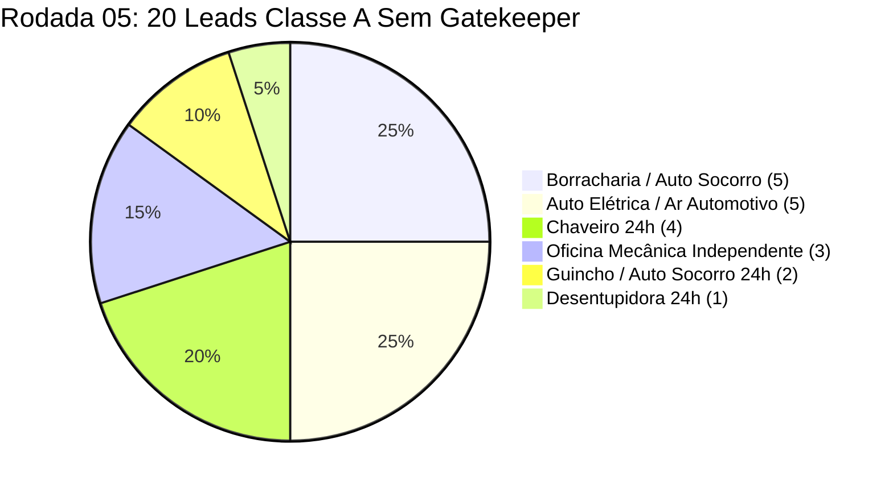

> [[Início|Painel]] › [[Mapa Comercial e CRM|Comercial e CRM]] › [[Base de Leads Fora do Top 3 (Rodada 04)|Rodada 04]] › [[Sistema CRM Local e Manual Operacional|CRM]]

# 🎯 Base de Leads Fora do Top 3 (Rodada 05 — Decisor Direto & Alta Resposta)

> [!important] Diretriz de Direção Comercial (Auditoria Pós-52 Leads)
> Como os **52 leads anteriores** (Rodadas 02, 03 e 04) já foram abordados (`1. A Abordar = 0`), a **Rodada 05** reabastece a fila diária com **20 leads 100% Classe A (75 a 100 pts)** desenhados especificamente para **resposta imediata no WhatsApp sem passar por recepcionista/secretária (Zero Gatekeeper)**:
> 1. **Filtro Estrutural de Decisor Direto (`(51) 9XXXX-XXXX` do Dono):** Exclusão total de clínicas odontológicas, franquias e restaurantes com balcão/recepção; foco cirúrgico em **Borracharias / Auto Socorro (`5`)**, **Auto Elétricas / Ar Automotivo (`5`)**, **Chaveiros 24h (`4`)**, **Oficinas Mecânicas Independentes (`3`)**, **Guinchos 24h (`2`)** e **Desentupidora 24h (`1`)**.
> 2. **Modelo B Ativo como Abertura Padrão:** Para furar a inércia logo na primeira mensagem, o botão verde `WhatsApp` do card e a aba do Drawer já abrem no **Modelo B (Falha Factual Auditada)** citando erros concretos verificados hoje (site com *Hospedagem Suspensa*, link `api.whatsapp.com` *sem o 9º dígito*, ficha *Não Reivindicada*, divergência de telefone entre Maps e site oficial ou categoria errada como *"Loja de pneus usados"*).
> 3. **Calibragem Determinística Tier 1:** `deterministicScoring.ts` passou a incluir `"borracharia"`, `"pneu"`, `"reboque"` e `"socorro"` no **Arquétipo Nível 1 (+20 pts)**, mantendo o bloqueio rígido do **Critério P (`>= 4º lugar`)** e zero duplicidade frente aos `92` contatos anteriores (`52` ativos + `40` arquivados).

---

## 1. Distribuição Determinística da Rodada 05 (`20/20 Classe A`)

* **Faixa de Score Determinístico:** `75 a 100 pts` (`100% Classe A — Prioridade Imediata Hoje`).
* **Canal Verificado:** `20/20` com WhatsApp móvel `(51) 9XXXX-XXXX` diretamente no Google Maps, zero linhas fixas puras.
* **Posição Auditada (Critério P):** `4º` ao `14º lugar` no Google Maps organicamente (`5` leads em `4º–5º`, `10` em `6º–10º`, `5` em `11º–14º`).
* **Estrutura de Conversão:** `Bloco 1 = Modelo B (Falha Factual)` por padrão (`Bloco 1 Volume` preservado no alternador), voz 100% em 1ª pessoa do singular (`"Eu"`), entregáveis 100% nativos no Google e proposta pontual exclusiva de **R$ 497,00 à vista no Pix (ou 2x de R$ 250,00)** no `Bloco 4`.

---

## 2. Ranking Completo dos 20 Leads Auditados (`11/11/2026`)

| Score | ID | Empresa | Segmento | Bairro | Maps | WhatsApp Verificado | Nota / Ficha | Evidência Factual Auditada (Gancho Modelo B) | Link Maps |
| :---: | :---: | :--- | :--- | :--- | :---: | :---: | :---: | :--- | :---: |
| **100 pts** | **O-023** | **Borracharia Sul Pneus - AUTOSOCORRO 👨🏻‍🔧🛞** | Borracharia / Auto Socorro | Tristeza | **4º** | `(51) 99212-4708` | `4.7 ★ (167)` | Categoria errada *"Loja de pneus usados"*, sem botão WA e sem site. | [Abrir](https://www.google.com/maps/place/Borracharia+Sul+Pneus+-+AUTOSOCORRO+%F0%9F%91%A8%F0%9F%8F%BB%E2%80%8D%F0%9F%94%A7%F0%9F%9B%9E/data=!4m7!3m6!1s0x9519837942facc1d:0xec7e9ce618611c98!8m2!3d-30.1081152!4d-51.2476021!16s%2Fg%2F11h7smwh8_!19sChIJHcz6QnmDGZURmBxhGOacfuw?authuser=0&hl=pt-BR&g_ep=EgoyMDI2MTEwOC4wIJJjKgBIAVAD&rclk=1) |
| **95 pts** | **O-024** | **Beto Ar Condicionado Automotivo** | Auto Elétrica / Ar Automotivo | Cavalhada | **4º** | `(51) 99255-1396` | `4.6 ★ (96)` | Site mantém botão `api.whatsapp.com` **sem o 9º dígito** (`555189594451`) + sem WA no Maps. | [Abrir](https://www.google.com/maps/place/Beto+Ar+Condicionado+Automotivo/data=!4m7!3m6!1s0x9519825b77548f91:0x7d223d5ddc1a51f9!8m2!3d-30.1055215!4d-51.2293409!16s%2Fg%2F1yh4g8q5d!19sChIJkY9Ud1uCGZUR-VEa3F09In0?authuser=0&hl=pt-BR&g_ep=EgoyMDI2MTEwOC4wIJJjKgBIAVAD&rclk=1) |
| **95 pts** | **E-007** | **JBK Guincho** | Guincho / Auto Socorro 24h | Cel. Aparicio Borges | **6º** | `(51) 98568-8984` | `5.0 ★ (51)` | Endereço malformado `"Rua: - Tv. das Camélias"`, Website só com `wa.me`, sem botão WA nativo. | [Abrir](https://www.google.com/maps/place/JBK+Guincho/data=!4m7!3m6!1s0x4739b6b2f806e9c5:0x565cad590755e0b8!8m2!3d-30.0802314!4d-51.1724482!16s%2Fg%2F11sw3l1h0s!19sChIJxekG-LK2OUcRuOBVB1mtXFY?authuser=0&hl=pt-BR&g_ep=EgoyMDI2MTEwOC4wIJJjKgBIAVAD&rclk=1) |
| **90 pts** | **O-027** | **Altemir Eletrica Automotiva Zona Sul Porto Alegre** | Auto Elétrica / Ar Automotivo | Campo Novo | **6º** | `(51) 99164-9410` | `4.7 ★ (136)` | `136 avs` sem resposta, categoria principal errada *"Oficina mecânica"*, sem site/WA. | [Abrir](https://www.google.com/maps/place/Altemir+Eletrica+Automotiva+Zona+Sul+Porto+Alegre/data=!4m7!3m6!1s0x95198364906e8bad:0xaa1467feab718ea0!8m2!3d-30.1460413!4d-51.208984!16s%2Fg%2F11c475fw7s!19sChIJrYtukGSDGZURoI5xq_5nFKo?authuser=0&hl=pt-BR&g_ep=EgoyMDI2MTEwOC4wIJJjKgBIAVAD&rclk=1) |
| **90 pts** | **E-008** | **RS Desentupidora 24h** | Desentupidora 24h | Mário Quintana | **6º** | `(51) 99235-9380` | `4.6 ★ (22)` | Botão oficial **Website** redireciona para **Hospedagem Suspensa** (`cgi-sys/suspendedpage.cgi`) + sem WA. | [Abrir](https://www.google.com/maps/place/RS+Desentupidora+24h/@-30.0455637,-51.1069772,17z/data=!3m1!4b1!4m6!3m5!1s0x95199d0c5ed9c50d:0xeb8990ed7a6ce724!8m2!3d-30.0455637!4d-51.1069772!16s%2Fg%2F11zcxw0kkz?authuser=0&hl=pt-BR&entry=ttu&g_ep=EgoyMDI2MTEwOC4wIKXMDSoASAFQAw%3D%3D) |
| **90 pts** | **O-025** | **Borracharia 24 horas** (*Borracharia Oscar*) | Borracharia / Auto Socorro | Glória | **7º** | `(51) 98134-4840` | `4.9 ★ (89)` | Ficha genérica *"Borracharia 24 horas"* diverge do site oficial *Borracharia Oscar* + 89 avs s/ resp. | [Abrir](https://www.google.com/maps/place/Borracharia+24+horas/data=!4m7!3m6!1s0x951977206a0bb03d:0x715aab9c5518bcd6!8m2!3d-30.0810204!4d-51.1975325!16s%2Fg%2F11xg7sd5sq!19sChIJPbALaiB3GZUR1rwYVZyrWnE?authuser=0&hl=pt-BR&g_ep=EgoyMDI2MTEwOC4wIJJjKgBIAVAD&rclk=1) |
| **90 pts** | **E-005** | **Abriu Chaveiros Tauros & Cia** | Chaveiro 24h | Cristal | **9º** | `(51) 99945-6045` | `4.5 ★ (55)` | Fone do Maps `(99945-6045)` diverge do WhatsApp oficial do site `(98232-3232)` + sem WA no Maps. | [Abrir](https://www.google.com/maps/place/Abriu+Chaveiros+Tauros+%26+Cia/data=!4m7!3m6!1s0x951982135552003b:0xf89b3fc591c7ae14!8m2!3d-30.0995705!4d-51.2424214!16s%2Fg%2F1tf1p_lk!19sChIJOwBSVROCGZURFK7HkcU_m_g?authuser=0&hl=pt-BR&g_ep=EgoyMDI2MTEwOC4wIJJjKgBIAVAD&rclk=1) |
| **90 pts** | **O-026** | **Auto Elétrica Cris Car & Mecânica** | Auto Elétrica / Ar Automotivo | Cavalhada | **10º** | `(51) 98602-8001` | `4.3 ★ (26)` | **Não Reivindicada** (*"Reivindicar esta empresa"*) + categoria errada *"Mecânico"* + sem site/WA. | [Abrir](https://www.google.com/maps/place/Auto+El%C3%A9trica+Cris+Car+%26+Mec%C3%A2nica/data=!4m7!3m6!1s0x951982663c2b3b89:0xa798b7dc9b9afc03!8m2!3d-30.0969981!4d-51.2307742!16s%2Fg%2F11b88pdbds!19sChIJiTsrPGaCGZURA_yam9y3mKc?authuser=0&hl=pt-BR&g_ep=EgoyMDI2MTEwOC4wIJJjKgBIAVAD&rclk=1) |
| **90 pts** | **O-030** | **Borracharia Ipanema** | Borracharia / Auto Socorro | Ipanema | **11º** | `(51) 98949-0996` | `4.8 ★ (90)` | Categoria errada *"Loja de pneus usados"*, `90 avs` sem resposta, horários ocultos e sem WA/site. | [Abrir](https://www.google.com/maps/place/Borracharia+Ipanema/data=!4m7!3m6!1s0x951983a39c95ee27:0x194c4c5bcf5b154!8m2!3d-30.1348421!4d-51.2289456!16s%2Fg%2F1pv1lv866!19sChIJJ-6VnKODGZURVLH1vMXElAE?authuser=0&hl=pt-BR&g_ep=EgoyMDI2MTEwOC4wIJJjKgBIAVAD&rclk=1) |
| **85 pts** | **E-009** | **Nonoai chaveiro** | Chaveiro 24h | Nonoai | **4º** | `(51) 98188-6831` | `5.0 ★ (8)` | `4º lugar` 24h; endereço sem número (`Av. Nonoai`), sem site/WA e `0 respostas`. | [Abrir](https://www.google.com/maps/place/Nonoai+chaveiro/@-30.0917924,-51.2220254,17z/data=!3m1!4b1!4m6!3m5!1s0xa508adeb46280749:0x8b36d45de2059b7f!8m2!3d-30.0917924!4d-51.2220254!16s%2Fg%2F11yjjb2rdv?authuser=0&hl=pt-BR&entry=ttu&g_ep=EgoyMDI2MTEwOC4wIKXMDSoASAFQAw%3D%3D) |
| **85 pts** | **E-006** | **Guincho Corrêa Zona Sul Porto Alegre** | Guincho / Auto Socorro 24h | Zona Sul | **11º** | `(51) 99542-3530` | `5.0 ★ (27)` | Fone do Maps `(99542-3530)` diverge do botão `wa.me` do site `(98046-7277)` + sem WA no Maps. | [Abrir](https://www.google.com/maps/place/Guincho+Corr%C3%AAa+Zona+Sul+Porto+Alegre/data=!4m7!3m6!1s0x80d050732f1f6a57:0x523c2f5895c016ba!8m2!3d-30.1088701!4d-51.2519579!16s%2Fg%2F11vd6b2kq1!19sChIJV2ofL3NQ0IARuhbAlVgvPFI?authuser=0&hl=pt-BR&g_ep=EgoyMDI2MTEwOC4wIJJjKgBIAVAD&rclk=1) |
| **85 pts** | **O-029** | **Upcar' Especializada em Ar condicionado automotivo** | Auto Elétrica / Ar Automotivo | Camaquã | **12º** | `(51) 98441-5733` | `4.9 ★ (71)` | `71 avs (4.9★)` sem resposta em categoria genérica *"Mecânica para carros"*, sem WA/site. | [Abrir](https://www.google.com/maps/place/Upcar%27+Especializada+em+Ar+condicionado+automotivo/data=!4m7!3m6!1s0x951983d4dd4ed24f:0xf0ab8078cee25772!8m2!3d-30.107087!4d-51.2380957!16s%2Fg%2F11rtl8k_p7!19sChIJT9JO3dSDGZURclfizniAq_A?authuser=0&hl=pt-BR&g_ep=EgoyMDI2MTEwOC4wIJJjKgBIAVAD&rclk=1) |
| **85 pts** | **O-032** | **Borracharia Ortiz** | Borracharia / Auto Socorro | Glória | **14º** | `(51) 99441-7625` | `4.7 ★ (248)` | **248 avaliações** caídas para `14º` por estar como *"Comércio de Pneu"*, sem site e sem WA. | [Abrir](https://www.google.com/maps/place/Borracharia+Ortiz/data=!4m7!3m6!1s0x951982bcd61cb42f:0xe7cd2b3ea38d5fc7!8m2!3d-30.0795334!4d-51.1977354!16s%2Fg%2F11cm0t19ph!19sChIJL7Qc1ryCGZURx1-Noz4rzec?authuser=0&hl=pt-BR&g_ep=EgoyMDI2MTEwOC4wIJJjKgBIAVAD&rclk=1) |
| **80 pts** | **O-031** | **Sepé Auto Elétrica** | Auto Elétrica / Ar Automotivo | Camaquã | **5º** | `(51) 98408-7614` | `4.7 ★ (291)` | `291 avs (4.7★)` com zero respostas, fora do Top 3 em `5º`, sem site e sem botão WA. | [Abrir](https://www.google.com/maps/place/Sep%C3%A9+Auto+El%C3%A9trica/data=!4m7!3m6!1s0x9519826a5e462bdb:0xc5a4396925f84c88!8m2!3d-30.1022897!4d-51.2394512!16s%2Fg%2F1q5hrgxlz!19sChIJ2ytGXmqCGZURiEz4JWk5pMU?authuser=0&hl=pt-BR&g_ep=EgoyMDI2MTEwOC4wIJJjKgBIAVAD&rclk=1) |
| **80 pts** | **O-034** | **Elite Motors** | Oficina Mecânica | Camaquã | **5º** | `(51) 98598-7105` | `4.8 ★ (40)` | `5º lugar` no Cristal/Camaquã, sem site vinculado, sem catálogo e sem botão WA direto. | [Abrir](https://www.google.com/maps/place/Elite+Motors/data=!4m7!3m6!1s0x951982682ca9e5eb:0xbcaae93fc2bf7de0!8m2!3d-30.1013986!4d-51.2343693!16s%2Fg%2F1ptylw34g!19sChIJ6-WpLGiCGZUR4H2_wj_pqrw?authuser=0&hl=pt-BR&g_ep=EgoyMDI2MTEwOC4wIJJjKgBIAVAD&rclk=1) |
| **80 pts** | **O-028** | **Borracharia** (*Av. Nonoai, 355*) | Borracharia / Auto Socorro | Nonoai | **6º** | `(51) 99863-1984` | `4.1 ★ (53)` | Ficha 24h com nome genérico *"Borracharia"*, `53 avs` s/ resposta, sem site e sem WA. | [Abrir](https://www.google.com/maps/place/Borracharia/@-30.0874321,-51.2166295,17z/data=!3m1!4b1!4m6!3m5!1s0x951983d4fec3a66f:0xa5e87381f7668d0b!8m2!3d-30.0874321!4d-51.2166295!16s%2Fg%2F11s19qhvgm?authuser=0&hl=pt-BR&entry=ttu&g_ep=EgoyMDI2MTEwOC4wIKXMDSoASAFQAw%3D%3D) |
| **80 pts** | **E-010** | **Chaveiro Biel 24h** | Chaveiro 24h | Cristal | **7º** | `(51) 98130-3615` | `5.0 ★ (3)` | Endereço com erro (`"Rua doutor raul moureira"`), `3 avs`, sem catálogo e sem botão WA. | [Abrir](https://www.google.com/maps/place/Chaveiro+Biel+24h/data=!4m7!3m6!1s0x9519834e371a995f:0xe6fff03b9be0faf9!8m2!3d-30.0902455!4d-51.2342056!16s%2Fg%2F11yrllsgqw!19sChIJX5kaN06DGZUR-frgmzvw_-Y?authuser=0&hl=pt-BR&g_ep=EgoyMDI2MTEwOC4wIJJjKgBIAVAD&rclk=1) |
| **80 pts** | **O-035** | **MECÂNICA CM MULTIMARCAS** | Oficina Mecânica | Azenha | **7º** | `(51) 99719-6668` | `5.0 ★ (2)` | Atendimento até 20h em `7º`; categoria genérica *"Mecânico"*, `2 avs`, sem site/WA. | [Abrir](https://www.google.com/maps/place/MEC%C3%82NICA+CM+MULTIMARCAS/@-30.0578,-51.213177,17z/data=!3m1!4b1!4m6!3m5!1s0x951979f53bea9dbb:0x6cfa1b4fc2896207!8m2!3d-30.0578!4d-51.213177!16s%2Fg%2F11y_rv2vh0?authuser=0&hl=pt-BR&entry=ttu&g_ep=EgoyMDI2MTEwOC4wIKXMDSoASAFQAw%3D%3D) |
| **80 pts** | **E-011** | **Tele-Chaveiro Campos Velho** | Chaveiro 24h | Cristal | **10º** | `(51) 99787-2393` | `4.8 ★ (6)` | `10º lugar`, sem site conectado, horários ocultos na ficha, sem catálogo e sem botão WA. | [Abrir](https://www.google.com/maps/place/Tele-Chaveiro+Campos+Velho/data=!4m7!3m6!1s0x95198272118f96a3:0xac64c2a1dd5c594e!8m2!3d-30.0925245!4d-51.2381122!16s%2Fg%2F1ptzwlj5_!19sChIJo5aPEXKCGZURTllc3aHCZKw?authuser=0&hl=pt-BR&g_ep=EgoyMDI2MTEwOC4wIJJjKgBIAVAD&rclk=1) |
| **75 pts** | **O-033** | **MBR Auto Center - OFICINA MECANICA e AR CONDICIONADO** | Oficina Mecânica | Camaquã | **11º** | `(51) 99929-2236` | `5.0 ★ (23)` | Botão oficial **Website** aponta para `api.whatsapp.com` **sem o 9º dígito** (`555199292236`). | [Abrir](https://www.google.com/maps/place/MBR+Auto+Center+-+OFICINA+MECANICA+e+AR+CONDICIONADO/data=!4m7!3m6!1s0x951983478ec9c0cd:0x9c9e17edc6ef61c9!8m2!3d-30.1048857!4d-51.2401297!16s%2Fg%2F11zcnxllrw!19sChIJzcDJjkeDGZURyWHvxu0Xnpw?authuser=0&hl=pt-BR&g_ep=EgoyMDI2MTEwOC4wIJJjKgBIAVAD&rclk=1) |

---

## 3. Banco de Reserva Verificado (Eventual Rodada 06)

Durante a auditoria ao vivo no Google Maps em `11/11/2026`, também foram validados fora do Top 3 com WhatsApp móvel ativo (mantidos em reserva após corte pelos 20 mais fortes em sinal técnico):
* **Chaveiro Massot** (`6º`, Cristal) — `(51) 98498-8170`
* **Ed's Car mecânica automotiva** (`8º`, Ipanema) — `(51) 98038-7704`
* **H-Service Oficina Mecânica** (`9º`, Cavalhada) — `(51) 99323-8326`
* **Beiker Automotiva** (`10º`, Medianeira) — `(51) 98032-5438`
* **GRASFIL CENTRO AUTOMOTIVO** (`11º`, Cristal) — `(51) 99307-6733`
* **Chaveiro Big Key** (`13º`, Cristal) — `(51) 99635-9946`
* **Bacana Guinchos** (`14º`, Partenon) — `(51) 99829-9252`
* **Mecânica do Rafinha** (`15º`, Cavalhada) — `(51) 98588-2083`

## Conexões Relacionadas
* [[Sistema CRM Local e Manual Operacional]]
* [[Fluxo Modular de Abordagem WhatsApp (4 Blocos)]]
* [[Taxonomia e Matriz de Nichos de Alta Conversao para Prospeccao]]
* [[Gestão de Objeções e Scripts de Contorno]]
* [[Base de Leads Fora do Top 3 (Rodada 04)]]
