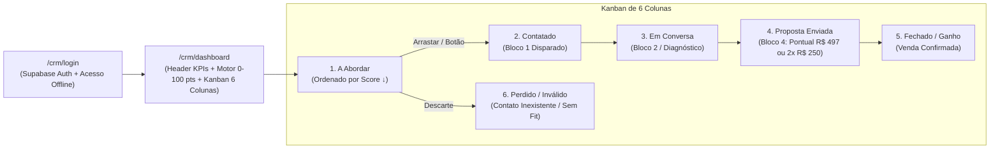

> [[Início|Painel]] › [[Mapa Comercial e CRM|Comercial e CRM]]

# 💻 Sistema CRM Local (`/crm`) e Manual Operacional

> [!abstract] A Ferramenta de Execução e Rotina Diária
> Instalado em **`https://leonardobrasil.com.br/crm`**, o CRM de Prospecção Local foi construído sob uma arquitetura de alto desempenho sem custos de mensalidades externas (React 18 + Supabase Auth & PostgreSQL + TailwindCSS + `@dnd-kit` + `lucide-react` + `react-hot-toast`). Ele foi especialmente projetado para a rotina diária de prospecção cirúrgica via WhatsApp com disparos de 1 clique, motor determinístico `0–100 pts`, cálculo financeiro em tempo real e roteiros dinâmicos.



---

## 1. Acesso, Segurança e Persistência Determinística

* **Rota Pública:** `/crm/login`
* **Painel Restrito:** `/crm/dashboard` (protegido pelo componente `CrmProtectedRoute`)
* **Mecanismos de Entrada:**
  1. **Autenticação Cloud:** E-mail e senha gerenciados pelo Supabase Auth;
  2. **Modo Offline Local (Acesso Rápido):** Botão de contingência imediata que armazena `localStorage.setItem("crm_offline_session", "true")`, garantindo acesso total mesmo em instabilidades de rede ou durante manutenções no Supabase.
* **Segurança de Indexação:** Todas as rotas do CRM contêm `<meta name="robots" content="noindex, nofollow" />` e são excluídas da pré-renderização estática do SSR.
* **Versionamento e Hidratação Determinística:** Chave `crm_prospect_leads_v8` em `crmProspectService.ts`, que preserva os avanços manuais (`stage` e `notes`) já feitos no navegador e hidrata automaticamente novos leads (`INITIAL_PROSPECTS`) junto ao cálculo puro de `deterministicScoring.ts` (0–100 pts).
* **Ordenação e Filtros Executivos:** Cada coluna do Kanban é ordenada deterministicamente por **Score (↓) → Posição no Maps (↑) → Volume Mensal (↓)**, com filtro rápido para **`Só Classe A (≥75 pts)`**, **`Classe A + B (≥60)`**, chips de **`Urgência 24h`** (Chaveiro, Guincho/Reboque, Desentupidora, Auto Elétrica, Borracharia/Auto Socorro), **`Oficinas Mecânicas`** (incluindo Auto Elétricas, Ar Automotivo e Borracharias) e **`Veterinárias`**. Incluídos em Arquétipo Tier 1 (`+20 pts`): `"borracharia"`, `"pneu"`, `"reboque"` e `"socorro"`.

---

## 2. O Header Executivo e os Indicadores de Conversão (KPIs)

O topo do CRM exibe um cockpit financeiro e operacional completo em tempo real:

```mermaid
flowchart TD
    subgraph Header Cockpit
        G["🎯 Meta Diária: 5 Abordagens / Dia (Barra de Progresso com % de Conclusão)"]
        F["Filtros: 'Só WhatsApp Ativo ✓' + Classe A (≥75 pts) / A+B + Segmento + Bairro"]
    end

    subgraph 6 KPIs Financeiros
        K1["Potencial WhatsApp: Total em R$ (Ticket R$ 497 / 2x R$ 250)"]
        K2["1. A Abordar: Leads priorizados por Score ↓"]
        K3["2. Contatados: Bloco 1 enviado"]
        K4["3. Em Conversa: Diagnóstico ativo"]
        K5["4. Em Proposta (R$): Pipeline de propostas enviadas"]
        K6["Receita Fechada: Faturamento acumulado (implantações pontuais × R$ 497)"]
    end

    Header Cockpit --> 6 KPIs Financeiros
```

### O Filtro Inteligente de WhatsApp & Score Determinístico:
Por padrão, o CRM abre com **`Só WhatsApp Ativo ✓`** ligado, ocultando fixos puros, e ordena os cards automaticamente por **Classe A (`≥ 75 pts`, Esmeralda)**, **Classe B (`60–74 pts`, Âmbar)** e **Classe C (`40–59 pts`, Azul)**. A barra adicional permite filtrar instantaneamente apenas **`Só Classe A ≥75`** para iniciar as abordagens pelos leads de maior urgência e retorno.

---

## 3. Cards do Kanban Redesenhados (Design Executivo)

Cada card do pipeline traz alta densidade factual sem subjetividade:
* **Badge de Score Determinístico & Rodada:** Exibe `Classe A (90 pts)` / `Classe B (70 pts)` + tag da rodada (`Rodada 04`), nota/avaliações (`4.6 ★ (269)`) e alerta vermelho quando o perfil aparece **`Não reivindicado`**;
* **Tipografia e Hierarquia:** Nome da empresa em destaque (`15px` bold) com badge de segmento e ícone de canal direto;
* **Badge de Demanda Mensal & Posição Maps:** Posição real verificada (`>= 4º lugar`, respeitando rigorosamente o Critério P) e volume de buscas mensais;
* **Alerta de Evidência Auditada:** Caixa destacada contendo a falha técnica ou discrepância factual levantada na auditoria;
* **Ações de 1 Toque:**
  * **Botão Verde WhatsApp:** Abre diretamente a conversa no WhatsApp Web com o número higienizado e a mensagem inicial pré-digitada;
  * **Botão "Ver Roteiro":** Abre a gaveta lateral completa.

---

## 4. A Gaveta Lateral Modular (Drawer de Blocos com Edição ao Vivo)

Ao tocar no botão *"Ver Roteiro"* de qualquer card, a gaveta lateral (`MessageBlocksDrawer.tsx`) exibe o **Detalhamento dos Critérios Auditados (0–100 pts)** (`Posição`, `Arquétipo`, `D`, `WA`, `U/C`, `H/R`, `L`, `Demanda`) e oferece:

### 4.1. Alternador Dinâmico de Bloco 1 (Modelo A vs Modelo B — Padrão Rodada 05)
* **🔍 Modelo B (Falha Factual Auditada — Padrão Ativo na Rodada 05):** quando `lead.bloco1 === lead.bloco1Falha`, tanto o botão verde 1-clique `WhatsApp` do card quanto o `MessageBlocksDrawer` abrem diretamente na abordagem factual citando o erro concreto auditado (ex.: *Hospedagem Suspensa*, *link `wa.me` sem 9º dígito*, *Perfil Não Reivindicado*, *categoria errada*), sem precisar alternar manualmente;
  > *"Olá, tudo bem? Aqui é o Leonardo Brasil, trabalho com posicionamento de empresas no Google. Estava analisando o segmento na região de [bairro] pelo celular e [falha específica auditada]. Posso te mandar um resumo rápido e gratuito mostrando o que dá para ajustar para colocar a [empresa] no Top 3?"*
* **🎯 Modelo A (Demanda & Top 3):** preservado no alternador do Drawer para testes ou retomadas baseadas em volume de busca mensal.
  > *"Olá, tudo bem? Aqui é o Leonardo Brasil, trabalho com posicionamento de empresas no Google. Só a palavra '[nicho]' tem cerca de [__] buscas por mês na cidade e o perfil da [empresa] ainda não aparece entre os 3 primeiros no Google Maps (está atualmente em [X]º lugar). Posso te mandar uma análise rápida e gratuita, mostrando o que dá para ajustar para colocar vocês no Top 3?"*

### 4.2. Edição ao Vivo nos Blocos 1 a 4 + Follow-up (1ª Pessoa & 100% Nativos Google)
Todos os blocos (incluindo a aba **Follow-up** para a coluna `3. Em Conversa`, com dados do CNPJ `65.993.728/0001-07`, opção de chamada de vídeo e visita presencial) são exibidos em campos de texto (`<textarea>`) editáveis ao vivo em **1ª pessoa do singular**, com entregáveis **100% nativos do Perfil da Empresa no Google** e proposta comercial pontual exclusiva na primeira abordagem (**R$ 497,00 à vista no Pix ou em 2x de R$ 250,00** — *sem mensalidade nem fidelidade*, com fechamento direto pelo WhatsApp ou vídeo/visita). Nos cards posicionados em **`3. Em Conversa`**, o botão rápido **`Follow-up Conversão (Pix CNPJ)`** abre a gaveta diretamente na aba **Follow-up** com cópia e abertura direta no WhatsApp Web. A gestão contínua pós-entrega é controlada separadamente no painel `/crm/clientes`.

---

## 5. Rotina Operacional Diária de Prospecção

| Horário | Atividade | Meta Diária |
| :---: | :--- | :--- |
| **09:00 - 09:45** | **Abordagem Inicial (Coluna 1 → Coluna 2):** Com *Só WhatsApp Ativo* ligado e ordenação automática por Score (`↓`), abordar os 5 cards Classe A do topo da fila. | 5 novas abordagens / dia |
| **11:30 - 12:00** | **Primeira Rodada de Respostas:** Responder leads que interagiram enviando o Bloco 2 (Diagnóstico). Mover card para *"3. Em Conversa"*. | Follow-up ágil |
| **14:30 - 15:30** | **Triagem Gmail & Proposta (Coluna 3 → Coluna 4):** Aplicar [[Gestão de Objeções e Scripts de Contorno#6. Triagem de Posse Google / Gmail (Clientes Leigos)|Triagem de Posse Gmail]] se necessário e enviar Blocos 3 e 4 (`R$ 497` / `2x R$ 250`). | 2 propostas / dia |
| **17:30 - 18:00** | **Fechamento e Atualização:** Registrar fechamentos em *"5. Fechado (Ganho)"* e descartar números inválidos em *"6. Perdido / Contato Inválido"*. | 1 a 2 fechamentos / semana |

---

## Conexões Relacionadas
* [[Método de Prospecção Ativa Local]]
* [[Fluxo Modular de Abordagem WhatsApp (4 Blocos)]]
* [[Taxonomia e Matriz de Nichos de Alta Conversao para Prospeccao]]
* [[Gestão de Objeções e Scripts de Contorno]]
* [[Base de Leads Fora do Top 3 (Rodada 05)]]
* [[Base de Leads Fora do Top 3 (Rodada 04)]]
* [[Base de Leads Fora do Top 3 (Rodada 03)]]
* [[Base de Leads Fora do Top 3 (Rodada 02)]]
* [[Base de 40 Leads Auditados de Porto Alegre|Arquivo: Base de 40 Leads (Rodada 01 Top 3)]]
* [[Branding, Perfil Comercial e Presença Digital]]
* [[Blindagem Cadastral e Proteção contra Suspensões]]
* [[Início|Voltar ao MOC]]
