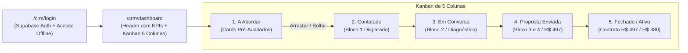

> [[Início|Painel]] › [[Mapa Comercial e CRM|Comercial e CRM]]

# 💻 Sistema CRM Local (`/crm`) e Manual Operacional

> [!abstract] A Ferramenta de Execução e Rotina Diária
> Instalado em **`https://leonardobrasil.com.br/crm`**, o CRM de Prospecção Local foi construído sob uma arquitetura de alto desempenho sem custos de mensalidades externas (React 18 + Supabase Auth & PostgreSQL + TailwindCSS + `@dnd-kit` + `lucide-react` + `react-hot-toast`). Ele foi especialmente projetado para a rotina diária de prospecção cirúrgica via WhatsApp com disparos de 1 clique, cálculo financeiro em tempo real e roteiros dinâmicos.



---

## 1. Acesso, Segurança e Contingência Offline

* **Rota Pública:** `/crm/login`
* **Painel Restrito:** `/crm/dashboard` (protegido pelo componente `CrmProtectedRoute`)
* **Mecanismos de Entrada:**
  1. **Autenticação Cloud:** E-mail e senha gerenciados pelo Supabase Auth;
  2. **Modo Offline Local (Acesso Rápido):** Botão de contingência imediata que armazena `localStorage.setItem("crm_offline_session", "true")`, garantindo acesso total mesmo em instabilidades de rede ou durante manutenções no Supabase.
* **Segurança de Indexação:** Todas as rotas do CRM contêm `<meta name="robots" content="noindex, nofollow" />` e são excluídas da pré-renderização estática do SSR.
* **Versionamento de Leads:** Utilização da chave de armazenamento `crm_prospect_leads_v4` em `crmProspectService.ts`, carregando a base de leads rigorosamente fora do Top 3 (Critério P) com integridade UTF-8 e preservação do estado local do navegador.

---

## 2. O Header Executivo e os Indicadores de Conversão (KPIs)

O topo do CRM exibe um cockpit financeiro e operacional completo em tempo real:

```mermaid
flowchart TD
    subgraph Header Cockpit
        G["🎯 Meta Diária: 5 Abordagens / Dia (Barra de Progresso com % de Conclusão)"]
        F["Filtro Rápido: 'Só WhatsApp Ativo ✓' (Padrão) vs 'Todos os Canais'"]
    end

    subgraph 6 KPIs Financeiros
        K1["Base Ativa: Total de empresas auditadas"]
        K2["Com WhatsApp: Leads prontos para 1 clique"]
        K3["Potencial na Mesa: Valor da carteira em R$ (Ticket R$ 497)"]
        K4["Em Abordagem: Leads em conversa ativa"]
        K5["Em Negociação: Pipeline de propostas enviadas em R$"]
        K6["Receita Fechada: Faturamento acumulado e % de conversão"]
    end

    Header Cockpit --> 6 KPIs Financeiros
```

### O Filtro Inteligente de WhatsApp:
Por padrão, o CRM abre com o botão **`Só WhatsApp Ativo ✓`** ligado. Ele oculta automaticamente empresas com telefone fixo ou números não móveis, permitindo focar 100% da energia matinal nas abordagens instantâneas via WhatsApp. Um clique no botão alterna para **`Todos os Canais`**, trazendo os leads de abordagem receptiva ou presencial.

---

## 3. Cards do Kanban Redesenhados (Design Executivo)

Cada card do pipeline foi ampliado para `310px–330px` com alta densidade de informação visual:
* **Tipografia e Hierarquia:** Nome da empresa em destaque (`15px` bold) com badge de segmento e ícone de canal direto;
* **Badge de Demanda Mensal:** Destacado em Azul Royal (`#3b82f6`) com o volume mensal de buscas daquele nicho na cidade e o status de visibilidade no Maps (ex: `2.400 buscas/mês • Fora do Top 3`);
* **Alerta de Evidência Auditada:** Caixa destacada em Dourado (`#fbbf24`) contendo a falha cadastral ou discrepância factual levantada na auditoria;
* **Ações de 1 Toque:**
  * **Botão Verde WhatsApp:** Abre diretamente a conversa no WhatsApp Web com o número higienizado e a mensagem inicial pré-digitada;
  * **Botão "Ver Roteiro":** Abre a gaveta lateral completa.

---

## 4. A Gaveta Lateral Modular (Drawer de Blocos com Edição ao Vivo)

Ao tocar no botão *"Ver Roteiro"* de qualquer card, a gaveta lateral (`MessageBlocksDrawer.tsx`) oferece:

### 4.1. Alternador Dinâmico de Bloco 1 (Modelo A vs Modelo B)
* **🎯 Modelo A (Demanda & Top 3):**
  > *"Olá, tudo bem? Aqui é o Leonardo Brasil, trabalho com posicionamento de empresas no Google. Só a palavra '[nicho]' tem cerca de [__] buscas por mês na cidade e o perfil da [empresa] ainda não aparece entre os primeiros. Posso te mandar uma análise rápida e gratuita, mostrando o que dá para melhorar?"*
* **🔍 Modelo B (Falha Factual Auditada):**
  > *"Olá, tudo bem? Aqui é o Leonardo Brasil, trabalho com posicionamento de empresas no Google. Estava analisando o perfil da [empresa] em [bairro] pelo Google Maps e notei um detalhe prático: [falha específica auditada]. Posso te mandar uma análise rápida e gratuita, mostrando o que dá para melhorar?"*

### 4.2. Edição ao Vivo nos Blocos 1 a 4
Todos os 4 blocos são exibidos em campos de texto (`<textarea>`) editáveis ao vivo.
* O especialista pode personalizar qualquer frase ou adicionar um detalhe de última hora antes do envio;
* O botão **"Enviar no WhatsApp"** sincroniza automaticamente o texto editado na URL do WhatsApp Web;
* Caso deseje reverter as edições para o roteiro original, o botão **"Restaurar Padrão"** recupera o template inicial instantaneamente.

---

## 5. Rotina Operacional Diária de Prospecção

| Horário | Atividade | Meta Diária |
| :---: | :--- | :--- |
| **09:00 - 09:45** | **Abordagem Inicial (Coluna 1 → Coluna 2):** Com o filtro *"Só WhatsApp Ativo"* ligado, abrir os 5 primeiros cards do topo, revisar o Bloco 1 e disparar no WhatsApp. | 5 novas abordagens / dia |
| **11:30 - 12:00** | **Primeira Rodada de Respostas:** Responder leads que interagiram enviando o Bloco 2 (Diagnóstico). Mover card para *"3. Em Conversa"*. | Follow-up ágil |
| **14:30 - 15:30** | **Apresentação de Solução e Proposta (Coluna 3 → Coluna 4):** Enviar Blocos 3 e 4 para leads qualificados. Agendar conversa de 10 min. | 2 propostas / dia |
| **17:30 - 18:00** | **Fechamento e Atualização:** Registrar pagamentos de R$ 497 em *"5. Fechado"* e salvar notas de observação no card. | 1 a 2 fechamentos / semana |

---

## Conexões Relacionadas
* [[Método de Prospecção Ativa Local]]
* [[Fluxo Modular de Abordagem WhatsApp (4 Blocos)]]
* [[O Framework dos 3 Pilares da Oferta]]
* [[Base de Leads Fora do Top 3 (Rodada 02)]]
* [[Base de 40 Leads Auditados de Porto Alegre|Arquivo: Base de 40 Leads (Rodada 01 Top 3)]]
* [[Branding, Perfil Comercial e Presença Digital]]
* [[Blindagem Cadastral e Proteção contra Suspensões]]
* [[Início|Voltar ao MOC]]
