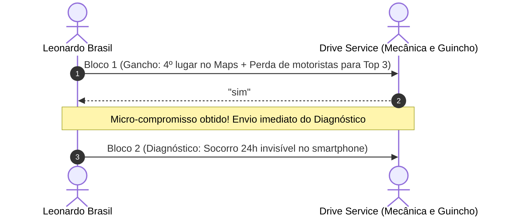

> [[00 - Painel de Interações ao Vivo (2026-11-09)|Painel de Interações]] › [[Base de Leads Fora do Top 3 (Rodada 02)|Leads Rodada 02]] › [[Fluxo Modular de Abordagem WhatsApp (4 Blocos)|Fluxo WhatsApp]]

# 🚙 Ficha de Negociação Ativa: Drive Service - Mecânica e Guincho

---

## 📌 Dados Cadastrais & Diagnóstico Técnico

| Atributo | Detalhe |
| :--- | :--- |
| **ID CRM** | `O-004` |
| **Razão / Nome Fantasia** | **Drive Service - Mecânica e Guincho** |
| **Endereço** | Av. Cavalhada, 3883 - Cavalhada, Porto Alegre - RS |
| **WhatsApp Oficial** | `(51) 98486-3861` • [Abrir no WhatsApp](https://wa.me/5551984863861) |
| **Ficha no Google Maps** | [Ver Perfil no Google Maps](https://www.google.com/maps/search/?api=1&query=Drive+Service+Mecanica+Guincho+Cavalhada+Porto+Alegre) |
| **Site Oficial** | [mecanicadriveservice.com.br](https://mecanicadriveservice.com.br/) |
| **Posição Observada no Maps** | **4º lugar** (Logo fora do Local 3-Pack da Zona Sul) |
| **Palavra-Chave Principal** | *"socorro mecânico na Zona Sul"* (~1.900 buscas/mês) |
| **Gargalo Técnico Principal** | Socorro 24h e Guincho na 4ª posição no Maps; perde chamadas noturnas e emergenciais de motoristas enguiçados para os 3 primeiros colocados |

---

## 💬 Linha do Tempo da Conversa no WhatsApp



### Histórico Registrado:
1. **Leonardo (Bloco 1):**
   > *"Olá, tudo bem? Aqui é o Leonardo Brasil, trabalho com posicionamento de empresas no Google.*  
   > *Estava analisando o perfil da *Drive Service* na Cavalhada pelo Google Maps e notei que vocês estão em 4º lugar nas buscas de socorro mecânico, perdendo motoristas enguiçados na Zona Sul para os 3 primeiros colocados.*  
   > *Posso te mandar uma análise rápida e gratuita, mostrando como subir para o Top 3?"*

2. **Drive Service:**
   > *"sim"*

---

## 🎯 Mensagem Pronta para Copiar e Colar (Próximo Passo)

Como ele autorizou o envio com o *"sim"*, entregar o diagnóstico rápido tocando no socorro noturno e guincho:

```text
Com certeza! Fiz uma checagem rápida no perfil de vocês e separei os 3 pontos principais:

1. *Posição no Maps:* Em 4º lugar, a Drive Service fica fora do bloco de 3 empresas que o Google exibe na tela inicial do celular quando um motorista enguiça na Zona Sul e busca por socorro ou guincho;
2. *Catálogo de Serviços:* Falta de destaque de guincho 24h, troca de bateria e socorro rápido cadastrados como serviços nas abas nativas do perfil;
3. *Blindagem Cadastral:* Perfil sem as categorias secundárias otimizadas de auto socorro e sem proteção contra alterações automáticas do Google.

Com esses ajustes, a oficina passa a disputar diretamente as 3 primeiras posições do eixo Cavalhada / Zona Sul.

Eu faço essa reestruturação e blindagem completa. Quer dar uma olhada em como funciona?
```

---

## 🚀 Mensagens para os Passos Seguintes

### Se ele responder *"Como funciona?"*:
```text
Eu sou especialista em estruturação e posicionamento do *Perfil da Empresa no Google* para oficinas mecânicas e serviços automotivos.

O meu trabalho de **Otimização, Implantação e Blindagem** resolve isso em 4 pilares:

1. *Alinhamento e Canal Direto:* Horários corretos e link oficial de WhatsApp de 1 toque no perfil com mensagem rastreável de contato;
2. *Blindagem Cadastral:* Posse primária garantida no seu e-mail e proteção contra alterações automáticas indevidas do Google ou de concorrentes;
3. *Catálogo de Serviços Automotivos:* Cadastro no Maps das especialidades mais buscadas (guincho 24h, socorro mecânico, freios, suspensão e revisão);
4. *Link Oficial de Avaliações:* Ativação do link direto do Google que abre a tela de 5 estrelas em 1 toque no celular do cliente para acelerar as notas sem burocracia.

Se quiser, já te passo as condições e valores para começarmos. Posso te enviar?
```

### Se ele perguntar *"Quanto custa?"*:
```text
Para fazer a reestruturação completa e colocar a Drive Service na disputa do Top 3 da Zona Sul para socorro e mecânica, o meu trabalho contempla todos os 4 pilares (alinhamento de WhatsApp de 1 toque, blindagem cadastral, catálogo de especialidades e link direto de avaliações 5 estrelas).

💰 *Investimento único:*
* R$ 497,00 à vista (via Pix)
* Ou em 2x de R$ 250,00

O prazo de execução é de 3 a 5 dias úteis.

Se fizer sentido para você, eu já libero o início hoje mesmo. Quer que eu te passe o passo a passo para começarmos?
```
