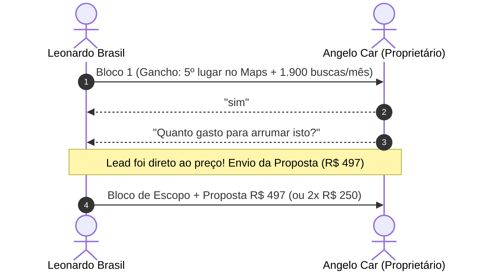

> [[00 - Painel de Interações ao Vivo (2026-11-09)|Painel de Interações]] › [[Base de Leads Fora do Top 3 (Rodada 02)|Leads Rodada 02]] › [[Fluxo Modular de Abordagem WhatsApp (4 Blocos)|Fluxo WhatsApp]]

# 🚗 Ficha de Negociação Ativa: Angelo Car Oficina Mecânica

---

## 📌 Dados Cadastrais & Diagnóstico Técnico

| Atributo | Detalhe |
| :--- | :--- |
| **ID CRM** | `O-005` |
| **Razão / Nome Fantasia** | **Angelo Car Oficina Mecânica** |
| **Endereço** | Av. Vicente Monteggia, 333 - Cavalhada, Porto Alegre - RS |
| **WhatsApp Oficial** | `(51) 98428-1009` • [Abrir no WhatsApp](https://wa.me/5551984281009) |
| **Ficha no Google Maps** | [Ver Perfil no Google Maps](https://www.google.com/maps/search/?api=1&query=Angelo+Car+Mecanica+Vicente+Monteggia+Cavalhada+Porto+Alegre) |
| **Site Oficial** | [angelocarmecanica.com.br](https://angelocarmecanica.com.br/) |
| **Posição Observada no Maps** | **5º lugar** (Fora do Local 3-Pack da Zona Sul) |
| **Palavra-Chave Principal** | *"oficina mecânica na Zona Sul"* (~1.900 buscas/mês) |
| **Gargalo Técnico Principal** | Falta de catálogo de serviços (bateria, freios, revisão) e perfil sem blindagem contra alterações automáticas |

---

## 💬 Linha do Tempo da Conversa no WhatsApp



### Histórico Registrado:
1. **Leonardo (Bloco 1):**
   > *"Olá, tudo bem? Aqui é o Leonardo Brasil, trabalho com posicionamento de empresas no Google.*  
   > *Estava analisando o perfil da *Angelo Car* na Vicente Monteggia pelo Google Maps e notei que vocês estão em 5º lugar nas buscas da Zona Sul, perdendo motoristas para os 3 primeiros colocados da região.*  
   > *Posso te mandar uma análise rápida e gratuita, mostrando como subir para o Top 3?"*

2. **Angelo Car:**
   > *"sim"*

3. **Angelo Car (Logo em seguida):**
   > *"Quanto gasto para arrumar isto?"*

---

## 🎯 Mensagem Pronta para Copiar e Colar (Próximo Passo)

Como o cliente perguntou direto pelo valor, responder de forma transparente com os **4 pilares nativos do Google** e as condições comerciais:

```text
Para fazer a reestruturação completa e colocar a Angelo Car na disputa do Top 3 da Zona Sul, o meu trabalho é estruturado em 4 pilares:

1. *Alinhamento e Canal Direto:* Horários corretos e botão oficial de WhatsApp de 1 toque no perfil com mensagem rastreável;
2. *Blindagem Cadastral:* Posse primária no seu e-mail e proteção contra alterações automáticas do Google ou de concorrentes;
3. *Catálogo de Serviços:* Cadastro no Google das especialidades mais buscadas na região (socorro de bateria, freios, suspensão, revisão);
4. *Link Direto de Avaliações:* Ativação do link oficial do Google que já abre na tela de 5 estrelas no celular do cliente em 1 toque.

💰 *Investimento único:*
* R$ 497,00 à vista (via Pix)
* Ou em 2x de R$ 250,00

O prazo de execução é de 3 a 5 dias úteis.

Se fizer sentido para você, eu já libero o início hoje mesmo. Quer que eu te passe o passo a passo para começarmos?
```

---

## 🚀 Mensagens de Fechamento (Passos Seguintes)

### Quando ele der o aceite (*"Pode ser"*, *"Vamos fazer"*):
```text
Perfeito! Para darmos início:

1. A chave Pix é [Sua Chave Pix Aqui] no valor de R$ 497,00 (ou R$ 250,00 da primeira parcela);
2. Qual é o seu e-mail do Gmail que hoje administra o perfil da oficina no Google?

Assim que você me passar o e-mail, eu envio a solicitação oficial de acesso administrativo pelo painel do Google e começo os ajustes técnicos hoje mesmo!
```

### Se perguntar como funciona o acesso:
```text
É bem simples e seguro: você não precisa me passar sua senha pessoal. Eu apenas solicito acesso de administrador pelo painel oficial do Google Meu Negócio diretamente para o seu e-mail, e você autoriza com um clique. A posse principal continua 100% sua.
```
