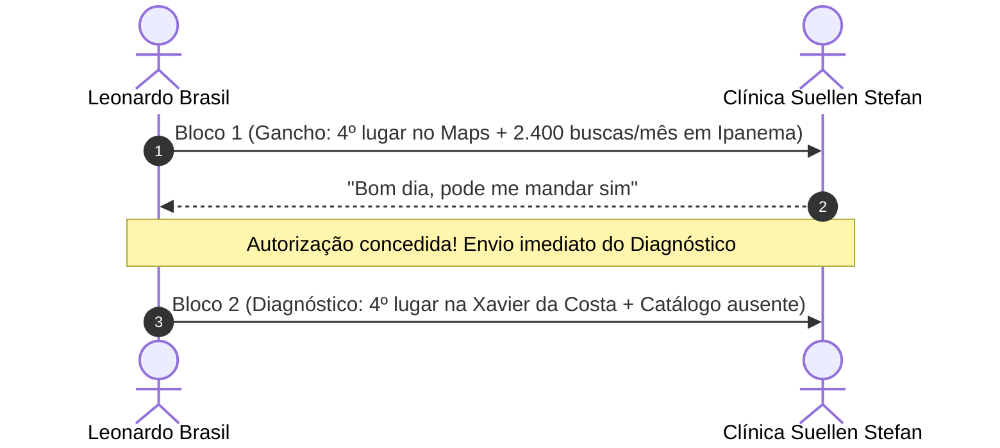

> [[00 - Painel de Interações ao Vivo (2026-11-09)|Painel de Interações]] › [[Base de Leads Fora do Top 3 (Rodada 02)|Leads Rodada 02]] › [[Fluxo Modular de Abordagem WhatsApp (4 Blocos)|Fluxo WhatsApp]]

# 🐾 Ficha de Negociação Ativa: Clínica Veterinária Suellen Stefan

---

## 📌 Dados Cadastrais & Diagnóstico Técnico

| Atributo | Detalhe |
| :--- | :--- |
| **ID CRM** | `V-001` |
| **Razão / Nome Fantasia** | **Clínica Veterinária Suellen Stefan** |
| **Endereço** | R. Conselheiro Xavier da Costa, 2705 - Ipanema, Porto Alegre - RS |
| **WhatsApp Oficial** | `(51) 99145-6761` • [Abrir no WhatsApp](https://wa.me/5551991456761) |
| **Ficha no Google Maps** | [Ver Perfil no Google Maps](https://www.google.com/maps/search/?api=1&query=Cl%C3%ADnica+Veterin%C3%A1ria+Suellen+Stefan+Ipanema+Porto+Alegre) |
| **Canal / Instagram** | [instagram.com/casadubicho](https://instagram.com/casadubicho) |
| **Posição Observada no Maps** | **4º lugar** (Logo abaixo do Local 3-Pack de Ipanema) |
| **Concorrentes no Top 3** | Bem Estar Pet (1º), Ceron (2º), Mania Pet (3º) |
| **Palavra-Chave Principal** | *"veterinária em Ipanema"* (~2.400 buscas/mês) |
| **Gargalo Técnico Principal** | Ocupa a 4ª posição no Maps na Xavier da Costa; tutores que buscam pelo celular veem apenas os 3 primeiros; perfil sem catálogo oficial de especialidades (vacinas, consultas, exames) e sem blindagem contra alterações automáticas |

---

## 💬 Linha do Tempo da Conversa no WhatsApp



### Histórico Registrado:
1. **Leonardo (Bloco 1):**
   > *"Olá, tudo bem? Aqui é o Leonardo Brasil, trabalho com posicionamento de empresas no Google.*  
   > *Só a palavra \"veterinária em Ipanema\" tem cerca de 2.400 buscas por mês na cidade e o perfil da *Clínica Veterinária Suellen Stefan* ainda não aparece entre os 3 primeiros no Google Maps (está atualmente em 4º lugar).*  
   > *Posso te mandar uma análise rápida e gratuita, mostrando o que dá para ajustar para colocar vocês no Top 3?"*

2. **Clínica Suellen Stefan:**
   > *"Bom dia, pode me mandar sim"*

---

## 🎯 Mensagem Pronta para Copiar e Colar (Próximo Passo)

Entregar a análise técnica prometida, mostrando a dor da 4ª colocação na Xavier da Costa / Ipanema:

```text
Com certeza! Fiz uma checagem rápida no perfil da clínica e separei os 3 pontos principais:

1. *Posição no Maps:* Em 4º lugar na Xavier da Costa, a clínica fica logo abaixo do bloco de 3 empresas que o Google exibe na tela inicial do celular quando um tutor de Ipanema busca por atendimento ou vacinas;
2. *Catálogo de Especialidades:* Falta de cadastro dos procedimentos mais buscados (consultas, vacinação, exames e cirurgias) nas abas nativas de serviços e produtos do perfil do Maps;
3. *Blindagem Cadastral:* Perfil sem amarração semântica com o bairro Ipanema e sem proteção contra alterações automáticas indevidas do Google.

Com esses ajustes, a clínica passa a disputar diretamente as 3 primeiras posições de Ipanema, captando os tutores da região que hoje vão para a concorrência.

Eu faço essa reestruturação e blindagem completa. Quer dar uma olhada em como funciona?
```

---

## 🚀 Mensagens para os Passos Seguintes

### Se ela responder *"Como funciona?"*:
```text
Eu sou especialista em estruturação e gestão estratégica do *Perfil da Empresa no Google* para clínicas locais.

O meu trabalho de **Otimização, Implantação e Blindagem** resolve isso em 4 pilares:

1. *Alinhamento e Canal Direto:* Horários corretos e link oficial de WhatsApp de 1 toque no perfil com mensagem rastreável de contato;
2. *Blindagem e Reivindicação:* Posse primária garantida no seu e-mail e proteção contra alterações automáticas do Google ou sugestões de concorrentes;
3. *Catálogo de Especialidades:* Inclusão dos serviços e procedimentos mais procurados para alavancar a clínica até o Top 3;
4. *Link Oficial de Avaliações:* Ativação do link direto do Google que abre a tela de 5 estrelas em 1 toque no celular do tutor para acelerar as notas sem burocracia.

Se fizer sentido, já posso te passar as condições e valores para começarmos. Posso te enviar?
```

### Se ela perguntar *"Quanto custa?"*:
```text
Para fazer a reestruturação completa e colocar a clínica no Top 3 do Google Maps em Ipanema, o meu trabalho contempla todos os 4 pilares (alinhamento de WhatsApp de 1 toque, blindagem cadastral, catálogo completo de especialidades e ativação do link direto de 5 estrelas).

💰 *Investimento único:*
* R$ 497,00 à vista (via Pix)
* Ou em 2x de R$ 250,00

O prazo de execução é de 3 a 5 dias úteis para deixar tudo pronto e blindado.

Se fizer sentido para você, eu já libero o início hoje mesmo. Quer que eu te passe o passo a passo para começarmos?
```

### Quando ela fechar:
```text
Perfeito! Para darmos início:

1. A chave Pix é [Sua Chave Pix Aqui] no valor de R$ 497,00 (ou R$ 250,00 da primeira parcela);
2. Qual é o e-mail do Gmail que hoje administra o perfil da clínica no Google?

Assim que você me passar o e-mail, eu envio a solicitação oficial de acesso administrativo pelo painel do Google e começo os ajustes técnicos hoje mesmo!
```
