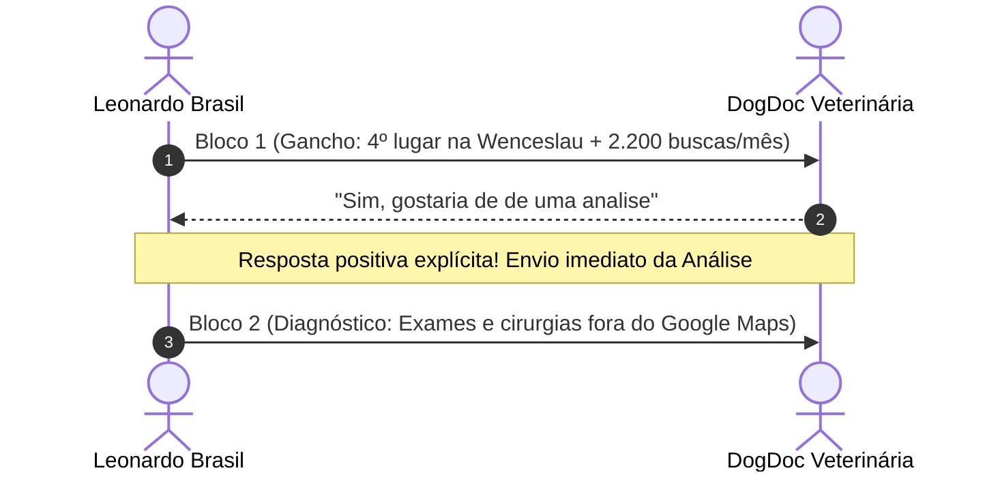

> [[00 - Painel de Interações ao Vivo (2026-11-09)|Painel de Interações]] › [[Base de Leads Fora do Top 3 (Rodada 02)|Leads Rodada 02]] › [[Fluxo Modular de Abordagem WhatsApp (4 Blocos)|Fluxo WhatsApp]]

# 🐾 Ficha de Negociação Ativa: DogDoc Veterinária e Petshop

---

## 📌 Dados Cadastrais & Diagnóstico Técnico

| Atributo | Detalhe |
| :--- | :--- |
| **ID CRM** | `V-003` |
| **Razão / Nome Fantasia** | **DogDoc Veterinária e Petshop** |
| **Endereço** | Av. Wenceslau Escobar, 1615 - Tristeza, Porto Alegre - RS |
| **WhatsApp Oficial** | `(51) 99978-6295` • [Abrir no WhatsApp](https://wa.me/5551999786295) |
| **Ficha no Google Maps** | [Ver Perfil no Google Maps](https://www.google.com/maps/search/?api=1&query=DogDoc+Veterin%C3%A1ria+Wenceslau+Escobar+Tristeza+Porto+Alegre) |
| **Site Oficial** | [dogdoc.com.br](https://dogdoc.com.br/) |
| **Posição Observada no Maps** | **4º lugar** (Fora do Local 3-Pack da Tristeza) |
| **Concorrentes no Top 3** | VidaPet (1º), Dr. Bigodes (2º), Natural Dog Cat (3º) |
| **Palavra-Chave Principal** | *"veterinária na Tristeza"* (~2.200 buscas/mês) |
| **Gargalo Técnico Principal** | Perfil sem catálogo de procedimentos e exames nas abas nativas; ausência de link de WhatsApp direto rastreável; fora do bloco de 3 empresas que os tutores visualizam no smartphone |

---

## 💬 Linha do Tempo da Conversa no WhatsApp



### Histórico Registrado:
1. **Leonardo (Bloco 1):**
   > *"Olá, tudo bem? Aqui é o Leonardo Brasil, trabalho com posicionamento de empresas no Google.*  
   > *Só a palavra \"veterinária na Tristeza\" tem cerca de 2.200 buscas por mês na cidade e o perfil da *DogDoc Veterinária* ainda não aparece entre os 3 primeiros no Google Maps (está atualmente em 4º lugar).*  
   > *Posso te mandar uma análise rápida e gratuita, mostrando o que dá para ajustar para colocar vocês no Top 3?"*

2. **DogDoc Veterinária:**
   > *"Sim, gostaria de de uma analise"*

---

## 🎯 Mensagem Pronta para Copiar e Colar (Próximo Passo)

Entregar a análise técnica prometida, mostrando exatamente onde a clínica perde espaço para VidaPet e Dr. Bigodes:

```text
Com certeza! Fiz uma checagem rápida no perfil da DogDoc e separei os 3 pontos principais:

1. *Posição no Maps:* Em 4º lugar na Tristeza, a DogDoc fica logo abaixo do bloco de 3 empresas que o Google exibe na tela inicial do celular quando um tutor busca por veterinária ou vacinas na região;
2. *Catálogo de Especialidades:* O site de vocês tem serviços completos de consultas, exames e cirurgias, mas isso não está cadastrado nas abas oficiais de serviços e produtos do perfil do Google Maps;
3. *Blindagem Cadastral:* Perfil sem amarração de categorias secundárias de atendimento veterinário e sem proteção contra alterações automáticas do Google.

Com esses ajustes, a clínica sobe diretamente para o Top 3 da Wenceslau Escobar, passando a receber os contatos que hoje vão para a concorrência.

Eu faço essa reestruturação e blindagem completa. Quer dar uma olhada em como funciona?
```

---

## 🚀 Mensagens para os Passos Seguintes

### Se ela responder *"Como funciona?"*:
```text
Eu sou especialista em estruturação e gestão estratégica do *Perfil da Empresa no Google* para clínicas locais.

O meu trabalho de **Otimização, Implantação e Blindagem** resolve isso em 4 pilares:

1. *Alinhamento e Canal Direto:* Horários corretos e link oficial de WhatsApp de 1 toque no perfil com mensagem rastreável de contato;
2. *Blindagem e Reivindicação:* Posse primária garantida no seu e-mail e proteção contra alterações automáticas do Google ou sugestões de terceiros;
3. *Catálogo de Especialidades:* Inclusão dos serviços, vacinas e exames mais buscados para alavancar a DogDoc até o Top 3;
4. *Link Oficial de Avaliações:* Ativação do link direto do Google que abre a tela de 5 estrelas em 1 toque no celular do tutor para acelerar as avaliações sem burocracia.

Se fizer sentido, já posso te passar as condições e valores para começarmos. Posso te enviar?
```

### Se ela perguntar *"Quanto custa?"*:
```text
Para fazer a reestruturação completa e colocar a DogDoc no Top 3 do Google Maps na Tristeza, o meu trabalho contempla todos os 4 pilares (alinhamento de WhatsApp de 1 toque, blindagem cadastral, catálogo completo de procedimentos e ativação do link direto de 5 estrelas).

💰 *Investimento único:*
* R$ 497,00 à vista (via Pix)
* Ou em 2x de R$ 250,00

O prazo de execução é de 3 a 5 dias úteis para deixar tudo pronto e blindado.

Se fizer sentido para você, eu já libero o início hoje mesmo. Quer que eu te passe o passo a passo para começarmos?
```
