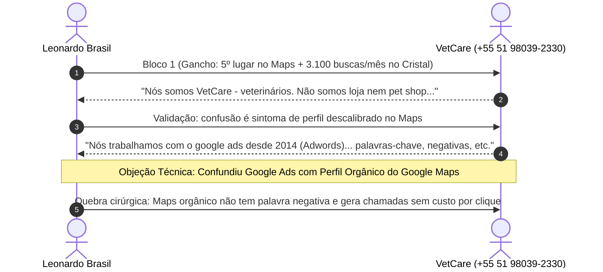

> [[00 - Painel de Interações ao Vivo (2026-11-09)|Painel de Interações]] › [[Base de Leads Fora do Top 3 (Rodada 03)|Leads Rodada 03]] › [[Fluxo Modular de Abordagem WhatsApp (4 Blocos)|Fluxo WhatsApp]]

# 🩺 Ficha de Negociação Ativa: VetCare Atendimento Veterinário

---

## 📌 Dados Cadastrais & Diagnóstico Técnico

| Atributo | Detalhe |
| :--- | :--- |
| **ID CRM** | `V-012` |
| **Razão / Nome Fantasia** | **VetCare - Atendimento Veterinário** |
| **Endereço** | R. Dr. Campos Velho, 820 - Cristal, Porto Alegre - RS |
| **WhatsApp Oficial** | `(51) 98039-2330` • [Abrir no WhatsApp](https://wa.me/5551980392330) |
| **Posição Observada no Maps** | **5º lugar** (Fora do Local 3-Pack do Cristal) |
| **Palavra-Chave Principal** | *"veterinária no Cristal"* (~3.100 buscas/mês) |
| **Grande Dor Identificada** | **Confusão de Posicionamento:** O perfil é confundido por tutores e pelo algoritmo com pet shop / loja de produtos, quando na realidade é uma equipe médica veterinária de consultas e atendimento clínico. |
| **Objeção Avançada Levantada** | *"Nós trabalhamos com o google ads desde 2014, quando ainda era Google adwords. Então estas questões de palavras-chave, palavras negativas, região demográfica de atendimento, perfil de público-alvo, etc a gente já faz a bastante tempo."* |

---

## 💬 Linha do Tempo da Conversa no WhatsApp



### Histórico Registrado:
1. **Leonardo:** Abordagem inicial (3.100 buscas no Cristal, 5º lugar no Maps).
2. **VetCare:** *"Olá. Nós somos VetCare - veterinários. Não somos loja veterinária ( não vendemos produtos) e não é Pet Care mas VET Care. Não confundir com pet shop."*
3. **Leonardo:** Explicou que a confusão de ser chamado para comprar ração/produtos decorre do perfil não estar amarrado com categoria médica e catálogo nativo, e que isso joga tutores de consulta médica para os 3 primeiros colocados do Maps.
4. **VetCare (Objeção Técnica):**  
   > *"Oi Leonardo, Nós trabalhamos com o google ads desde 2014, quando ainda era Google adwords. Então estas questões de palavras-chave, palavras negativas, região demográfica de atendimento, perfil de público-alvo, etc a gente já faz a bastante tempo."*

---

## 🎯 Análise Estratégica da Objeção: Google Ads vs Google Maps Orgânico

1. **Reconhecimento de Autoridade:** O cliente é instruído e anuncia há mais de 10 anos. Não pode ser tratado como leigo básico.
2. **O Ponto Cego Técnico:**
   - No **Google Ads**, você compra cliques em leilão e usa palavras negativas na rede de pesquisa.
   - No **Google Maps (Perfil da Empresa / Local 3-Pack)**, **não existe palavra negativa**. O algoritmo do Maps lê exclusivamente a **categoria primária**, **categorias secundárias** e o **catálogo médico nativo** do perfil.
   - Ter campanha de Google Ads ativa **não blinda a ficha orgânica do Maps** contra a confusão com pet shop nem garante as 3 primeiras posições no mapa.
3. **Sinergia Financeira:**
   - O Google Maps orgânico gera rotas, ligações e mensagens **sem nenhum custo por clique (gratuito e permanente)**.
   - Além disso, um Perfil da Empresa perfeitamente categorizado melhora o Ad Rank local e **diminui o custo por clique do próprio Google Ads** que a VetCare já paga!

---

## 🚀 Mensagem Pronta para Envio (WhatsApp)

```text
Sensacional saber disso! Quem anuncia no Google desde 2014, na época do AdWords, tem uma bagagem e maturidade que menos de 1% das clínicas locais têm. Parabéns pela consistência!

E é justamente por você entender o funcionamento do Google que vai ficar muito fácil enxergar o que está acontecendo:

O trabalho de *Google Ads (Tráfego Pago)* e a *Otimização do Perfil da Empresa no Google Maps (Orgânico)* rodam sob regras e algoritmos completamente diferentes:

1. *No Google Maps orgânico NÃO EXISTE palavra negativa:* O mapa não tem campo de negativas. O robô do Maps decide quem exibe e para quem exibe baseado estritamente na árvore de categorias da ficha e no catálogo médico cadastrado. Por isso vocês continuam sendo procurados como pet shop e aparecem em 5º lugar no mapa, mesmo rodando Ads há 10 anos;

2. *Custo por Clique vs Posição Perpétua:* No Google Ads, cada clique de tutor custa dinheiro e só aparece enquanto a campanha estiver rodando verba diária. Já no *Top 3 do Google Maps*, as chamadas, rotas e mensagens são *100% gratuitas e permanentes*, 24h por dia;

3. *Sinergia com o seu Ads:* Quando a ficha do Maps está calibrada como autoridade médica, o Google aumenta o índice de relevância local da VetCare e isso inclusive *reduz o custo por clique (CPC)* das suas campanhas pagas.

Ou seja: eu não mexo no tráfego pago de vocês (que vocês já dominam muito bem). O meu foco é colocar a ficha da VetCare no *Top 3 do Maps orgânico*, para vocês pararem de perder consultas gratuitas para os 3 concorrentes da região.

Posso te apontar os 3 campos cadastrais do Maps que hoje estão gerando essa confusão de pet shop?
```
