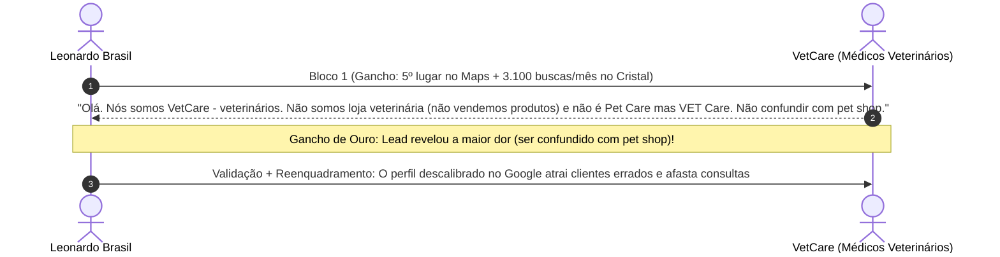

> [[00 - Painel de Interações ao Vivo (2026-11-09)|Painel de Interações]] › [[Base de Leads Fora do Top 3 (Rodada 03)|Leads Rodada 03]] › [[Fluxo Modular de Abordagem WhatsApp (4 Blocos)|Fluxo WhatsApp]]

# 🐾 Ficha de Negociação Ativa: VetCare Atendimento Veterinário

---

## 📌 Dados Cadastrais & Diagnóstico Técnico

| Atributo | Detalhe |
| :--- | :--- |
| **ID CRM** | `V-012` |
| **Razão / Nome Fantasia** | **VetCare - Atendimento Veterinário** |
| **Endereço** | R. Dr. Campos Velho, 820 - Cristal, Porto Alegre - RS |
| **WhatsApp Oficial** | `(51) 98039-2330` • [Abrir no WhatsApp](https://wa.me/5551980392330) |
| **Posição Observada no Maps** | **5º lugar** (Fora do Local 3-Pack do Cristal) |
| **Palavra-Chave Principal** | *"veterinária no Cristal"* (~3.100 buscas/mês) |
| **Grande Dor Identificada** | **Confusão de Posicionamento:** O perfil é confundido por tutores e pelo algoritmo com pet shop / loja de produtos, quando na realidade é uma equipe médica veterinária de consultas e atendimento clínico. Falta de categorias médicas e catálogo de serviços. |

---

## 💬 Linha do Tempo da Conversa no WhatsApp



### Histórico Registrado:
1. **Leonardo (Bloco 1):**
   > *"Olá, tudo bem? Aqui é o Leonardo Brasil, trabalho com posicionamento de empresas no Google.*  
   > *Só a palavra \"veterinária no Cristal\" tem cerca de 3.100 buscas por mês na região e o perfil da Pet Care Veterinária na Campos Velho ainda não aparece entre os 3 primeiros no Google Maps (está atualmente em 5º lugar).*  
   > *Posso te mandar uma análise rápida e gratuita, mostrando o que dá para ajustar para colocar vocês no Top 3?"*

2. **VetCare (Correção de Posicionamento & Dor Real):**
   > *"Olá. Nós somos VetCare - veterinários. Não somos loja veterinária ( não vendemos produtos) e não é Pet Care mas VET Care. Não confundir com pet shop."*

---

## 🎯 Quebra de Objeção & Ponte Comercial (Copiar e Colar no WhatsApp)

Esta correção é a **melhor oportunidade possível**. O cliente odeia ser confundido com pet shop.  
A resposta deve:
1. **Agradecer a correção e pedir desculpas pelo nome com humildade e respeito profissional**;
2. **Reenquadrar o problema**: essa confusão acontece justamente porque o perfil no Google Maps está com as categorias genéricas descalibradas, atraindo quem quer ração/produtos em vez de quem precisa de **consultas médicas veterinárias**;
3. **Apresentar a solução dos 4 pilares**: blindar como médicos veterinários clínicos, retirar tags de loja e cadastrar catálogo de consultas e procedimentos;
4. **Fazer o convite para a análise gratuita**.

```text
Perfeito! Muito obrigado pela correção e peço desculpas pela confusão no nome.

E você tocou exatamente no ponto central da questão: essa confusão é o maior sintoma de um perfil descalibrado no Google.

Quando as categorias do Perfil da Empresa não estão amarradas como atendimento médico veterinário clínico, o algoritmo do Google e os tutores acabam confundindo vocês com pet shop ou loja. Isso gera dois prejuízos:
1. Pessoas chamando querendo comprar ração ou produtos;
2. E o pior: tutores que estão buscando *médico veterinário no Cristal* acabam caindo nas 3 clínicas do topo do Maps, porque o Google não entende a autoridade médica da VetCare.

O meu trabalho de reestruturação resolve exatamente isso:
- Ajusta a categoria primária exclusiva para *Médico Veterinário / Clínica Veterinária*;
- Remove qualquer associação errada com comércio de produtos ou pet shop;
- Cadastra o catálogo oficial das especialidades e consultas de vocês;
- Posiciona a VetCare no Top 3 para quem busca atendimento clínico de verdade.

Posso te mandar os pontos que precisam ser ajustados no perfil do Google para acabar de vez com essa confusão e focar só em atrair pacientes para consultas?
```
