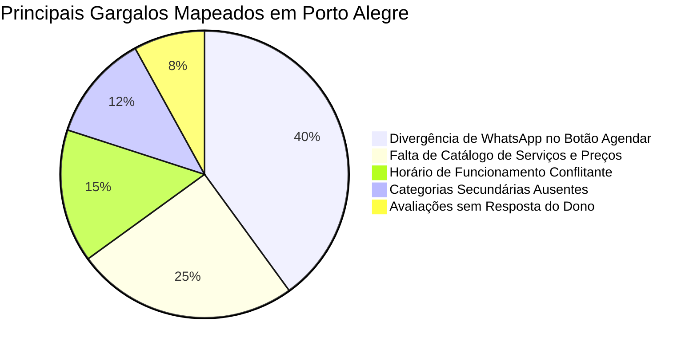

# 🏙️ Base de Diagnósticos Locais de Porto Alegre

O arquivo [`src/pages/crm/data/initialProspects.ts`](file:///d:/LEONARDO/Drive/Projetos/leonardo-brasil/src/pages/crm/data/initialProspects.ts) contém um mapeamento inicial de **28 empresas reais** da Zona Sul e bairros nobres de Porto Alegre (Ipanema, Tristeza, Vila Assunção, Cristal, Menino Deus, Moinhos de Vento), com inconsistências de dados previamente auditadas.

---

## 1. Amostra de Oportunidades Mapeadas no CRM

| Empresa | Nicho | Bairro | Gargalo Crítico Identificado |
| :--- | :--- | :--- | :--- |
| **Odontik Odontologia** | Odontologia | Tristeza | Campo de telefone exibe número fixo, enquanto campo Website aponta para WhatsApp de outro número, omitindo o domínio oficial. |
| **Yurgel Odontologia** | Odontologia | Ipanema | Bio do Instagram aponta endereço na Av. Tramandaí com link WhatsApp diferente, sem horários no perfil para bater com "Aberto 24 horas". |
| **Dontoclin Ipanema** | Odontologia | Ipanema | Divergência de número de WhatsApp: perfil exibe um celular, mas botão "Agendar Online" aponta para outro número totalmente diferente. |
| **Clínica Veterinária Vets** | Veterinária | Vila Assunção | Botão "Agendar Online" aponta para celular, enquanto a bio do Instagram oficial anuncia link de WhatsApp sobre o número fixo. |
| **Pet Support Zona Sul** | Veterinária | Cristal | Botão "Agendar Online" no Google aponta para um WhatsApp secundário, enquanto o site oficial exibe outro contato principal. |
| **Centro Odontológico RP** | Odontologia | Cristal | Divergência de dígito 9 no número de celular anunciado no Maps versus link do Instagram. |
| **Clínica Clara Vita** | Odontologia | Cristal | Site oficial em "Estamos finalizando os detalhes", sem horários nem serviços listados no Google Maps. |

---

## 2. Padrões Mais Recorrentes de Gargalo Encontrados

1. **Botão de Agendamento que cai em atendente antigo:** Muito comum quando a empresa troca de secretária ou de linha telefônica e esquece de atualizar o link direto de agendamento do Google Meu Negócio.
2. **Perfis categorizados de forma pobre:** Clínicas com cirurgiões renomados aparecendo apenas como "Consultório Médico" ou "Dentista", perdendo buscas de pacientes particulares de alto ticket que procuram "Implante Dentário" ou "Invisalign".

---

## Conexões Relacionadas
* [[Scripts e Roteiros de Abordagem WhatsApp]]
* [[Manual Operacional do CRM]]
* [[Sistema CRM de Prospecção Local]]
* [[00 - MOC - Índice Geral|Voltar ao MOC]]
