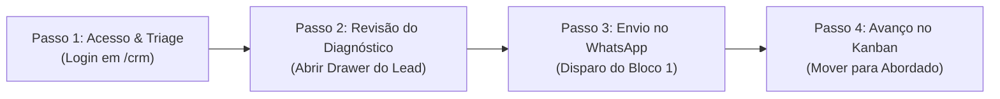

# 📖 Manual Operacional do CRM

Este manual estabelece o **protocolo diário de prospecção ativa** de Leonardo Brasil para manter um fluxo constante de novos clientes fechados toda semana.

---

## 1. Rotina Diária em 4 Passos

### Passo 1: Acesso ao Painel
* Acessar `https://leonardobrasil.com.br/crm`.
* Autenticar-se com as credenciais administrativas.
* Visualizar os leads na coluna **"Identificados"** ou **"Qualificados"**.

### Passo 2: Análise da Oportunidade
* Clicar no card do lead para abrir a **Gaveta Lateral de Abordagem**.
* Revisar o campo **"Diagnóstico Prático do Perfil"**:
  * Qual é a inconsistência exata? (ex: divergência entre o número de WhatsApp no perfil e o número no Instagram; falta de horário de funcionamento; categoria incorreta).

### Passo 3: Envio da Mensagem no WhatsApp
* Na gaveta, clicar em **"Abrir WhatsApp com Bloco 1"**.
* O WhatsApp Web / Desktop abrirá diretamente na conversa com o responsável, com a mensagem introdutória pronta.
* Se preferir copiar para ajustar uma palavra, clicar em **"Copiar Bloco 1"**.

### Passo 4: Atualização no Pipeline
* Arrastar o card do lead para a coluna **"Abordado"**.
* Registrar a data de envio.
* Se o cliente responder com interesse, enviar o **Bloco 2** (análise aprofundada) e mover o card para **"Em Negociação"**.

---

## 2. Métricas e Metas Semanais Recomendadas

| Métrica | Meta Diária | Meta Semanal |
| :--- | :--- | :--- |
| **Novos Leads Qualificados** | 5 leads | 25 leads |
| **Primeiras Mensagens Enviadas (Bloco 1)** | 5 disparos | 25 disparos |
| **Taxa Média de Resposta** | ~30% a 40% | 8 a 10 conversas ativas |
| **Propostas Apresentadas (Bloco 3 / Áudio)** | 1 a 2 propostas | 5 a 8 propostas |
| **Contratos Fechados** | — | **1 a 3 clientes / semana** |

---

## Conexões Relacionadas
* [[Sistema CRM de Prospecção Local]]
* [[Pipeline e Estágios do Kanban]]
* [[Scripts e Roteiros de Abordagem WhatsApp]]
* [[00 - MOC - Índice Geral|Voltar ao MOC]]
