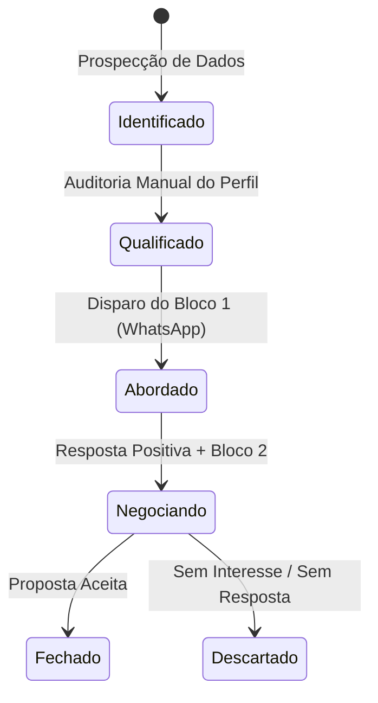

# 🪜 Pipeline e Estágios do Kanban

O pipeline comercial em `/crm` estrutura o ciclo de vida de cada oportunidade de consultoria em 6 colunas sequenciais bem delineadas.

---

## 1. Mapeamento das Colunas

### 1. `identificado` — Lead Identificado
* **Definição:** A empresa foi mapeada em uma determinada cidade/bairro com dados básicos coletados (nome, nicho, telefone público).
* **Critério de Saída:** O perfil no Google Maps foi inspecionado visualmente e um gargalo real foi detectado.

### 2. `qualificado` — Lead Qualificado
* **Definição:** O gargalo foi formalizado em um diagnóstico técnico (ex: divergência de NAP, falta de catálogo, avaliações sem resposta há mais de 3 meses). Os 3 blocos de abordagem foram gerados.
* **Critério de Saída:** Envio do primeiro contato via WhatsApp (Bloco 1).

### 3. `abordado` — Primeiro Contato Enviado
* **Definição:** A mensagem do Bloco 1 foi enviada ao WhatsApp oficial ou do decisor da empresa. O lead está aguardando retorno.
* **Critério de Saída:** O lead responde positivamente (*"Olá, vi sim! O que você notou?"*) ou visualiza sem responder por mais de 5 dias (follow-up).

### 4. `negociando` — Em Conversa / Negociação
* **Definição:** O cliente engajou na conversa. Foi enviado o Bloco 2 com a explicação detalhada do problema e/ou um áudio personalizado de Leonardo Brasil demonstrando a oportunidade de vendas no Top 3 do Maps.
* **Critério de Saída:** Apresentação formal do investimento único da consultoria e fechamento de contrato.

### 5. `fechado` — Cliente Conquistado 🏆
* **Definição:** Proposta aceita, pagamento confirmado e acesso concedido ao Perfil da Empresa no Google (via papel de Administrador/Gerente) para início da otimização cirúrgica.

### 6. `descartado` — Descartado / Sem Fit
* **Definição:** O contato não respondeu após 2 follow-ups, a empresa fechou as portas ou o perfil já se encontra 100% otimizado e bem gerenciado.

---

## Conexões Relacionadas
* [[Sistema CRM de Prospecção Local]]
* [[Manual Operacional do CRM]]
* [[Scripts e Roteiros de Abordagem WhatsApp]]
* [[00 - MOC - Índice Geral|Voltar ao MOC]]
