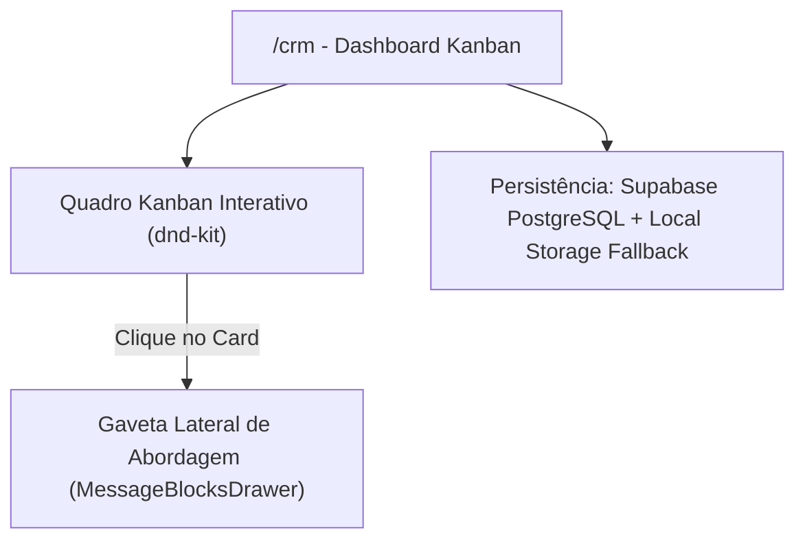

# 📊 Sistema CRM de Prospecção Local

* **Rota Interna Protegida:** [`/crm`](https://leonardobrasil.com.br/crm)
* **Arquivos do Módulo:** [`src/pages/crm/`](file:///d:/LEONARDO/Drive/Projetos/leonardo-brasil/src/pages/crm/)
* **Objetivo de Negócio:** Centralizar e automatizar a prospecção ativa de empresas locais de alto potencial com base em diagnósticos reais de gargalos no Google Maps.

---

## 1. Visão Geral da Arquitetura do CRM

O CRM foi construído de forma nativa e leve dentro do próprio projeto, sem custos de ferramentas terceiras:

### Funcionalidades Centrais:
1. **Quadro Kanban com Drag and Drop:** Arraste e solte fluido entre colunas de status utilizando `@dnd-kit/core`.
2. **Filtros Dinâmicos:** Filtro instantâneo por nicho (`odontologia`, `veterinaria`, etc.), por bairro/cidade e por termo de busca no nome da empresa.
3. **Gaveta Lateral de Abordagem (Drawer):** Ao clicar em qualquer lead, abre-se uma gaveta com a auditoria detalhada do perfil daquela empresa e os 3 blocos de mensagem de WhatsApp pré-redigidos.
4. **Disparo em 1 Clique para WhatsApp:** Botão que abre a conversa com o número do lead já contendo o texto formatado.

---

## Conexões Relacionadas
* [[Manual Operacional do CRM]]
* [[Pipeline e Estágios do Kanban]]
* [[Scripts e Roteiros de Abordagem WhatsApp]]
* [[Base de Diagnósticos Locais de Porto Alegre]]
* [[00 - MOC - Índice Geral|Voltar ao MOC]]
