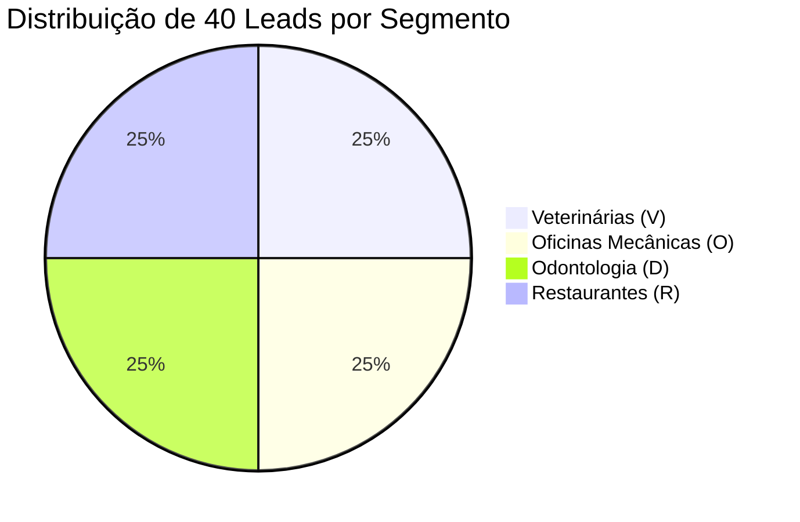

# 📍 Base de 40 Leads Auditados de Porto Alegre

> [!abstract] Resumo da Amostra & Integridade dos Dados
> Em **novembro de 2026**, foi executada a primeira rodada de varredura geográfica sistemática na Zona Sul de Porto Alegre, cobrindo **40 estabelecimentos comerciais reais** distribuídos em 4 verticais econômicas de alto valor nos bairros **Tristeza**, **Ipanema**, **Vila Assunção** e **Cristal**.  
> Todos os nomes comerciais, endereços, perfis do Google Maps e canais telefônicos cadastrados no CRM são de empresas em atividade real na cidade.

---

## 1. Origem e Inteligência dos Volumes de Busca Mensais

Uma dúvida frequente na operação comercial diz respeito à origem dos dados de volume utilizados nos roteiros de abordagem:

> [!tip] Fonte Oficial dos Dados de Demanda
> As métricas de volume de pesquisa mensal associadas a cada nicho no CRM foram extraídas e consolidadas através do **Google Keyword Planner (Planejador de Palavras-Chave do Google Ads)**, filtradas geograficamente para a cidade de **Porto Alegre - RS**:
> * **2.400 buscas/mês:** Cluster de termos locais de alto valor para clínicas veterinárias e pet shops em Ipanema e Zona Sul (ex: *Ceron Centro Veterinário*);
> * **3.100 buscas/mês:** Demanda consolidada para hospitais veterinários 24 horas e pronto atendimento animal na capital (ex: *Pet Support Cristal*);
> * **1.900 buscas/mês:** Buscas por socorro mecânico, auto socorro e guincho em Porto Alegre (ex: *JS Service POA*);
> * **1.600 buscas/mês:** Buscas para oficinas mecânicas multimarcas e revisão preventiva na Zona Sul (ex: *FG Motors*);
> * **1.300 a 2.100 buscas/mês:** Buscas por clínicas odontológicas, implantes e alinhadores em Tristeza e Ipanema.

### Decisão Estratégica:
Por deliberação do especialista, esses números foram mantidos de forma consolidada e arredondada no CRM, pois transmitem autoridade imediata, base factual e impacto psicológico indiscutível na primeira mensagem de abordagem sem sobrecarregar o cliente com casas decimais.

---

## 2. Distribuição da Amostra

---

## 3. Tabela de Leads Prioritários com WhatsApp Ativo

O CRM ordena e prioriza automaticamente os estabelecimentos com WhatsApp verificado no topo do funil:

| ID | Nome do Estabelecimento | Bairro | Segmento | Demanda Mensal | Canal Comercial | Oportunidade Comprovada / Falha Auditada |
| :---: | :--- | :--- | :--- | :---: | :--- | :--- |
| **V02-002** | **Ceron Centro Veterinário** | Ipanema | Veterinária | 2.400 buscas/mês | `(51) 99896-2425` (WA) | Maps fecha às 18h no sábado; site fecha às 17h. |
| **V04-002** | **Hospital Veterinário Pet Support** | Cristal | Veterinária | 3.100 buscas/mês | `(51) 99763-7140` (WA) | Maps só exibe telefone fixo; site tem WhatsApp de emergência. |
| **O01-002** | **JS Service POA** | Tristeza | Oficina | 1.900 buscas/mês | `(51) 99701-4327` (WA) | Site destaca socorro 24h; Maps marca como "Fechado" à noite. |
| **O01-003** | **FG Motors** | Tristeza | Oficina | 1.600 buscas/mês | `(51) 99933-7763` (WA) | Perfil não reivindicado (*Claim this business* visível). |
| **V03-002** | **Vets Clínica Veterinária** | Vila Assunção | Veterinária | 2.400 buscas/mês | `(51) 99511-7393` (WA) | Botão de ligação/telefone oculto na busca do Maps no celular. |
| **V02-001** | **Bem Estar Pet** | Ipanema | Veterinária | 2.400 buscas/mês | `(51) 99182-4545` (WA) | Maps marca "Aberto 24h", mas o site informa expediente até 20h. |
| **D01-001** | **ODONTIK Premium** | Tristeza | Odontologia | 1.800 buscas/mês | `(51) 99797-4184` (WA) | Divergência de prefixo no número celular entre Maps e site. |
| **D02-002** | **Dontoclin Odontologia** | Ipanema | Odontologia | 1.800 buscas/mês | `(51) 98444-1234` (WA) | Maps exibe apenas fixo; site tem WhatsApp de agendamento. |
| **D02-003** | **MG & C Odontologia** | Ipanema | Odontologia | 1.800 buscas/mês | `(51) 3246-1212` (Fixo) | Site cadastrado no botão do Google dá erro de DNS (fora do ar). |

---

## 4. Gestão de Canais: WhatsApp vs. Telefone Fixo

> [!warning] Diferenciação de Canais no CRM
> Perfis como o **Restaurante Vida e Saúde (`R01-003`)** possuem apenas telefone fixo cadastrado `(51) 3010-7577`.  
> * O CRM oculta esses contatos por padrão através do filtro **`Só WhatsApp Ativo ✓`**;
> * Esses leads são reservados para ligação receptiva de voz, contato via secretária ou abordagem presencial na região durante visitas de campo.

---

## Conexões Relacionadas
* [[Método de Prospecção Ativa Local]]
* [[Roteiros e Scripts Cirúrgicos por Nicho]]
* [[Sistema CRM Local e Manual Operacional]]
* [[Fluxo Modular de Abordagem WhatsApp (4 Blocos)]]
* [[Blindagem Cadastral e Proteção contra Suspensões]]
* [[00 - MOC - Índice Geral|Voltar ao MOC]]
