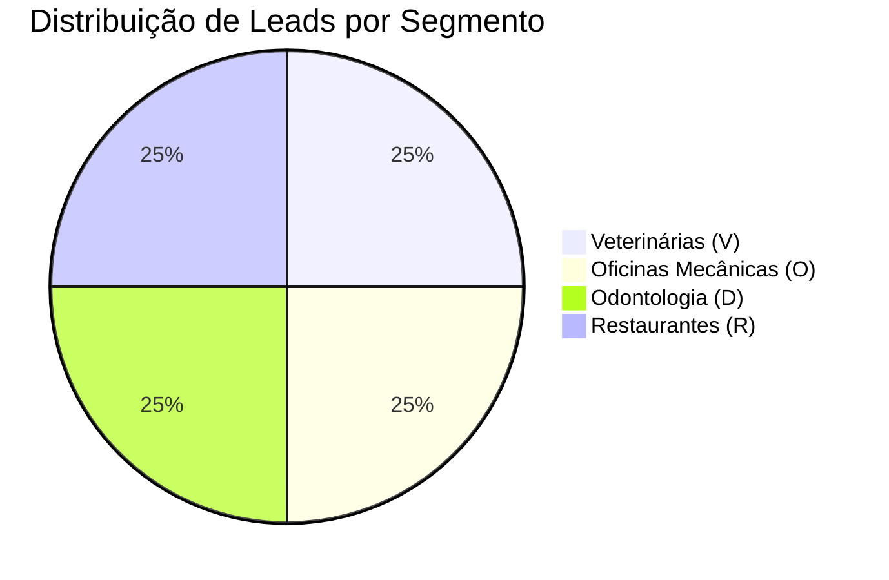

# 📍 Base de 40 Leads Auditados de Porto Alegre

> [!abstract] Resumo da Amostra
> Em **07/11/2026**, foi executada a primeira rodada de varredura geográfica sistemática na Zona Sul de Porto Alegre, cobrindo **40 estabelecimentos comerciais reais** distribuídos em 4 verticais econômicas de alto valor nos bairros **Tristeza**, **Ipanema**, **Vila Assunção** e **Cristal**.

---

## 1. Distribuição da Amostra

---

## 2. Tabela de Leads Prioritários (Classe B e C com Oportunidades Comprovadas)

| ID | Nome do Estabelecimento | Bairro | Segmento | Canal Comercial | Oportunidade Comprovada / Gancho Real |
| :---: | :--- | :--- | :--- | :--- | :--- |
| **V02-002** | **Ceron Centro Veterinário** | Ipanema | Veterinária | `(51) 99896-2425` (WA) | Maps fecha às 18h no sábado; site fecha às 17h. |
| **V04-002** | **Hospital Veterinário Pet Support** | Cristal | Veterinária | `(51) 99763-7140` (WA) | Maps só exibe telefone fixo; site tem WhatsApp de emergência. |
| **O01-002** | **JS Service POA** | Tristeza | Oficina | `(51) 99701-4327` (WA) | Site destaca socorro 24h; Maps marca como "Fechado" à noite. |
| **O01-003** | **FG Motors** | Tristeza | Oficina | `(51) 99933-7763` (WA) | Perfil não reivindicado (*Claim this business* visível). |
| **V03-002** | **Vets Clínica Veterinária** | Vila Assunção | Veterinária | `(51) 99511-7393` (WA) | Botão de ligação/telefone oculto na busca do Maps no celular. |
| **V02-001** | **Bem Estar Pet** | Ipanema | Veterinária | `(51) 99182-4545` (WA) | Maps marca "Aberto 24h", mas o site informa expediente até 20h. |
| **D01-001** | **ODONTIK Premium** | Tristeza | Odontologia | `(51) 99797-4184` (WA) | Divergência de prefixo no número celular entre Maps e site. |
| **D02-002** | **Dontoclin Odontologia** | Ipanema | Odontologia | `(51) 98444-1234` (WA) | Maps exibe apenas fixo; site tem WhatsApp de agendamento. |
| **D02-003** | **MG & C Odontologia** | Ipanema | Odontologia | `(51) 3246-1212` (Fixo) | Site cadastrado no botão do Google dá erro de DNS (fora do ar). |

---

## 3. Gestão de Canais: WhatsApp vs. Telefone Fixo

> [!warning] Alerta Operacional: Perfis sem WhatsApp Móvel
> Estabelecimentos como o **Restaurante Vida e Saúde (`R01-003`)** possuem apenas telefone fixo cadastrado `(51) 3010-7577`.  
> * **Diretriz de Contato:** Esses perfis **NÃO** devem receber disparos pelo WhatsApp Web. Eles são mantidos no CRM para abordagem receptiva por ligação de voz ou visita presencial pelo especialista na região.

---

## Conexões Relacionadas
* [[Método de Prospecção Ativa Local]]
* [[Roteiros e Scripts Cirúrgicos por Nicho]]
* [[Sistema CRM Local (/crm) e Manual Operacional]]
* [[00 - MOC - Índice Geral|Voltar ao MOC]]
