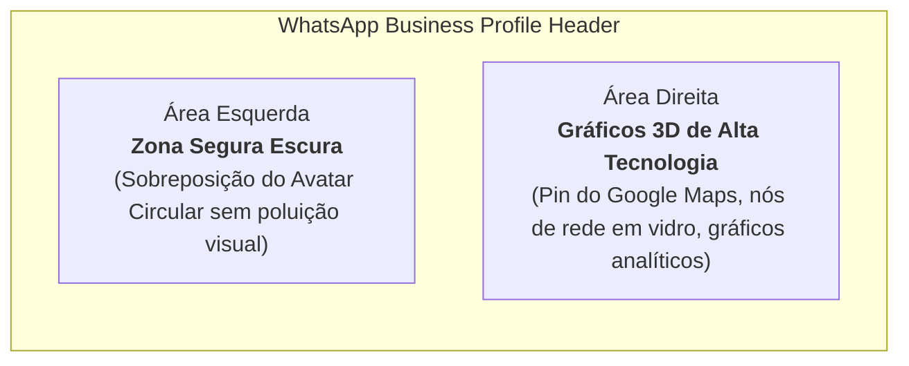

# 👔 Branding, Perfil Comercial e Presença Digital

> [!abstract] O Impacto da Primeira Impressão
> Em vendas B2B via WhatsApp, a primeira ação de qualquer empresário ou gestor ao receber uma abordagem é **tocar na foto do perfil** para avaliar a credibilidade da pessoa. Uma presença impecável, executiva e coerente aumenta a taxa de resposta em mais de 300%.

---

## 1. Fotografia de Perfil e Identidade Visual

* **O Retrato Executivo:** Leonardo Brasil com terno azul-royal de corte italiano, camisa social branca, gravata acetinada azul-clara, barba aparada e postura confiante contra fundo de estúdio em degradê escuro.
* **Transmissão de Valor:** Sofisticação, seriedade corporativa e autoridade executiva, distanciando-se da figura do "freelancer amador".
* **Paleta de Cores da Marca:**
  * **Azul Royal Primário:** `#1D4ED8` / `#2563EB`
  * **Preto Ônix / Fundo Studio:** `#080C14`
  * **Cyan / Esmeralda Glow:** `#06B6D4` / `#10B981`

---

## 2. A Imagem de Capa do WhatsApp Business

A capa oficial para o perfil comercial do WhatsApp foi desenvolvida na proporção **16:9 widescreen**, projetada para harmonizar diretamente com o retrato executivo:

* **Arquivo Local de Alta Resolução:**  
  `whatsapp_business_cover_executive_v2_png_1794096558921.jpg`

---

## 3. Configuração do Perfil Comercial no WhatsApp Business

| Campo | Preenchimento Oficial Recomendado |
| :--- | :--- |
| **Nome Comercial** | `Leonardo Brasil \| Especialista Google Meu Negócio` |
| **Categoria** | `Consultoria Empresarial` *(ou Serviços de Marketing)* |
| **Descrição da Empresa** | Estruturação, blindagem e posicionamento estratégico do Perfil da Empresa no Google para negócios e clínicas locais. Mais visibilidade orgânica e novos clientes via Google Maps.  📍 Atendimento Zona Sul de Porto Alegre & Região Metropolitana |
| **Site** | `https://leonardobrasil.com.br` |
| **E-mail de Contato** | `contato@leonardobrasil.com.br` *(ou leonardoferrazbrasil@gmail.com)* |
| **Horário de Atendimento** | Segunda a Sexta: 08:30 às 18:30 \| Sábado: 09:00 às 13:00 |
| **Recado (Status)** | *Consultoria & Diagnóstico de Perfil no Google Maps* |

---

## 4. O `@` Oficial nas Redes Sociais

Empresários tradicionais compram de pessoas com nome próprio e autoridade pública.

* **Recomendação Máxima (1º Lugar):** **`@leonardobrasil`**  
  * Conexão perfeita com o domínio `leonardobrasil.com.br`.
* **Alternativas Oficiais Fortes:**
  * **`@oleonardobrasil`** — Formato brasileiro de alta liderança;
  * **`@leonardobrasil.pro`** — Curto, executivo e moderno;
  * **`@leonardobrasiloficial`** — Segurança institucional máxima.
* **O que NÃO Usar:**
  * Evitar `@leoferrazdev` (posiciona como programador técnico, e não como estrategista de crescimento e vendas locais).

---

## Conexões Relacionadas
* [[Perfil Profissional Leonardo Brasil]]
* [[Brandbook e Diretrizes Visuais]]
* [[Método de Prospecção Ativa Local]]
* [[Fluxo Modular de Abordagem WhatsApp (4 Blocos)]]
* [[00 - MOC - Índice Geral|Voltar ao MOC]]
