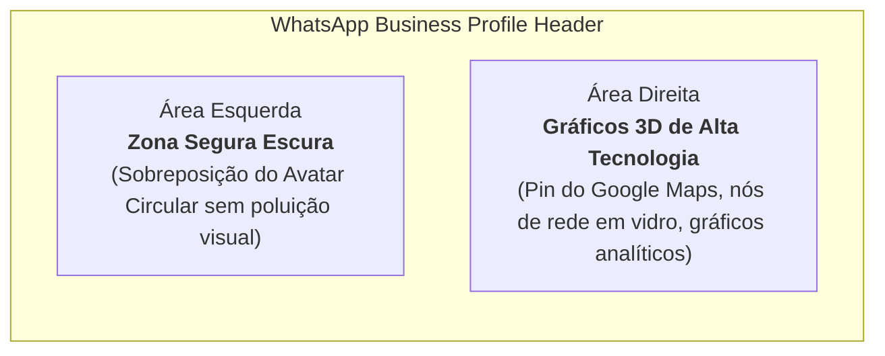

# 👔 Branding, Perfil Comercial e Presença Digital

> [!abstract] O Impacto da Primeira Impressão no Fechamento B2B
> Em vendas B2B via WhatsApp e redes sociais, a primeira ação de qualquer empresário ou tomador de decisão ao receber uma abordagem é **tocar na foto do perfil** ou **buscar o nome no Instagram/Google** para checar a credibilidade. Uma presença impecável, executiva e coerente aumenta a taxa de resposta em mais de 300% e elimina a desconfiança de fraude.

---

## 1. Fotografia de Perfil e Identidade Visual

* **O Retrato Executivo:** Leonardo Brasil com terno azul-royal de corte italiano, camisa social branca, gravata acetinada azul-clara, barba aparada e postura confiante contra fundo de estúdio em degradê escuro.
* **Transmissão de Valor:** Sofisticação corporativa, seriedade e autoridade técnica sênior, distanciando-se radicalmente da figura do "freelancer amador" ou "menino da agência".
* **Paleta de Cores da Marca (Executive Brandbook):**
  * **Azul Royal Primário:** `#1D4ED8` / `#2563EB` / `#3B82F6` (autoridade executiva)
  * **Preto Ônix / Fundo Studio:** `#080C14` / `#0A0D14` (foco e modernidade)
  * **Ouro Metálico / Dourado:** `#F59E0B` / `#FBBF24` (destaque de valor e prêmios)
  * **Verde Esmeralda:** `#10B981` (canal de conversão WhatsApp)

---

## 2. A Imagem de Capa do WhatsApp Business

A capa oficial para o perfil comercial do WhatsApp foi desenvolvida na proporção **16:9 widescreen**, projetada para harmonizar diretamente com o retrato executivo:



* **Arquivo Local de Alta Resolução:**  
  `whatsapp_business_cover_executive_v2_png_1794096558921.jpg`

---

## 3. Configuração do Perfil Comercial no WhatsApp Business

| Campo | Preenchimento Oficial Recomendado |
| :--- | :--- |
| **Nome Comercial** | `Leonardo Brasil \| SEO & Google Meu Negócio` |
| **Categoria** | `Consultoria Empresarial` *(ou Serviços de Marketing)* |
| **Descrição da Empresa** | Posicionamento estratégico e blindagem do Perfil da Empresa no Google para negócios e clínicas locais. Mais visibilidade orgânica e novos clientes via Google Maps.<br><br>📍 Atendimento Zona Sul de Porto Alegre & Região Metropolitana |
| **Site** | `https://leonardobrasil.com.br` |
| **E-mail de Contato** | `contato@leonardobrasil.com.br` |
| **Horário de Atendimento** | Segunda a Sexta: 08:30 às 18:30 \| Sábado: 09:00 às 13:00 |
| **Recado (Status)** | *Consultoria & Diagnóstico de Perfil no Google Maps* |

---

## 4. O Instagram Estratégico: Otimização de Perfil & GEO Linking

### 4.1. Auditoria do `@` (Nome de Usuário)
* **Decisão Oficial:** **`@oleonardobrasil`**
* **Por que NÃO usar `@leonardobrasil.com.br`?**
  1. *Poluição e Ruído Visual:* Redes sociais são ecossistemas visuais humanos. O uso de extensões de domínio (`.com.br`) em arrobas gera sensação imediata de robô, spam comercial ou perfil genérico não-humano;
  2. *Usabilidade de Menção:* Ninguém digita com naturalidade `ponto com ponto br` ao marcar alguém nos Stories ou em comentários de posts;
  3. *Força de Marca Pessoal:* No Brasil, o uso do artigo antes do nome próprio (**`@oleonardobrasil`**) é a convenção consagrada entre grandes especialistas e líderes de mercado, denotando distinção, autoridade e exclusividade.

---

### 4.2. Campo Nome (Name SEO): `Leonardo Brasil | SEO & Google Meu Negócio`

> [!important] O Segredo do Campo "Nome" no Instagram
> O campo **Nome** (em negrito no perfil) é o principal campo indexado pelo algoritmo de busca interna do Instagram.  
> A escolha oficial é:  
> **`Leonardo Brasil | SEO & Google Meu Negócio`**  
>  
> * **Por que supera "Especialista Google Meu Negócio"?**
>   1. Inclui o termo universal de busca **"SEO"**, capturando tomadores de decisão que procuram por otimização orgânica;
>   2. Contém a expressão exata **"Google Meu Negócio"** com alto volume de pesquisa por empresários locais;
>   3. Cria consistência semântica e entidade unificada com o site oficial `https://leonardobrasil.com.br`.

---

### 4.3. Reescrita da Bio do Instagram (Sem a palavra "Diretor", Foco Solo Especialista)

Como a atuação é autônoma e cirúrgica, termos burocráticos como "Diretor" ou plurais artificiais ("Estruturamos", "Nossa equipe") foram substituídos por um posicionamento direto de **Especialista de Alto Desempenho**:

```text
Especialista em Google Meu Negócio & SEO Local
Posiciono empresas e clínicas no Top 3 do Google Maps
Blindagem cadastral contra alterações e suspensões
📍 Porto Alegre - RS | Atendimento em todo o Brasil
👇 Solicite seu diagnóstico gratuito de posicionamento:
leonardobrasil.com.br
```

#### Anatomia da Bio de Alta Conversão:
1. **Linha 1 (Quem Sou):** Especialidade exata e nicho de atuação;
2. **Linha 2 (O Que Eu Entrego):** O resultado final tangível mais desejado (Top 3 do Google Maps);
3. **Linha 3 (O Diferencial de Segurança):** [[Blindagem Cadastral e Proteção contra Suspensões|Blindagem Cadastral]];
4. **Linha 4 (GEO Targeting):** Sinal claro de geolocalização física (Porto Alegre - RS) para relevância local, com extensão nacional;
5. **Linha 5 (Chamada para Ação):** Direcionamento claro para o link com diagnóstico gratuito.

---

### 4.4. Técnica de GEO Linking (Conexão Tripla)

Para maximizar a pontuação de relevância geográfica nos algoritmos do Google e da Meta:
1. **Link na Bio:** Conectado à página de auditoria ou home oficial `https://leonardobrasil.com.br?utm_source=instagram&utm_medium=bio`;
2. **Localização nos Posts e Stories:** Fixar consistentemente a tag de localização como *Porto Alegre*, *Zona Sul - Porto Alegre*, *Bairro Ipanema* ou *Bairro Tristeza*;
3. **Destaques Fixados (Highlights):**
   * 🏆 **Resultados:** Prints de clientes alcançando o Top 3 no Google Maps;
   * 🛡️ **Blindagem:** Explicações didáticas sobre os perigos de edições indevidas e suspensões de contas;
   * 💡 **Casos Reais:** Análises rápidas de perfis locais com falhas sanadas;
   * 📲 **Contato:** Link de 1 toque para o WhatsApp comercial.

---

## Conexões Relacionadas
* [[Perfil Profissional Leonardo Brasil]]
* [[Brandbook e Diretrizes Visuais]]
* [[Blindagem Cadastral e Proteção contra Suspensões]]
* [[Método de Prospecção Ativa Local]]
* [[Fluxo Modular de Abordagem WhatsApp (4 Blocos)]]
* [[Sistema CRM Local e Manual Operacional]]
* [[00 - MOC - Índice Geral|Voltar ao MOC]]
