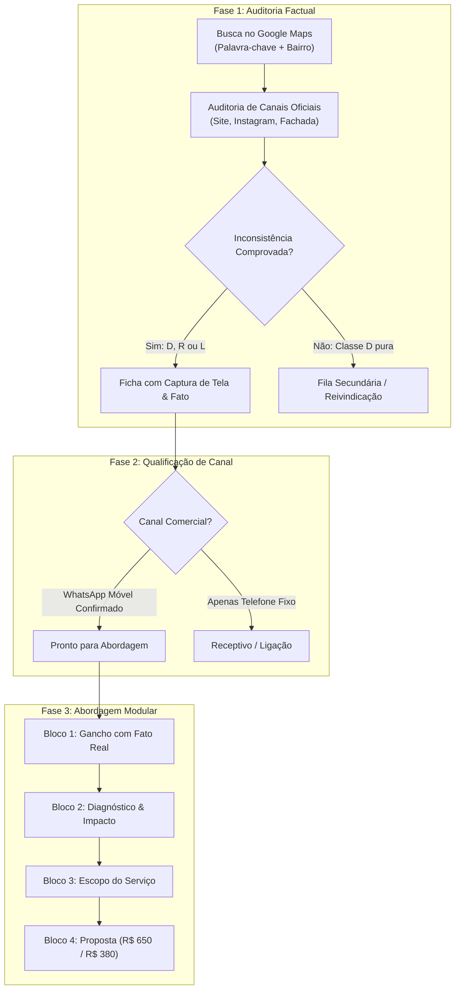

# 🎯 Método de Prospecção Ativa Local

> [!abstract] A Tese Fundamental
> O método de prospecção ativa de **Leonardo Brasil** rejeita categoricamente disparos em massa, templates genéricos e mensagens robotizadas. A taxa de conversão semanal de novos clientes decorre de uma **abordagem cirúrgica baseada em evidência real e factual auditada**, onde cada contato inicia como uma consultoria atenciosa e não como uma venda invasiva.

---

## 1. Por que Mensagens Genéricas Fracassam

Quando um empresário ou recepcionista recebe uma mensagem como:
> *"Notei um detalhe prático no seu perfil: Oportunidade de estruturação cadastral e catálogo de serviços. Vocês sabiam dessa divergência?"*

A reação imediata é o **descarte como spam**. O termo *"oportunidade de estruturação cadastral"* é um jargão abstrato que denuncia automação fria. 

### O Contraste da Abordagem Cirúrgica
Em contrapartida, quando o empresário lê:
> *"No perfil do Google de vocês o fechamento de sábado consta às 18h, mas no site oficial consta às 17h. Vocês realmente atendem até às 18h ou é uma divergência cadastral?"*

Ele reconhece imediatamente que **um profissional humano esteve na página dele, verificou o endereço dele e encontrou um problema real**. Ele não se sente atacado; ele se sente grato e curioso.

---

## 2. Critérios de Triagem e Auditoria

A triagem prévia audita 5 dimensões objetivas antes de qualquer contato comercial:

| Código | Critério Auditado | Evidência Comprovada | Pontuação de Oportunidade |
| :---: | :--- | :--- | :---: |
| **D** | **Divergência Cadastral** | Horário de funcionamento, telefone ou endereço desencontrado entre Maps e site oficial. | **Classe B (20 pts)** |
| **R** | **Reputação Abandonada** | Pelo menos 5 avaliações públicas sem resposta do proprietário no perfil. | **Classe C (15 pts)** |
| **L** | **Link Quebrado** | Botão "Website" no Maps aponta para link fora do ar (erro 404, DNS). | **Classe C (5 pts)** |
| **F** | **Frequência de Interação** | Volume de avaliações geradas nos últimos 90 dias (demanda ativa). | Recorrência |
| **M** | **Mudanças Recentes** | Publicação de fotos, posts ou atualizações pelo empresário nos últimos 180 dias. | Recorrência |

> [!important] Regra de Ouro da Governança
> Nenhuma abordagem é disparada sem:
> 1. Captura de tela com data e hora da divergência armazenada no arquivo de evidências;
> 2. Confirmação do vínculo entre o número de WhatsApp e a empresa;
> 3. Formulação da divergência como **hipótese a confirmar**, e jamais como acusação de erro ou ameaça de perda.

---

## 3. Os 3 Mandamentos da Comunicação de Abertura

1. **Localização Precisa:** Sempre mencione o bairro ou rua de Porto Alegre (ex: *"aqui na Tristeza"*, *"na Otto Niemeyer"*, *"na Cel. Marcos em Ipanema"*). Isso comprova proximidade e quebra barreiras.
2. **Elogio Sincero:** Reconheça notas altas e bom trabalho prévio (ex: *"vi a nota 4,9 de vocês, parabéns!"*).
3. **Pergunta Aberta de Confirmação:** Termine com uma dúvida que exige resposta humana (ex: *"Vocês realmente atendem nesse horário ou ficou desatualizado por lá?"*).

---

## Conexões Relacionadas
* [[O Framework dos 3 Pilares da Oferta]]
* [[Fluxo Modular de Abordagem WhatsApp (4 Blocos)]]
* [[Roteiros e Scripts Cirúrgicos por Nicho]]
* [[Gestão de Objeções e Scripts de Contorno]]
* [[Sistema CRM Local (/crm) e Manual Operacional]]
* [[00 - MOC - Índice Geral|Voltar ao MOC]]
