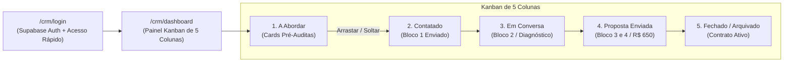

# 💻 Sistema CRM Local (`/crm`) e Manual Operacional

> [!abstract] A Ferramenta de Execução
> Instalado em **`https://leonardobrasil.com.br/crm`**, o CRM de Prospecção Local foi desenvolvido sob a mesma stack de alto desempenho de **[funilcomercial.com](https://funilcomercial.com)** (React 18 + Supabase Auth & PostgreSQL + TailwindCSS + `@dnd-kit` + `lucide-react` + `react-hot-toast`), permitindo gestão ágil do pipeline de vendas diário sem custos de mensalidades externas (como HubSpot ou Pipedrive).

---

## 1. Acesso e Segurança
* **Rota Pública:** `/crm/login`
* **Painel Restrito:** `/crm/dashboard` (protegido por `CrmProtectedRoute`)
* **Mecanismos de Entrada:**
  1. **Autenticação Cloud:** E-mail e senha gerenciados pelo Supabase Auth;
  2. **Acesso Rápido / Modo Offline Local:** Botão de contingência imediata que armazena token em `localStorage.getItem("crm_offline_session")`, garantindo acesso total mesmo sem conexão com a nuvem ou durante validações de e-mail.
* **Segurança de Indexação:** Todas as rotas sob `/crm` contêm meta tags `noindex, nofollow` e são excluídas da pré-renderização estática do SSR.

---

## 2. A Gaveta Lateral Modular (Drawer de 4 Blocos)

Ao clicar em qualquer card do Kanban, uma gaveta lateral se abre contendo:
* **Dados Cadastrais:** Nome, endereço, segmento, telefone e URL do Google Maps;
* **Oportunidade Específica:** Classificação do lead (Classe B, C ou D) e detalhe auditado da falha;
* **Os 4 Blocos Progressivos:**
  * Bloco 1: Gancho de abertura factual;
  * Bloco 2: Diagnóstico e impacto financeiro;
  * Bloco 3: Escopo de implantação e blindagem;
  * Bloco 4: Proposta comercial (R$ 650 / R$ 380).
* **Botão "Copiar Bloco N":** Copia instantaneamente o bloco para a área de transferência com notificação visual;
* **Botão "Abrir WhatsApp Web":** Abre uma nova aba no navegador para `https://web.whatsapp.com/send?phone=5551...` já com o Bloco 1 preenchido na caixa de digitação.

---

## 3. Rotina Operacional Diária de Prospecção

| Horário | Atividade | Meta Diária |
| :---: | :--- | :--- |
| **09:00 - 09:45** | **Abordagem Inicial (Coluna 1 → Coluna 2):** Abrir os 5 primeiros cards do topo, clicar em *"Abrir WhatsApp Web"* e disparar o Bloco 1. | 5 novas abordagens / dia |
| **11:30 - 12:00** | **Primeira Rodada de Respostas:** Responder leads que interagiram enviando o Bloco 2 (Diagnóstico). Mover card para *"3. Em Conversa"*. | Follow-up ágil |
| **14:30 - 15:30** | **Apresentação de Solução e Proposta (Coluna 3 → Coluna 4):** Enviar Blocos 3 e 4 para leads qualificados. Agendar conversa de 10 min. | 2 propostas / dia |
| **17:30 - 18:00** | **Fechamento e Atualização:** Registrar pagamentos de R$ 650 em *"5. Fechado"* e salvar notas de observação no card. | 1 a 2 fechamentos / semana |

---

## Conexões Relacionadas
* [[Método de Prospecção Ativa Local]]
* [[Fluxo Modular de Abordagem WhatsApp (4 Blocos)]]
* [[O Framework dos 3 Pilares da Oferta]]
* [[Base de 40 Leads Auditados de Porto Alegre]]
* [[Supabase Auth e Banco de Dados]]
* [[00 - MOC - Índice Geral|Voltar ao MOC]]
